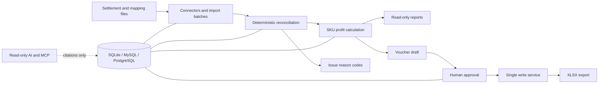

# CrossERP

CrossERP is a local-first cross-border ecommerce reconciliation tool. It imports settlement files, matches orders and payouts with deterministic rules, calculates SKU profit with `Decimal`, records issues with reason codes, and produces approval-gated voucher exports. The AI layer is read-only: it explains stored results with citations and never calculates money or writes accounting entries.

Version 0.5.0 is an internal milestone. The project is not published to PyPI, GHCR, Docker Hub, or a public release channel.

## What is implemented

- Amazon Settlement Flat File V2, Shopify Payments CSV, and YAML-mapped order, SKU, cost, fee, and FX imports.
- Deterministic reconciliation, duplicate and failed-import handling, issue queues, SKU profit reports, CSV/XLSX exports, and a read-only web UI.
- Approval state machine and the single `ledger/write_service.py` write path for XLSX exports.
- User roles, Argon2 passwords, server sessions, CSRF protection, login lockout, API tokens, and security events.
- Append-only hash-chained business and security audit logs with export and offline verification.
- Read-only AI tools, redaction and prompt-injection guards, OpenTelemetry call records, budgets, alerts, MCP stdio service, and offline evaluation baselines.
- SQLite, MySQL 8.4, and PostgreSQL 18 support; Docker Compose profiles for all three.

## Safety rules

1. Money is calculated only by deterministic code using `Decimal`/`Money4`; an LLM never computes or changes an amount.
2. Nothing is written to a ledger without an approved request and `ledger/write_service.py`.
3. AI tools use read-only database access and return citations to stored rows.
4. Audit records are append-only, and the repository contains no secrets or real seller data.

## Architecture



## Quick start with the project environment

Use the repository `.venv`; do not rely on a system Python environment.

```bash
uv sync --all-extras
source .venv/bin/activate
uv run crosserp demo --check --no-browser
```

On Windows PowerShell:

```powershell
uv sync --all-extras
.\.venv\Scripts\Activate.ps1
uv run crosserp demo --check --no-browser
```

The demo uses a separate SQLite database and fixed synthetic samples. For a new application database:

```bash
uv run crosserp init --admin-username admin --admin-password-stdin
uv run crosserp serve
```

The command reads the password twice from standard input. Open `http://127.0.0.1:8000` and log in. For Docker Compose, see [docs/deploy.md](docs/deploy.md). For local wheel installation and timing, see [docs/install.md](docs/install.md).

## Development

```bash
uv run ruff format --check .
uv run ruff check .
uv run mypy src
uv run pytest --cov=crosserp --cov-fail-under=80 -q
```

Read [CONTRIBUTING.md](CONTRIBUTING.md), [docs/security.md](docs/security.md), [docs/database.md](docs/database.md), and [docs/architecture.md](docs/architecture.md) before changing the system. Architectural decisions are in [docs/adr/](docs/adr/).
