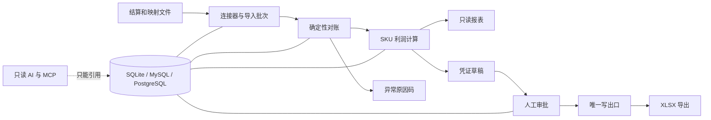

# CrossERP

CrossERP 是一个本地优先的跨境电商对账工具：导入结算文件，用确定性规则匹配订单和打款，用 `Decimal` 计算 SKU 利润，列出带原因码的异常，并在人工审批后导出凭证。AI 只能读取已经保存的结果、给出带引用的解释，不能算钱，也不能写账。

当前版本是 0.5.0 内部里程碑。项目暂不发布到 PyPI、GHCR、Docker Hub，也不创建公开 Release。

## 已实现功能

- Amazon Settlement Flat File V2、Shopify Payments CSV，以及 YAML 映射的订单、SKU、成本、费用和汇率导入。
- 确定性对账、重复/失败导入处理、异常原因码、SKU 利润、CSV/XLSX 报表和只读网页。
- 审批状态机，以及唯一的 `ledger/write_service.py` XLSX 写出路径。
- 用户角色、Argon2 密码、服务器会话、CSRF、防暴力登录锁定、API token 和安全事件。
- 只追加审计哈希链、审计导出和离线校验。
- 只读 AI 工具、脱敏和提示注入防护、调用记录、预算告警、MCP stdio 服务和离线评测基线。
- SQLite、MySQL 8.4、PostgreSQL 18，以及三种 Docker Compose profile。

## 四条红线

1. 金额只能由确定性代码用 `Decimal`/`Money4` 计算，LLM 永远不计算或修改金额。
2. 没有人工审批，不能写账；所有写出必须经过 `ledger/write_service.py`。
3. AI 只能用只读数据库工具，并且要给出数据库引用。
4. 审计只追加，仓库不放密钥和真实卖家数据。

## 架构



## 使用项目 `.venv` 开始

```bash
uv sync --all-extras
source .venv/bin/activate
uv run crosserp demo --check --no-browser
```

Windows PowerShell：

```powershell
uv sync --all-extras
.\.venv\Scripts\Activate.ps1
uv run crosserp demo --check --no-browser
```

演示使用独立 SQLite 数据库和固定合成样本。创建正式数据库并启动网页：

```bash
uv run crosserp init --admin-username admin --admin-password-stdin
uv run crosserp serve
```

密码需要从标准输入连续输入两遍。浏览器打开 `http://127.0.0.1:8000` 登录。Docker Compose 看 [docs/deploy.md](docs/deploy.md)，本地 wheel 安装看 [docs/install.md](docs/install.md)。

## 开发检查

```bash
uv run ruff format --check .
uv run ruff check .
uv run mypy src
uv run pytest --cov=crosserp --cov-fail-under=80 -q
```

修改前请读 [CONTRIBUTING.md](CONTRIBUTING.md)、[docs/security.md](docs/security.md)、[docs/database.md](docs/database.md)、[docs/architecture.md](docs/architecture.md) 和 [docs/adr/](docs/adr/)。
