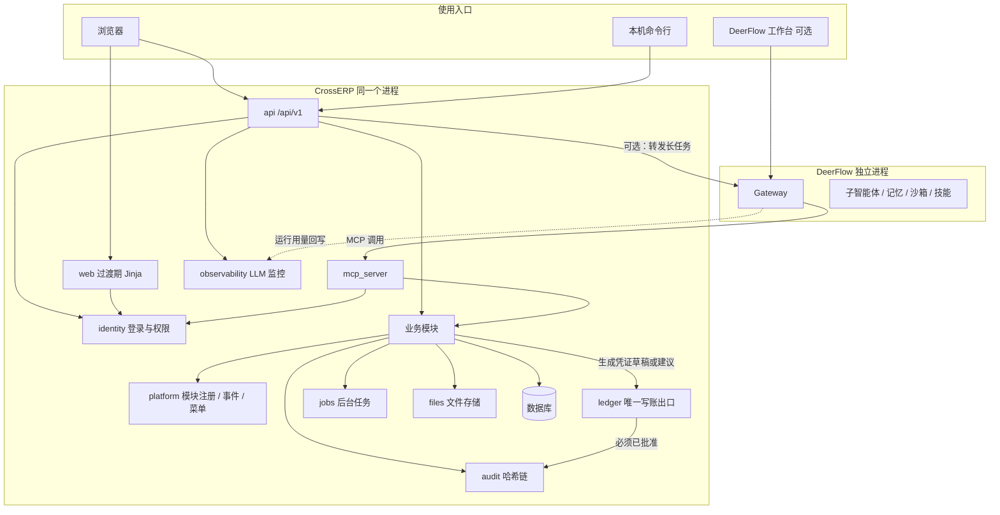
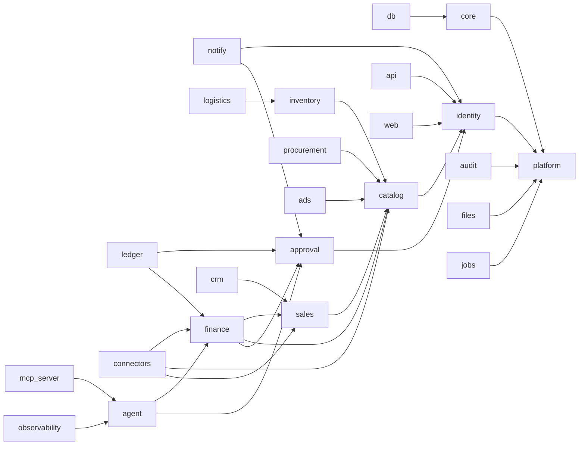

# CrossERP 后端架构与功能模块

- 文档日期：2026-11-09（Asia/Shanghai）
- 依据：`docs/plan/实施方案.md` 第 2 节、`docs/architecture.md`、`docs/adr/*`、本地 `src/crosserp/` 包结构
- 目标：在不推翻现有内核的前提下，把后端整理成以后加模块不必改对账和写账核心的结构

---

## 1. 总体选择：模块化的单体系统

继续保持「一个程序、一套数据库、浏览器访问」的 B/S 架构，不拆成许多独立微服务。原因与原实施方案一致：maken 一个人维护，部署要简单，审计和写账必须走同一条路径。

变化在于：每个业务域做成**插件式模块**。模块可以启用或关闭（例如先不用 CRM），但不能绕过平台层的权限、审计和写账出口。

```text
浏览器 Vue 页面 ── JSON /api/v1 ──┐
本机命令行 ───────────────────────┼── FastAPI 进程
MCP / DeerFlow ───────────────────┘
         │
         ├── 展示：api（新）、web（现有 Jinja，过渡期保留）
         ├── 智能体：agent、mcp_server、observability
         ├── 业务模块：finance、catalog、sales、inventory…
         ├── 集成：connectors、ledger
         └── 平台：identity、audit、platform、db、core、jobs、files、notify
         │
         └── SQLite 或 MySQL 或 PostgreSQL
```

三库兼容规则不变（ADR 0004）：只用通用类型；金额用 `Money4`；时间用 `UtcDateTime`；长文本用 `Text`（MySQL 上是 `MEDIUMTEXT`）；差异集中在 `db/dialects.py`。

---

## 2. 架构图



模块依赖（箭头表示「可以使用」；禁止反向依赖，避免对账内核被 CRM 拖住）：



说明：`agent` 只读取业务结果或提交「建议/待审批」，不得调用 `ledger` 的导出或推送。`connectors` 的 API 拉取只读；写出外部账套只能经 `ledger`。

---

## 3. 每个模块的统一形状

新模块或把现有包升级时，建议具备这些部分（名称可按现有风格微调，但职责要齐）：

| 部分 | 职责 |
|---|---|
| `manifest` | 模块名、版本、依赖哪些模块、菜单项、权限点、发出/监听的事件 |
| 模型声明 | 表和字段；由 `db` 统一纳入 Alembic，遵守只追加 |
| `schemas` | 对外的 Pydantic 数据结构 |
| `services` | 业务规则，不直接处理 HTTP |
| `router` | `/api/v1/<模块>/...` |
| `permissions` | 本模块权限点，注册进现有权限矩阵 |
| 迁移说明 | 本模块新增了哪些表/列 |
| 事件 | 做完一件事后通知其他模块，而不是直接改对方的表 |
| 测试 | 服务测试 + 权限测试；不删除已有测试 |

现有代码多数已经按包分开（`recon`、`profit`、`approval` 等），但菜单、权限和路由集中在 `web/app.py`。升级路径是：先抽出 JSON 路由和服务边界，再补 `manifest`，不必一夜之间搬家。

---

## 4. 模块清单

### 4.1 平台层

| 模块 | 现在对应 | 职责 | 以后怎么扩展 |
|---|---|---|---|
| `platform` | 无独立包，「推断」新加 | 模块注册、事件总线、菜单汇总、功能开关 | 新模块只要注册就能出现在菜单和接口列表 |
| `core` | `core` | 精确金额、币种、枚举、错误类型 | 新费用分类、新币种 |
| `db` | `db` | 表定义、迁移、仓储、三库差异 | 只追加表和列 |
| `identity` | `auth` | 用户、角色、会话、CSRF、API Token、权限矩阵 | 以后的 SSO/LDAP 只加在这里 |
| `audit` | `audit` | 业务审计链、安全日志链、导出和校验 | 外部只读副本 |
| `files` | 部分隐含在导入和 `export_artifact` | 上传、导出文件的统一存取 | 本机目录先做，以后可加对象存储，接口不变 |
| `jobs` | 无独立包，导入等多在请求里做完 | 长时间任务：导入、对账、API 拉取、评测 | 先用数据库任务表 + 后台线程；以后可换外部队列而不改业务模块 |
| `notify` | 原计划 v1.0，尚未落地 | 待审批、预算告警的通知 | 先飞书自定义机器人，预留企业微信/钉钉/邮件 |

### 4.2 业务层

| 模块 | 现在对应 | 职责 | 阶段 |
|---|---|---|---|
| `catalog` | `sku`、`sku_cost` 等表，无独立包 | 内部货号、平台货号、成本期间、Listing、类目、品牌、组合装 | 现在先做 SKU/成本；其余后期 |
| `sales` | `order_line` | 订单、退货、履约状态 | 现在先做只读订单；履约后期 |
| `inventory` | 无 | 仓库、库存数量、流水、入出库、调拨、盘点、预警 | 后期 |
| `procurement` | 无 | 供应商、采购单、收货、采购退货、供应商对账 | 后期 |
| `logistics` | 利润里的头程金额字段 | 头程批次、物流商、运费模板、轨迹、费用核对 | 后期 |
| `finance` | `connectors` 导入结果 + `recon` + `profit` + `issues` + `vouchers` + 汇率/科目 | 导入、结算、对账、异常、利润、凭证、科目、汇率、应收应付、核销 | 核心已有；科目/汇率界面和应收应付分别在 v1.0 / 后期 |
| `ads` | `profit_snapshot.ads` 可空 | 广告活动、花费导入、分摊 | 后期 |
| `crm` | 无 | 客户、线索、商机、联系人、跟进、工单、评价 | 后期 |
| `approval` | `approval` | 审批状态机、职责分离 | 现有单级；多级后期 |

`finance` 内部建议继续保留现有子包，而不是合并成一个大文件：

- `connectors`：识别文件、标准化
- `recon`：匹配
- `profit`：利润快照
- `issues`：异常
- `vouchers`：凭证草稿与借贷校验

它们对外都通过 `finance` 的菜单和 `/api/v1/finance` 出现，对内仍是清晰边界。

### 4.3 集成层与智能体层

| 模块 | 现在对应 | 职责 |
|---|---|---|
| `connectors` | `connectors` | 文件连接器已有；API 连接器按原计划在拿到权限后做 |
| `ledger` | `ledger` | 唯一写账和导出出口，检查批准状态、内容哈希、一次性令牌 |
| `agent` | `agent` | 只读工具、引用和数字校验、提示词；以后增加智能体档案和写建议工具 |
| `mcp_server` | `mcp_server` | 把同一套工具发给 DeerFlow 或其它 MCP 客户端 |
| `observability` | `observability` | `llm_call`、预算、告警、评测 |
| `api` | 无，现有路由几乎都在 `web/app.py` | JSON 接口 |
| `web` | `web` | 过渡期的 Jinja 页面 |
| `cli` / `demo` / `evals` | 已有 | 命令行、演示数据和评测，不进入卖家菜单 |

---

## 5. 模块之间的事件

模块不要直接改另一模块的核心表。典型事件：

| 事件 | 谁发出 | 谁监听 | 说明 |
|---|---|---|---|
| `import.batch.finished` | connectors / finance | recon、jobs | 成功导入后可自动或手动触发对账 |
| `recon.run.finished` | recon | issues、profit、notify | 生成或更新异常，刷新利润快照 |
| `issue.updated` | issues | audit（必记）、notify | 处理意见变更 |
| `voucher.submitted` | vouchers | approval、notify | 进入待审批 |
| `approval.decided` | approval | ledger、notify、audit | 只有批准才允许写账 |
| `ledger.exported` | ledger | audit、files | 记录产物哈希 |
| `catalog.cost.changed` | catalog | profit | 提醒需要按规则重算；重算仍由代码完成 |
| `inventory.moved` | inventory | finance（后期成本结转） | 原计划成本结转「等有库存模块再加」 |
| `crm.ticket.created` | crm | notify | 售后超时提醒 |
| `agent.proposal.created` | agent | approval | 映射或分类建议等待人确认 |
| `agent.run.finished` | agent 或 DeerFlow 回写 | observability | 记录 token 与状态 |
| `llm.budget.threshold` | observability | notify | 80% / 100% 预算 |

事件投递先做「同一进程内的同步/后台调用」，保证和业务修改能放在可预期的事务边界里。跨进程消息队列不是现在的目标。

---

## 6. 接口约定

所有新接口使用：

- 前缀：`/api/v1/<模块>/...`
- 数据格式：JSON，字符集 UTF-8
- 鉴权：浏览器继续用会话 Cookie + CSRF 头；脚本和 MCP 用 API Token（只存哈希，明文只显示一次）
- 分页：`page`、`page_size`、`total`、`items`
- 筛选：能按 `store_id`、期间、状态过滤
- 错误：`{ "code": "...", "message": "给人看的中文", "details": {} }`，不把堆栈发给浏览器
- 写操作：记审计；涉及金额的写入由服务端用 `Decimal` 校验，不信任前端算好的利润
- 写账和导出：除 `ledger` 外谁调用都失败，并写安全日志
- 幂等：导入、审批决定、导出带请求标识，避免重复点击产生两套结果
- 文档：FastAPI 自动 OpenAPI，前端由此生成客户端

现有 HTML 路由在过渡期原样保留，不强制先删。

权限点在现有基础上追加，不删除旧权限，以免旧测试和旧角色失效。后期模块的新权限示例：

- `catalog.read` / `catalog.write`
- `sales.read`
- `inventory.read` / `inventory.write`
- `procurement.read` / `procurement.write`
- `crm.read` / `crm.write`
- `agent.manage` / `agent.tool.grant`
- `integration.manage`
- `module.manage`

现有 `report.read`、`import.run`、`issue.handle`、`voucher.draft`、`approval.submit`、`approval.decide`、`voucher.download`、`ai.ask`、`audit.read`、`audit.export`、`security_log.read`、`llm_monitor.read`、`user.manage`、`setting.manage`、`budget.manage` 保持不变。

数据范围：v1.0 先做「一家公司多个店铺」的筛选；若要对某用户限制可见店铺，追加用户-店铺授权表（见数据模型），默认不改变现有「能登录就能看全部业务报表」的行为，除非 maken 要求收紧。现有代码未见店铺授权表，「推断」目前没有按店铺隔离。

多租户：不做 SaaS。以后若有第二家公司共用一套部署，再追加 `company_id`，不修改现有主键含义。

---

## 7. 后台任务、文件、外部系统

**后台任务**：导入大文件、API 拉数、评测、定时问答适合进 `jobs`。任务表记录谁发起、状态、进度、错误。失败可重试；成功结果写回业务表并记审计。

**文件存储**：上传的报表和导出的凭证先放本机受控目录，数据库只存路径和 SHA-256。接口做成可替换，避免业务模块直接写死磁盘路径。

**外部系统适配**（与原计划一致，权限未拿到就保持文件导入）：

| 系统 | 方式 | 阶段 | 注意 |
|---|---|---|---|
| Amazon 结算文件 V2 | 已有文件连接器 | 已有 | 官方字段已在导入规格中核实 |
| Shopify 打款 CSV | 已有文件连接器 | 已有 | 基础列已核实 |
| 领星 / 赛狐导出 | 列映射文件连接器 | 已有骨架 | 真实表头「待真实数据验证」 |
| Amazon SP-API | 只读拉结算报告后复用现有解析 | v1.0，取决于权限 | 密钥不进仓库 |
| Shopify Admin API | 只读拉订单/打款 | v1.0，取决于权限 | 同上 |
| 领星 OpenAPI | 只读拉报表 | v1.0，取决于权限 | 同上 |
| 金蝶云星空 / 通用 Excel | 已有导出目标 | 已有 | 必须先审批 |
| ERPNext | 审批后 REST 推送日记账 | v1.0 可选 | 不复制 ERPNext 代码 |
| 飞书 | 只通知待审批和预算告警，不在飞书里批准 | v1.0 | 与原计划一致 |
| DeerFlow 2.0 | 独立进程 + MCP | v1.0 | 见 `03-智能体接入与DeerFlow.md` |
| 淘宝 / 抖店 / Odoo | 只留插件接口 | 原计划 v1.0 不做实现 |  |

平台授权页只保存连接状态和脱敏信息；真正的密钥放本机保险柜或环境变量。

---

## 8. 如何新增一个模块（步骤）

以「库存」为例，其它后期模块同样处理：

1. 在模块开关里登记 `inventory`，默认关闭。
2. 编写 `manifest`：菜单、权限、依赖 `catalog`。
3. 在数据模型中**追加**仓库、库存、流水等表，不改已有 `sku` 字段含义。
4. 写 Alembic 迁移，并在 SQLite / MySQL / PostgreSQL 上验证。
5. 实现服务：入库、出库、数量变动。涉及金额或成本结转的部分只生成草稿，交给现有审批和 `ledger`。
6. 挂上 `/api/v1/inventory/...`，补权限测试和审计断言。
7. 前端按 `01-前端页面设计.md` 增加页面，并根据模块开关决定是否显示菜单。
8. 如需智能体查询库存，把只读工具加到 `agent` 白名单和 MCP；写工具只能建待审批项。
9. 更新本设计文档和用户说明，不删除旧测试。

禁止事项：直接在 `recon` 或 `ledger` 里写库存特例；让 AI 计算结转金额；删除或重命名已经上线的列来「腾地方」。

---

## 9. 现有代码如何逐步靠拢

不建议重新建仓库或改包名（现在是 `crosserp`，实施方案里曾用过 `agent_erp` 的早期名称，以仓库实查为准）。

| 现有位置 | 靠拢方式 |
|---|---|
| `src/crosserp/web/app.py` 中的大量页面路由 | 保持可用；新功能走 `api` 路由 |
| `src/crosserp/db/schema.py` 集中表定义 | 可继续集中，或按模块拆文件后在一处导入。无论哪种，迁移仍由 Alembic 统一管理 |
| `auth` | 改称 `identity` 只是设计名，实施时可保留包名 `auth`，避免无意义重命名 |
| `recon` / `profit` / `issues` / `vouchers` | 保留包，注册为 finance 域的一部分 |
| `agent/tools.py` 与 `mcp_server` | 继续共用同一只读白名单；新增工具必须同时出现在测试里 |
| `ledger/write_service.py` | 不拆、不绕开 |
| 已有 Jinja 模板 | 被 Vue 页面替换前不删除 |

每次迁移以「加接口、加测试、再替换一个页面」为步长，避免一次改完所有路由。

---

## 10. 和原实施方案的关系

原模块表（实施方案 2.2）全部保留。本次新增的是：`platform`、`files`、`jobs`、`catalog`、`sales`、`inventory`、`procurement`、`logistics`、`ads`、`crm`、`api`，以及把 `notify`、智能体治理从「以后再说」写成明确边界。

原 v1.0 不做完整库存/采购/生产的决定仍然有效：那些模块有设计、有菜单预留、默认关闭，不占用 v1.0 验收。

---

## 11. 未能核实

- 生产环境反向代理和 HTTPS 的具体软件，原计划已标「推断」。
- 任务队列是否需要 Redis 等外部组件：当前体量「推断」先不需要。
- 现有 `web/app.py` 之外是否已有隐藏的 JSON API：本次按页面路由实查，未见独立的 `/api/v1` 前缀。
