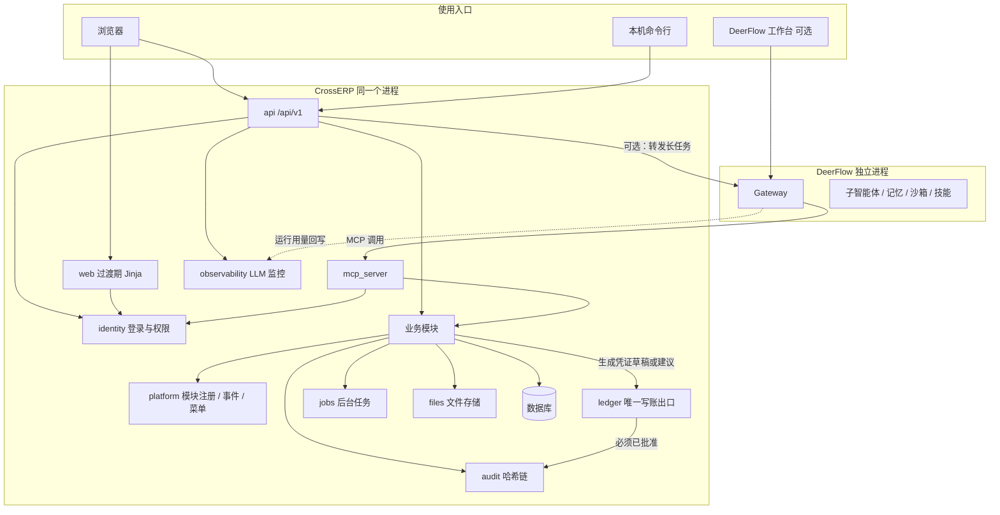
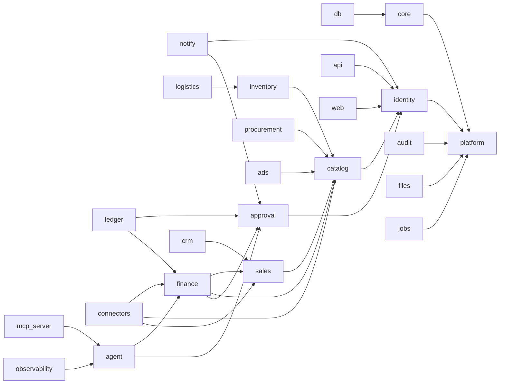

## 状态与关系

- **状态：仅设计，部分内容已被 08 v4 补充**。后端总体分层和人工流程仍有效；数据库与后端架构以 [08 第 2、11 章](08-后端模块与API设计.md) 为准，实体与动作以 [`08/ontology-entities.yaml`](08/ontology-entities.yaml) 为准。
- 本文仍有效：模块化单体、单一写账出口、审计只追加、业务逻辑与数据库访问分层。旧的 DeerFlow 独立部署、单人模式、审批金额上限 **【已被 08 v4 第 4.6 节取代】**和 IM 立即审批表述以 08 第 4、10、12 章替代。
# CrossERP 后端架构与功能模块

- 文档日期：2026-11-09（Asia/Shanghai）
- 依据：`docs/plan/实施方案.md` 第 2 节、`docs/architecture.md`、`docs/adr/*`、本地 `src/crosserp/` 包结构
- 目标：在不推翻现有内核的前提下，把后端整理成以后加模块不必改对账和写账核心的结构

---

## 1. 总体选择：模块化的单体系统

继续保持「一个程序、一套数据库、浏览器访问」的 B/S 架构，不拆成许多独立微服务。原因与原实施方案一致：maken 一个人维护，部署要简单，审计和写账必须走同一条路径。

变化在于：每个业务域做成**插件式模块**。模块可以启用或关闭（例如先不用 CRM），但不能绕过平台层的权限、审计和写账出口。

```text
浏览器 Vue 页面 ── JSON /api/v1 ──┐
本机命令行 ───────────────────────┼── FastAPI 进程
MCP / DeerFlow ───────────────────┘
         │
         ├── 展示：api（新）、web（现有 Jinja，过渡期保留）
         ├── 智能体：agent、mcp_server、observability
         ├── 业务模块：finance、catalog、sales、inventory…
         ├── 集成：connectors、ledger
         └── 平台：identity、audit、platform、db、core、jobs、files、notify
         │
         └── SQLite 或 MySQL 或 PostgreSQL
```

三库兼容规则不变（ADR 0004）：只用通用类型；金额用 `Money4`；时间用 `UtcDateTime`；长文本用 `Text`（MySQL 上是 `MEDIUMTEXT`）；差异集中在 `db/dialects.py`。

---

## 2. 架构图



模块依赖（箭头表示「可以使用」；禁止反向依赖，避免对账内核被 CRM 拖住）：



说明：`agent` 只读取业务结果或提交「建议/待审批」，不得调用 `ledger` 的导出或推送。`connectors` 的 API 拉取只读；写出外部账套只能经 `ledger`。

---

## 3. 每个模块的统一形状

新模块或把现有包升级时，建议具备这些部分（名称可按现有风格微调，但职责要齐）：

| 部分 | 职责 |
|---|---|
| `manifest` | 模块名、版本、依赖哪些模块、菜单项、权限点、发出/监听的事件 |
| 模型声明 | 表和字段；由 `db` 统一纳入 Alembic，遵守只追加 |
| `schemas` | 对外的 Pydantic 数据结构 |
| `services` | 业务规则，不直接处理 HTTP |
| `router` | `/api/v1/<模块>/...` |
| `permissions` | 本模块权限点，注册进现有权限矩阵 |
| 迁移说明 | 本模块新增了哪些表/列 |
| 事件 | 做完一件事后通知其他模块，而不是直接改对方的表 |
| 测试 | 服务测试 + 权限测试；不删除已有测试 |

现有代码多数已经按包分开（`recon`、`profit`、`approval` 等），但菜单、权限和路由集中在 `web/app.py`。升级路径是：先抽出 JSON 路由和服务边界，再补 `manifest`，不必一夜之间搬家。

---

## 4. 模块清单

### 4.1 平台层

| 模块 | 现在对应 | 职责 | 以后怎么扩展 |
|---|---|---|---|
| `platform` | 无独立包，「推断」新加 | 模块注册、事件总线、菜单汇总、功能开关 | 新模块只要注册就能出现在菜单和接口列表 |
| `core` | `core` | 精确金额、币种、枚举、错误类型 | 新费用分类、新币种 |
| `db` | `db` | 表定义、迁移、仓储、三库差异 | 只追加表和列 |
| `identity` | `auth` | 用户、角色、会话、CSRF、API Token、权限矩阵 | 以后的 SSO/LDAP 只加在这里 |
| `audit` | `audit` | 业务审计链、安全日志链、导出和校验 | 外部只读副本 |
| `files` | 部分隐含在导入和 `export_artifact` | 上传、导出文件的统一存取 | 本机目录先做，以后可加对象存储，接口不变 |
| `jobs` | 无独立包，导入等多在请求里做完 | 长时间任务：导入、对账、API 拉取、评测 | 先用数据库任务表 + 后台线程；以后可换外部队列而不改业务模块 |
| `notify` | 原计划 v1.0，尚未落地 | 待审批、预算告警的通知 | 先飞书自定义机器人，预留企业微信/钉钉/邮件 |

### 4.2 业务层

| 模块 | 现在对应 | 职责 | 阶段 |
|---|---|---|---|
| `catalog` | `sku`、`sku_cost` 等表，无独立包 | 内部货号、平台货号、成本期间、Listing、类目、品牌、组合装 | 现在先做 SKU/成本；其余后期 |
| `sales` | `order_line` | 订单、退货、履约状态 | 现在先做只读订单；履约后期 |
| `inventory` | 无 | 仓库、库存数量、流水、入出库、调拨、盘点、预警 | 后期 |
| `procurement` | 无 | 供应商、采购单、收货、采购退货、供应商对账 | 后期 |
| `logistics` | 利润里的头程金额字段 | 头程批次、物流商、运费模板、轨迹、费用核对 | 后期 |
| `finance` | `connectors` 导入结果 + `recon` + `profit` + `issues` + `vouchers` + 汇率/科目 | 导入、结算、对账、异常、利润、凭证、科目、汇率、应收应付、核销 | 核心已有；科目/汇率界面和应收应付分别在 v1.0 / 后期 |
| `ads` | `profit_snapshot.ads` 可空 | 广告活动、花费导入、分摊 | 后期 |
| `crm` | 无 | 客户、线索、商机、联系人、跟进、工单、评价 | 后期 |
| `approval` | `approval` | 审批状态机、职责分离 | 现有单级；多级后期 |

`finance` 内部建议继续保留现有子包，而不是合并成一个大文件：

- `connectors`：识别文件、标准化
- `recon`：匹配
- `profit`：利润快照
- `issues`：异常
- `vouchers`：凭证草稿与借贷校验

它们对外都通过 `finance` 的菜单和 `/api/v1/finance` 出现，对内仍是清晰边界。

### 4.3 集成层与智能体层

| 模块 | 现在对应 | 职责 |
|---|---|---|
| `connectors` | `connectors` | 文件连接器已有；API 连接器按原计划在拿到权限后做 |
| `ledger` | `ledger` | 唯一写账和导出出口，检查批准状态、内容哈希、一次性令牌 |
| `agent` | `agent` | 只读工具、引用和数字校验、提示词；以后增加智能体档案和写建议工具 |
| `mcp_server` | `mcp_server` | 把同一套工具发给 DeerFlow 或其它 MCP 客户端 |
| `observability` | `observability` | `llm_call`、预算、告警、评测 |
| `api` | 无，现有路由几乎都在 `web/app.py` | JSON 接口 |
| `web` | `web` | 过渡期的 Jinja 页面 |
| `cli` / `demo` / `evals` | 已有 | 命令行、演示数据和评测，不进入卖家菜单 |

---

## 5. 模块之间的事件

模块不要直接改另一模块的核心表。典型事件：

| 事件 | 谁发出 | 谁监听 | 说明 |
|---|---|---|---|
| `import.batch.finished` | connectors / finance | recon、jobs | 成功导入后可自动或手动触发对账 |
| `recon.run.finished` | recon | issues、profit、notify | 生成或更新异常，刷新利润快照 |
| `issue.updated` | issues | audit（必记）、notify | 处理意见变更 |
| `voucher.submitted` | vouchers | approval、notify | 进入待审批 |
| `approval.decided` | approval | ledger、notify、audit | 只有批准才允许写账 |
| `ledger.exported` | ledger | audit、files | 记录产物哈希 |
| `catalog.cost.changed` | catalog | profit | 提醒需要按规则重算；重算仍由代码完成 |
| `inventory.moved` | inventory | finance（后期成本结转） | 原计划成本结转「等有库存模块再加」 |
| `crm.ticket.created` | crm | notify | 售后超时提醒 |
| `agent.proposal.created` | agent | approval | 映射或分类建议等待人确认 |
| `agent.run.finished` | agent 或 DeerFlow 回写 | observability | 记录 token 与状态 |
| `llm.budget.threshold` | observability | notify | 80% / 100% 预算 |

事件投递先做「同一进程内的同步/后台调用」，保证和业务修改能放在可预期的事务边界里。跨进程消息队列不是现在的目标。

---

## 6. 接口约定

所有新接口使用：

- 前缀：`/api/v1/<模块>/...`
- 数据格式：JSON，字符集 UTF-8
- 鉴权：浏览器继续用会话 Cookie + CSRF 头；脚本和 MCP 用 API Token（只存哈希，明文只显示一次）
- 分页：`page`、`page_size`、`total`、`items`
- 筛选：能按 `store_id`、期间、状态过滤
- 错误：`{ "code": "...", "message": "给人看的中文", "details": {} }`，不把堆栈发给浏览器
- 写操作：记审计；涉及金额的写入由服务端用 `Decimal` 校验，不信任前端算好的利润
- 写账和导出：除 `ledger` 外谁调用都失败，并写安全日志
- 幂等：导入、审批决定、导出带请求标识，避免重复点击产生两套结果
- 文档：FastAPI 自动 OpenAPI，前端由此生成客户端

现有 HTML 路由在过渡期原样保留，不强制先删。

权限点在现有基础上追加，不删除旧权限，以免旧测试和旧角色失效。后期模块的新权限示例：

- `catalog.read` / `catalog.write`
- `sales.read`
- `inventory.read` / `inventory.write`
- `procurement.read` / `procurement.write`
- `crm.read` / `crm.write`
- `agent.manage` / `agent.tool.grant`
- `integration.manage`
- `module.manage`

现有 `report.read`、`import.run`、`issue.handle`、`voucher.draft`、`approval.submit`、`approval.decide`、`voucher.download`、`ai.ask`、`audit.read`、`audit.export`、`security_log.read`、`llm_monitor.read`、`user.manage`、`setting.manage`、`budget.manage` 保持不变。

数据范围：v1.0 先做「一家公司多个店铺」的筛选；若要对某用户限制可见店铺，追加用户-店铺授权表（见数据模型），默认不改变现有「能登录就能看全部业务报表」的行为，除非 maken 要求收紧。现有代码未见店铺授权表，「推断」目前没有按店铺隔离。

多租户：不做 SaaS。以后若有第二家公司共用一套部署，再追加 `company_id`，不修改现有主键含义。

---

## 7. 后台任务、文件、外部系统

**后台任务**：导入大文件、API 拉数、评测、定时问答适合进 `jobs`。任务表记录谁发起、状态、进度、错误。失败可重试；成功结果写回业务表并记审计。

**文件存储**：上传的报表和导出的凭证先放本机受控目录，数据库只存路径和 SHA-256。接口做成可替换，避免业务模块直接写死磁盘路径。

**外部系统适配**（与原计划一致，权限未拿到就保持文件导入）：

| 系统 | 方式 | 阶段 | 注意 |
|---|---|---|---|
| Amazon 结算文件 V2 | 已有文件连接器 | 已有 | 官方字段已在导入规格中核实 |
| Shopify 打款 CSV | 已有文件连接器 | 已有 | 基础列已核实 |
| 领星 / 赛狐导出 | 列映射文件连接器 | 已有骨架 | 真实表头「待真实数据验证」 |
| Amazon SP-API | 只读拉结算报告后复用现有解析 | v1.0，取决于权限 | 密钥不进仓库 |
| Shopify Admin API | 只读拉订单/打款 | v1.0，取决于权限 | 同上 |
| 领星 OpenAPI | 只读拉报表 | v1.0，取决于权限 | 同上 |
| 金蝶云星空 / 通用 Excel | 已有导出目标 | 已有 | 必须先审批 |
| ERPNext | 审批后 REST 推送日记账 | v1.0 可选 | 不复制 ERPNext 代码 |
| 飞书 / 企业微信 | 通知 + **可在 IM 内直接审批**（maken 2026-11-10 已定，见第 16 节） | v1.0 | 身份绑定、签名回调、内容哈希核对、服务端复核权限；超金额门槛须回网页确认 |
| DeerFlow 2.0 | 独立进程 + MCP | v1.0 | 见 `03-智能体接入与DeerFlow.md` |
| 淘宝 / 抖店 / Odoo | 只留插件接口 | 原计划 v1.0 不做实现 |  |

平台授权页只保存连接状态和脱敏信息；真正的密钥放本机保险柜或环境变量。

---

## 8. 如何新增一个模块（步骤）

以「库存」为例，其它后期模块同样处理：

1. 在模块开关里登记 `inventory`，默认关闭。
2. 编写 `manifest`：菜单、权限、依赖 `catalog`。
3. 在数据模型中**追加**仓库、库存、流水等表，不改已有 `sku` 字段含义。
4. 写 Alembic 迁移，并在 SQLite / MySQL / PostgreSQL 上验证。
5. 实现服务：入库、出库、数量变动。涉及金额或成本结转的部分只生成草稿，交给现有审批和 `ledger`。
6. 挂上 `/api/v1/inventory/...`，补权限测试和审计断言。
7. 前端按 `01-前端页面设计.md` 增加页面，并根据模块开关决定是否显示菜单。
8. 如需智能体查询库存，把只读工具加到 `agent` 白名单和 MCP；写工具只能建待审批项。
9. 更新本设计文档和用户说明，不删除旧测试。

禁止事项：直接在 `recon` 或 `ledger` 里写库存特例；让 AI 计算结转金额；删除或重命名已经上线的列来「腾地方」。

---

## 9. 现有代码如何逐步靠拢

不建议重新建仓库或改包名（现在是 `crosserp`，实施方案里曾用过 `agent_erp` 的早期名称，以仓库实查为准）。

| 现有位置 | 靠拢方式 |
|---|---|
| `src/crosserp/web/app.py` 中的大量页面路由 | 保持可用；新功能走 `api` 路由 |
| `src/crosserp/db/schema.py` 集中表定义 | 可继续集中，或按模块拆文件后在一处导入。无论哪种，迁移仍由 Alembic 统一管理 |
| `auth` | 改称 `identity` 只是设计名，实施时可保留包名 `auth`，避免无意义重命名 |
| `recon` / `profit` / `issues` / `vouchers` | 保留包，注册为 finance 域的一部分 |
| `agent/tools.py` 与 `mcp_server` | 继续共用同一只读白名单；新增工具必须同时出现在测试里 |
| `ledger/write_service.py` | 不拆、不绕开 |
| 已有 Jinja 模板 | 被 Vue 页面替换前不删除 |

每次迁移以「加接口、加测试、再替换一个页面」为步长，避免一次改完所有路由。

---

## 10. 和原实施方案的关系

原模块表（实施方案 2.2）全部保留。本次新增的是：`platform`、`files`、`jobs`、`catalog`、`sales`、`inventory`、`procurement`、`logistics`、`ads`、`crm`、`api`，以及把 `notify`、智能体治理从「以后再说」写成明确边界。

原 v1.0 不做完整库存/采购/生产的决定仍然有效：那些模块有设计、有菜单预留、默认关闭，不占用 v1.0 验收。

---

## 11. 未能核实

- 生产环境反向代理和 HTTPS 的具体软件，原计划已标「推断」。
- 任务队列是否需要 Redis 等外部组件：当前体量「推断」先不需要。
- 现有 `web/app.py` 之外是否已有隐藏的 JSON API：本次按页面路由实查，未见独立的 `/api/v1` 前缀。

---

## 12. 补齐模块（2026-11-10 追加）

maken 要求补齐完整 ERP 能力，并且「深度结合 agent，但传统流程不能舍弃，要做可控管理」。新模块仍按第 3 节的统一形状实现，**默认关闭**，在 `/admin/modules` 打开。所有新模块都遵守：金额由确定性代码计算；影响账面的动作只生成凭证草稿，审批后经 `ledger` 写出；AI 只能经第 12.4 节的工具读数或建草稿。

### 12.1 新增与扩展的模块

| 层 | 模块 | 职责 | 依赖 | 阶段 |
|---|---|---|---|---|
| 业务 | `expense` | 报销、借款、差旅、费用标准；批准后生成凭证草稿（借费用科目、贷其他应付/其他应收） | identity、workflow、accounting | 现在做 |
| 业务 | `accounting`（finance 内新子包） | 总账、科目余额表、三张报表、期末结账、成本结转、汇兑损益 | finance、inventory（结转） | 现在做 / v1.0 |
| 业务 | `budget` | 预算编制、执行占用、预警、调整申请 | accounting、identity（部门） | v1.0 |
| 业务 | `tax` | VAT 申报跟踪、出口退税资料与进度 | finance、sales、procurement | v1.0 / 后期 |
| 业务 | `procurement`（扩展） | 询价比价、采购合同、供应商评估 | catalog | v1.0 |
| 业务 | `inventory`（扩展） | 批次效期、补货建议（预测由代码按历史销量算） | catalog、sales | 现在做 / v1.0 |
| 业务 | `hr` | 组织、员工、入离职、考勤、请假；**系统内算薪**（规则引擎，见第 15 节） | identity、workflow、accounting | 后期 |
| 业务 | `office` | 合同、固定资产及折旧、公告、办公用品 | identity、accounting | 后期 |
| 平台 | `workflow`（由现有 `approval` 升级） | 统一审批中心：审批类型注册、多级规则、金额额度、抄送、代理 | identity | 现在做 |
| 平台 | `notify`（落地） | 站内消息、订阅、飞书/企业微信/邮件通道 | identity | 现在做（站内）/ v1.0（外部通道） |
| 平台 | `im_approval`（新） | IM 账号绑定、审批卡片推送、签名回调处理；建立在渠道插件接口上（见第 16 节） | notify、workflow、identity | v1.0 |
| 平台 | `knowledge`（由 `docs` + 原智能体知识库合并） | 企业知识库：空间/文件夹、版本、审核发布、标签、空间/文档权限、员工个人档案、RAG 检索与重建索引、敏感文档访问审计、到期提醒；新人上手助手（第 17 节） | files、identity、audit、agent | 现在做 / v1.0 |
| 平台 | `reports` | 报表目录、运行、导出、自定义报表 | 各业务模块的只读查询 | 现在做 / 后期（自定义） |
| 平台 | `permission`（identity 内扩展） | 三级权限、数据范围、字段权限、临时授权、复核、职责分离（第 13 节） | identity | 现在做 |
| 平台 | `audit`（扩展） | 统一操作日志、AI 追溯、敏感告警、保留归档（第 14 节） | platform | 现在做 |
| 集成 | `connectors`（扩展） | 领星/赛狐导入向导、平台 API 同步任务 | finance、catalog、sales | 现在做 / v1.0 |
| 集成 | `ledger`（扩展） | 金蝶导出设置、ERPNext 可选推送目标 | workflow | v1.0 / 后期 |
| 智能体 | `agent_control` | 自主等级策略、AI 运行状态（正常/降级/关闭）、建议生命周期、票据收件箱、主动提醒、可信度统计 | agent、workflow、audit | 现在做 |

`workflow` 是统一审批中心的后端：每个需要审批的单据类型在自己的 `manifest` 里注册「审批类型」（例如 `expense.claim`、`hr.leave`、`procurement.po`、`finance.voucher`、`agent.suggestion`），审批中心只认类型，不写各模块的特例。

### 12.2 端到端业务链（数据怎么连起来）

```text
CRM 商机 ──赢单──→ 销售订单 ──行──→ SKU
                      │                 │
                      │          补货建议（库存不足）
                      │                 ↓
                      │          询价 → 采购单 → 收货 → 入库(+库存、+批次)
                      │                                      │
                      │                    头程运单 ── 调拨/出库到 FBA/海外仓
                      ↓                                      │
                  出库/发货(−库存) ─────────────────────────┘
                      │
                      ├─→ 平台结算导入 → 对账 → 利润
                      ├─→ 收入/应收凭证草稿（订单→凭证）
                      ├─→ 成本结转凭证草稿（借主营业务成本、贷库存商品）
                      └─→ 退货：退货单 → 退货入库(+库存，或报损) → 冲减收入/成本的凭证草稿
采购付款：应付 → 付款申请 → 审批 → 核销
```

每一步之间用**明确的关联字段**连，不靠名字猜（字段见 `04-数据模型.md` 第 17 节）：

| 环节 | 从 | 到 | 关联方式 | 现在是否已通 |
|---|---|---|---|---|
| 商机/客户→订单 | `crm_opportunity` / `crm_account` | `sales_order` | `sales_order.opportunity_id`、`customer_id` | **断点 1**（2026-11-10 端到端测试确认），补齐批次 B 修复 |
| 订单→SKU | `sales_order_line` | `sku` | `internal_sku` | 已通（前端假数据） |
| 补货→采购 | `replenishment_suggestion` | `purchase_order` | `purchase_order.source_suggestion_id` | 新增 |
| 询价→采购 | `rfq` | `purchase_order` | `purchase_order.rfq_id`、`contract_id` | 新增 |
| 采购→入库 | `purchase_receipt` | `stock_movement` | `stock_movement.ref_type/ref_id` | 已通（前端假数据） |
| 头程→库存 | `shipment` | `stock_doc`（调拨/入库） | `stock_doc.shipment_id` | 部分通 |
| 订单→出库 | `sales_order` | `stock_movement` | `ref_type='sales_order'` | 已通（前端假数据） |
| 订单→凭证 | `sales_order` / `settlement` | `voucher` | `voucher_rule`（逐单 / 按结算单 / 按期汇总）+ `voucher.source_type/source_id` + `voucher_source_link` | **断点 3**，补齐批次 A 修复 |
| 出库→成本结转 | `stock_movement` | `cogs_run` → `voucher` | `cogs_run_line.movement_id` | 新增 |
| 销售退货→库存 | `sales_return` | `stock_movement` | `ref_type='sales_return'` | 未通，补齐批次 B 一并接上 |
| 采购退货→库存 | `purchase_return_line` | `stock_movement` | `purchase_return_line.stock_movement_id` | **断点 2**：无明细行和数量、不扣库存，补齐批次 B 修复 |
| 订单发货→物流运单 | `sales_fulfillment` | `shipment` | `sales_shipment_link`（自发货运单号 / FBA 头程批次） | **断点 4**，补齐批次 B 修复 |
| 采购→应付→付款 | `purchase_receipt` | `ap_invoice` → `clearing` | `ap_invoice.source_type/source_id` | 部分通 |
| 报销→凭证 | `expense_claim` | `voucher` | `voucher.source_type='expense_claim'` | 新增 |

另加一张通用的 `document_link`（来源单据 → 目标单据），供 `/dashboard/chain` 业务链追溯页一次查出整条链和断点。

### 12.3 新增事件

| 事件 | 发出 | 监听 | 说明 |
|---|---|---|---|
| `crm.opportunity.won` | crm | sales、agent_control | 生成销售订单草稿（人确认） |
| `sales.order.shipped` | sales | inventory、accounting | 扣库存；进入待结转清单 |
| `sales.return.received` | sales | inventory、accounting | 退货入库；冲减凭证草稿 |
| `procurement.receipt.confirmed` | procurement | inventory、finance（应付） | 加库存、批次；生成应付 |
| `procurement.return.confirmed` | procurement | inventory、finance | 扣库存（修复现有断点） |
| `inventory.below_safety` | inventory | agent_control、notify | 触发补货建议 |
| `inventory.batch.near_expiry` | inventory | notify | 临期提醒 |
| `accounting.period.closing` | accounting | 各模块 | 收集未完成事项 |
| `accounting.cogs.drafted` | accounting | workflow | 结转凭证进审批 |
| `expense.claim.approved` | workflow | accounting、notify | 生成凭证草稿、通知出纳 |
| `budget.threshold` | budget | notify、agent_control | 80% / 100% |
| `hr.employee.offboarded` | hr | identity、office、im_approval | 停用账号、解绑 IM、提醒回收资产 |
| `hr.payroll.calculated` / `reviewed` | hr | workflow、notify | 算薪完成进复核；复核通过进审批 |
| `hr.payroll.approved` | workflow | accounting | 生成工资凭证草稿 |
| `im.binding.changed` | im_approval | audit、security | 绑定/解绑 |
| `im.callback.rejected` | im_approval | audit、security、notify | 签名不对、哈希不一致、越权，触发敏感告警 |
| `workflow.item.created` / `decided` | workflow | notify、audit、agent_control | 统一审批事件 |
| `agent.suggestion.created` / `decided` / `expired` / `undone` | agent_control | workflow、audit | 建议生命周期 |
| `agent.mode.changed` | agent_control | notify、audit、security | 正常/降级/关闭切换 |
| `permission.changed` | identity | audit、security | 改角色、字段权限、数据范围 |
| `audit.sensitive_action` | audit | notify | 敏感操作告警 |

### 12.4 新模块的智能体工具与工具注册表

**工具注册表**（`agent_tool`，扩展原 `agent_tool_catalog`）统一登记四类工具：

| 类型 | 说明 |
|---|---|
| 内置 ERP 工具 | 各模块 `agent_tools.py` 提供（查利润、起草采购单……） |
| 联网搜索 / 网页抓取 | 查公开信息（汇率公告、平台政策、竞品页面）；结果是**不可信数据** |
| MCP 服务器工具 | 外部 MCP 服务器发现的工具，导入后默认停用 |
| 自定义 HTTP 工具 | 管理员登记的 HTTP 接口（方法、地址、参数模板、返回字段映射） |

每个工具可配置：启用/停用；哪些角色或智能体可用；参数与密钥（密钥只存服务端本机保险柜，`config_ref` 引用，接口和页面永不回显）；频率上限（每分钟/每天）；读写类别（`read` / `propose` / `execute_l3`）；自主等级上限。

联网结果规则：一律当数据不当指令；回答里引用必须带网址和抓取时间；**任何写动作都不能只凭联网结果触发**，必须同时有系统内记录作证据；外部工具调用都进统一操作日志。


完整清单在 `05-智能体深度结合与可控管理.md` 第 8 节。后端规则：工具放在各模块自己的 `agent_tools.py`，由 `agent` 统一注册给网页助手和 MCP；`side_effect` 只能是 `none` / `propose` / `execute_l3` 三种；执行前依次检查工具授权、被代表用户权限、数据范围、自主等级、硬上限。

### 12.5 新模块权限点（追加，不删旧的）

| 模块 | 新增权限点 |
|---|---|
| expense | `expense.claim.create`、`expense.claim.read_own`、`expense.claim.read_dept`、`expense.claim.read_all`、`expense.loan.create`、`expense.policy.manage`、`expense.pay`（出纳确认，需审批后） |
| accounting | `gl.read`、`statement.read`、`period.close`、`cogs.draft`、`fx_reval.draft` |
| budget | `budget.read_dept`、`budget.read_all`、`budget.manage`、`budget.adjust.submit` |
| tax | `tax.read`、`tax.manage` |
| procurement（扩展） | `rfq.manage`、`contract.manage`、`supplier.score.read`、`supplier.create`（与 `payment.request` 职责分离） |
| inventory（扩展） | `batch.read`、`replenishment.read`、`replenishment.convert` |
| hr | `hr.org.read`、`hr.employee.read_basic`、`hr.employee.read_sensitive`、`hr.employee.manage`、`hr.leave.submit`、`hr.attendance.manage`、`hr.payroll.read`、`hr.payroll.manage`、`hr.payroll.calculate`、`hr.payroll.review`、`hr.payroll.rule.manage`、`hr.deduction.manage`、`hr.payslip.read_own` |
| im_approval | `im.bind.self`、`im.binding.manage`、`im.approval.manage`（通道开关、可批类型、金额门槛） |
| office | `office.contract.manage`、`office.asset.manage`、`office.announcement.publish`、`office.supply.request` |
| workflow | `approval.submit`（已有）、`approval.decide`（已有）、`approval.rule.manage`、`approval.cc.read`、`approval.delegate` |
| notify / reports | `notify.channel.manage`、`notify.rule.manage`、`report.read`（已有）、`report.build`、`report.export` |
| knowledge | `kb.read`（再受空间/文档权限约束）、`kb.edit`、`kb.review`、`kb.space.manage`、`kb.index.manage`、`kb.personal.read_own`、`kb.personal.manage`（人事）、`kb.sensitive.download`、`onboarding.manage` |
| integrations | `integration.manage`（已有）、`integration.sync.run`、`ledger.target.manage` |
| agent_control | `agent.tool.manage`、`agent.mcp.manage`、`ai.ask`（已有）、`ai.suggestion.accept`、`ai.autonomy.manage`、`ai.mode.manage`、`ai.inbox.use`、`ai.trust.read`、`ai.scope.manage` |
| permission / audit | `role.manage`、`role.copy`、`permission.matrix.edit`、`user.override.manage`、`effective_permission.read`、`field_policy.manage`、`data_scope.manage`、`temp_grant.manage`、`access_review.run`、`sod.manage`、`audit.ai.read`、`audit.alert.manage`、`audit.retention.manage` |

---

## 13. 系统权限（2026-11-10 追加）

### 13.1 权限表体系（取代固定角色）

maken 2026-11-10 要求：权限是**一张表**，不是写死的角色。

- **权限点目录**（`permission`）：每个模块在 `manifest` 里注册自己的权限点，分三级——菜单/页面、按钮/动作、字段；另有「数据范围规则类型」（店铺、部门、本人、负责人、仓库、金额门槛）。权限点不手工新增，随模块上线自动出现。
- **角色可自建**：管理员可以新建、复制、编辑、停用角色；预置的 16 个角色只是**模板**（第 13.2 节），同样可改。
- **角色继承**：子角色继承父角色的全部权限，再「追加」或「覆盖」（对某权限点显式拒绝）。继承可多层，系统禁止循环。
- **一人多角色 + 用户级例外**：一个用户可挂多个角色；还可以对单个用户单独「允许」或「拒绝」某权限点（`user_permission_override`），例外有原因、可设有效期。
- **有效权限计算**（后端统一函数，前端「有效权限查看」页调用同一个结果）：
  1. 展开用户每个角色的继承链，收集所有「允许」和「拒绝」；
  2. 加上用户级例外和未过期的临时授权；
  3. 功能权限 = 所有允许的并集 − 任何来源的**显式拒绝**（**拒绝优先**）；
  4. 数据范围 = 各角色范围的并集（与领星「多角色取并集」做法一致，来源见第 13.2 节），再减去显式拒绝和金额上限 **【已被 08 v4 第 4.6 节取代】**；
  5. 字段 = 任一角色允许可见即可见，除非有「强制隐藏」（显式拒绝）；
  6. 结果缓存，任何权限变更后失效重算；每条结果都能说出「来自哪个角色 / 哪条继承 / 哪条例外 / 被哪条拒绝覆盖」。
- **变更审计**：角色、权限点勾选、字段规则、数据范围、用户例外、临时授权的每次变更都写统一操作日志（改前改后）；改「敏感权限点」需第二个管理员确认并触发告警。

### 13.2 预置角色模板（跨境卖家常见分工）

参考资料（2026-11-10 检索）：

- 领星 ERP 帮助文档「角色管理」：角色是操作权限的集合，一个用户可拥有多个角色；建议「岗位名称作为角色名称」；支持复制角色；数据权限可控制是否可见采购成本、库存单价、库存货值、供应商。https://www.lingxing.com/help/article/UsersAndRoles
- 领星「数据权限管理」：数据权限分 SKU、单据、Listing、仓库；字段权限含采购成本、库存成本、供应商；用户多角色时数据权限取并集，「全部可见优先于权限人可见」；可按组织继承下级数据。https://www.lingxing.com/help/article/DataPermissionManagementid
- 领星「全面使用」把使用者分为：运营（运营、客服、广告优化师）、供应链（采购、仓库、物流）、财务（管理者、财务）。https://www.lingxing.com/help/article/allrounduse
- 行业文章对跨境卖家岗位的划分：选品/产品开发、采购、仓储物流、店铺运营、广告推广、客服、财务，小团队一人多岗。https://www.eservicesgroup.com.cn/baike/19952 、https://minhaitech.cn/index.php?m=home&c=View&a=index&aid=174
- 积加、马帮的预置角色本次未检索到公开说明，「未核实」。

继承方向：采用「**上级继承下级再追加**」（如 运营主管 继承 店铺运营，再加审批和团队范围），这样日常只用「追加」，显式拒绝只留给少数例外。各模板的具体权限点是「推断」的起步值，管理员可改。

| 模板 | 继承自 | 主要能做 | 默认数据范围 | 默认字段限制 | 原角色 |
|---|---|---|---|---|---|
| 老板/总经理 | — | 全部功能，含系统设置、权限、AI 总开关；仍受职责分离约束（不能批自己提交的单） | 全部 | 无 | admin |
| 店铺运营 | — | 商品/Listing、订单、退货查看、补货建议查看、提交采购需求、利润查看、异常处理、凭证草稿与提交、CRM | 本人负责的店铺和 Listing | 采购单价打码（「推断」可按公司改） | operator |
| 运营主管 | 店铺运营 | + 审批组内采购需求/广告预算/促销、看团队业绩、分配 Listing 负责人 | 所管店铺组 / 本部门及下级 | 同上 | — |
| 广告投放 | — | 广告活动、花费导入、分摊规则提交、广告效果；订单与利润只读 | 本人负责的店铺 | 采购成本隐藏 | — |
| 产品开发/选品 | — | 新品与 SKU 建档、类目品牌、发起询价、供应商查看 | 本人负责的 SKU / 品类 | 可见采购成本 | — |
| 采购 | — | 供应商、询价比价、采购合同、采购单、收货、采购退货、供应商对账发起、付款申请 | 本人负责的采购单与供应商 + 授权仓库 | 可见采购成本 | purchaser |
| 仓储/物流 | — | 入库、出库、调拨、盘点、批次、头程运单、物流费录入 | 授权仓库 | 采购成本、库存货值隐藏 | — |
| 客服/售后 | — | 工单、评价、退货登记、订单只读、工单回复 | 本人负责的店铺 | 成本隐藏；买家联系方式按脱敏规则 | — |
| 会计 | — | 凭证起草、总账/报表查看、对账、费用映射、税务资料、成本结转起草 | 全部财务数据 | 薪资明细隐藏 | finance |
| 财务主管 | 会计 | + 审批凭证/报销/付款、期末结账、预算管理、金蝶导出 | 全部 | 薪资汇总可见 | finance |
| 出纳 | — | 资金流水、已批准付款的付款确认、收付款核销提交 | 资金账户与付款单 | 不能审批凭证（职责分离） | — |
| 人事行政 | — | 组织、员工、入离职、考勤、请假、算薪与复核、员工个人档案、合同、资产、公告 | 全部员工 | 可见薪资与证件 | hr_admin |
| 普通员工 | — | 报销、借款、差旅、请假、领用、我的工资条、我的个人档案、知识库阅读 | 本人 | 只看自己的薪资 | employee |
| 部门主管 | 普通员工 | + 审批本部门报销/请假/采购申请、看本部门预算 | 本部门及下级 | 下属薪资隐藏 | manager |
| 审计 | — | 全部只读 + 全部日志、AI 追溯、审计包导出；对所有写动作显式拒绝 | 全部（只读） | 薪资与证件默认打码 | auditor |
| 只读/外部顾问 | — | 看板与报表只读 | 授权店铺；默认带有效期（临时授权） | 成本、薪资隐藏 | viewer |

旧代码的五种角色在升级时按「原角色」列映射到模板，用户不会丢权限。

### 13.2b 三级权限

| 级别 | 控制什么 | 实现 |
|---|---|---|
| 菜单 / 页面 | 能不能看到菜单、能不能打开这个页 | 现有 `config/pages.ts` 每页标注所需权限点；后端接口同样校验；无权进 `/not-authorized` |
| 按钮 / 动作 | 能不能点「新建」「提交」「批准」「导出」 | 前端 `PermissionGate` + 后端每个写接口校验；**后端为准** |
| 字段 | 某字段隐藏、只读或脱敏显示 | `field_policy` 表：按角色 × 对象 × 字段设置 `hidden / masked / readonly`；后端在序列化时就去掉，不是前端藏起来。典型：SKU 成本、毛利（viewer 看不到）；薪资、身份证号、银行卡（只有 hr_admin + 本人）；买家联系方式 |

### 13.3 数据范围

在「能做这个动作」之外，再限定「能对哪些数据做」：

| 维度 | 例子 |
|---|---|
| 店铺 | 运营 A 只看美国站和英国站（`user_store_grant`，原设计已有） |
| 部门 | 主管只看本部门及下级的报销、请假、预算 |
| 本人 | 员工只看自己提交的报销、借款、请假、薪资条 |
| 金额门槛 | 主管只能批 ≤ ¥5,000 的报销；超过自动升到财务或老板（`approval_rule` + `data_scope.amount_limit`） |

多个**角色**的数据范围取**并集**；显式拒绝和金额上限 **【已被 08 v4 第 4.6 节取代】**优先；管理员给智能体加的收窄规则与之取**交集**。未配置时保持现在「能登录就能看全部店铺」的行为，避免升级后大家突然看不到数据。

### 13.4 职责分离

- **不能自己批自己**（已有，且已在后台拦截）。
- **做单的人不能审单**：同一张单据的提交人、被代表人、起草的智能体所代表的人，都不能是审批人。
- 可配置的互斥规则（`sod_rule`）：例如「新建供应商」和「发起付款」不能是同一人；「改费用标准」和「批报销」不能是同一人；「改权限」需第二个 admin 确认。
- 单人模式（已有）下允许自批 **【已被 08 v4 第 4.6、12.1 节取代】**，但每次都打标记并进敏感告警。

### 13.5 智能体的身份与权限

- 智能体有自己的身份（`actor_type=agent`、`agent_id`），所有动作都记「代谁」（`on_behalf_of_user_id`）。
- **权限 = 当前登录用户（被代表的人）的全部有效权限，绝不更多**：含功能权限、字段权限、数据范围；用户权限变化，AI 立即跟着变。
- 可选收窄：管理员可以按智能体或按工具再收窄（只能收窄，不能放大），例如「这个智能体不能用联网工具」「这个智能体只能看美国站」。
- **动作护栏（不是权限削减）**：即使登录用户自己有这些权限，AI 代他做这些动作时也必须停在「草稿 / 待人确认」：钱和账的动作最高 L2；审批决定只能由真人点；不能自己批自己、做单不能审单；改权限、改自主等级、改日志保留只能由真人操作。这些护栏作用在「动作」上，用户本人的权限表不受影响。
- 定时任务的委托人由 admin 指定；委托人停用或权限变小，任务权限跟着变小。

### 13.6 临时授权与定期复核

- **临时授权**（`temp_grant`）：例如主管休假期间让副手代批，必须有起止时间和原因，到期自动收回；授权和收回都记日志。
- **定期复核**（`access_review`）：默认每季度（「估算」可调）生成复核任务，主管逐人确认「保留 / 收回」；90 天未使用的权限会被标出（「推断」阈值）。复核结果进审计。

---

## 14. 操作日志（2026-11-10 追加）

### 14.1 一条统一日志，三个视图

人、AI、系统的动作写进**同一张** `audit_log`（现有哈希链表，追加字段，不新建第二条链），在页面上分三个视图：

| 视图 | 页面 | 内容 |
|---|---|---|
| 人工操作日志 | `/audit`（现有，扩展） | `actor_type = human / system` |
| AI 操作日志 | `/audit/ai`（新） | `actor_type = agent`，可点进「建议追溯」 |
| 登录与安全日志 | `/security-log`（现有） | 登录成败、权限变更、拒绝访问、AI 模式切换（独立的 `security_event` 链，保留） |

### 14.2 每条日志记什么

| 字段 | 说明 |
|---|---|
| 操作者类型 | human / agent / system |
| 操作者 | 用户 id；或 agent_id |
| 代谁 | `on_behalf_of_user_id`（AI 和临时授权时必填） |
| 动作 | 例如 `expense.claim.submit`、`approval.decide` |
| 对象 | 对象类型 + 编号 |
| 改前 / 改后 | 字段级差异（敏感字段只记「已修改」，不记明文） |
| 原因 / 证据 | 人填的原因；AI 的证据引用 |
| 审批链接 | 关联的审批单编号 |
| IP / 设备 | IP、浏览器标识；MCP 调用记 Token 名称 |
| 渠道 | `web` / `feishu` / `wecom` / `mcp` / `system`；IM 渠道另记 IM 用户编号和卡片消息编号 |
| AI 专属 | 模型名、提示词版本、`agent_run_id`、`llm_call_id`、工具调用编号列表、把握度、自主等级 |
| 请求编号 | 串起同一次请求的多条日志 |
| 哈希 | 上一条哈希 + 本条内容哈希（现有 ADR 0003 机制） |

### 14.3 防篡改、保留、查询导出、告警

- **防篡改**：继续用现有哈希链 + 校验页 `/audit/verify` + 可离线校验的审计包导出。
- **保留期**：默认业务日志保留 10 年（「推断」，会计档案法定期限原计划已标「未核实」，需会计确认），AI 运行明细（提示词全文、工具返回）默认 3 年（「估算」），到期先归档再按策略处理，处理动作本身记日志。日志表只追加，不提供删除接口。
- **查询与导出**：按人、代谁、动作、对象、时间、操作者类型筛选；导出为可校验的压缩包（已有）。
- **敏感操作告警**：改权限/角色/字段权限、导出数据、批量作废、AI 模式切换、单人模式自批、非工作时间大额审批、智能体被拒绝的越权调用，写入 `audit_alert` 并通知 admin 和 auditor。

### 14.4 AI 建议追溯

每条 `agent_suggestion` 都能沿以下编号串起来：

```text
触发（会话消息 / 定时任务） → agent_run → agent_run_step + llm_tool_call（调了什么工具）
  → 读取记录清单（表名 + 记录编号）→ 输出（建议内容、证据、把握度）
  → 被代表用户确认提交 → approval 决定（谁、何时、意见）
  → 效果（生成/修改了哪些单据，document_link）→ 是否撤销
```

`/audit/ai/:id` 用时间轴一屏展示这条线，任何一环缺失都标红。

---

## 15. 系统内算薪（maken 2026-11-10 已定）

### 15.1 原则

- 薪资在 CrossERP 内计算，含个税和社保/公积金。
- **计算全部由确定性代码完成**（精确小数），AI 不参与任何金额计算，也看不到个人薪资明细。
- **税率、费率、基数上下限、起征额都放在规则表（配置），不写在代码里**。默认值一律标「待会计/HR 核实」，未核实的规则版本在界面上显示警示，且不能用于正式算薪（需 HR 或财务确认后状态改为「已核实」）。
- 规则按生效期分版本；每次算薪记录所用规则版本和输入哈希，可以复算。

### 15.2 计算步骤（每位员工每月）

1. **应发工资** = 基本工资 + 津贴 + 加班 + 绩效 − 缺勤扣款（考勤来自 `attendance_record`、请假来自 `leave_request`，按规则表折算）。
2. **社保 / 公积金**：按员工参保城市的规则版本，缴费基数 = 申报基数夹在该城市上下限之间；个人部分和单位部分分别按各险种比例计算（养老、医疗、失业、工伤、生育、公积金），舍入规则也在配置里。
3. **个税：累计预扣法**
   - 累计预扣预缴应纳税所得额 = 本年累计收入 − 累计免税收入 − 累计减除费用（按月 × 每月减除额，配置） − 累计专项扣除（个人社保公积金） − 累计专项附加扣除 − 累计依法确定的其他扣除；
   - 本期应预扣税额 = 累计应纳税所得额 × 预扣率 − 速算扣除数 − 累计减免税额 − 累计已预扣税额（税率表在配置里）；
   - 结果为负时本月为 0，差额结转（规则在配置里确认，「待会计/HR 核实」）。
4. **专项附加扣除**：按员工登记的项目和生效期，每月计入（项目名称、每月标准都在配置里）。
5. **实发** = 应发 − 个人社保公积金 − 个税 − 其他扣款。
6. **单位成本** = 应发 + 单位社保公积金。

上述公式结构是按通行做法写的设计（「推断」），具体口径、舍入、年中入职等特殊情况须会计/HR 核实后写入规则表；代码只负责按规则表执行。

### 15.3 流程

```text
发起算薪（选期间、范围）→ 系统计算（记录规则版本、输入哈希）
  → HR 复核（与上月对比、标出大幅变化；调整须填原因，调整也重新由代码计算）
  → 提交审批（统一审批中心，类型 hr.payroll；金额门槛可设多级）
  → 批准 → 生成工资凭证草稿（借应付职工薪酬等、贷银行存款/应交税费/其他应付款，科目映射在配置，「待会计核实」）
  → 凭证照常审批后经 ledger 写出；工资条对员工本人可见
```

职责分离：算薪发起人 / 复核人不能是审批人。薪资批准后锁定，修改只能走「更正批次」。

### 15.4 权限

薪资相关字段（基本工资、应发、实发、个税、社保明细、银行卡）全部受字段权限保护：hr_admin 可见；finance 仅在被授权时可见汇总或明细；员工只看自己的工资条；其他角色、智能体一律隐藏。导出薪资明细是敏感操作，触发告警。

---

## 16. 飞书 / 企业微信内直接审批（maken 2026-11-10 已定）

### 16.1 身份绑定

- 每个 CrossERP 用户可以绑定一个飞书账号和/或一个企业微信账号（`im_identity_binding`）。
- 绑定方式：在 CrossERP 网页「我的飞书/企微绑定」发起 → 跳转 IM 官方授权（OAuth 类登录）→ 回调拿到 IM 用户唯一编号 → 与当前登录用户绑定。具体授权接口名称以飞书/企业微信开放平台文档为准（「未核实」）。
- 一个 IM 账号只能绑一个 CrossERP 用户；离职、停用时自动解绑。绑定和解绑都记审计和安全日志。

### 16.2 审批卡片与回调

1. 单据进入某人的待审批时，`im_approval` 生成一张卡片：标题、类型、金额（由代码算好的值）、摘要、AI 证据要点（如有）、**内容哈希**（`payload_hash`，与现有审批锁定内容哈希一致）、卡片有效期。
2. 卡片按钮回调到 CrossERP 的回调地址。服务端依次检查：
   - **签名校验**：按平台规定校验请求签名/加密（密钥只在本机配置，不进仓库）；时间戳过旧或重复的请求拒绝（防重放）；
   - **身份**：回调里的 IM 用户编号必须有有效绑定，换算成 CrossERP 用户；
   - **内容哈希**：卡片里的 `payload_hash` 必须等于该审批当前内容哈希，不一致说明单据在推送后被改过，拒绝并提示「内容已变化，请重新查看」；
   - **权限与职责分离**：在服务端重新检查该用户此刻是否仍有审批权限、数据范围、是否是提交人/被代表人（不能自批、做单不能审单）、是否轮到他这一级；
   - **金额门槛**：超过 `approval_rule.require_web_above` 的单据，IM 卡片只显示「去网页确认」，回调里的批准一律拒绝。
3. 通过检查后，调用与网页完全相同的审批服务；写审计时记录 `channel = feishu / wecom`、IM 用户编号、卡片消息编号。
4. 处理结果回写卡片状态（已批准/已驳回/已失效），其他审批人的卡片同步失效。

### 16.3 不做的事

- 不在 IM 里显示薪资明细、买家联系方式等受字段权限保护的内容。
- 智能体不能在 IM 里替人点批准。
- IM 侧任何失败都不影响网页审批：IM 通道关闭时，审批照常在网页完成。

### 16.4 渠道插件接口（通知与 IM 可扩展）

所有通知和 IM 渠道都实现同一个插件接口，新增渠道只需写一个插件并在 `/admin/channels` 启用：

| 能力 | 说明 |
|---|---|
| `send(message)` | 发普通消息（文本、链接、摘要） |
| `send_approval_card(card)` | 发可交互的审批卡片（第 16.2 节）；不支持的渠道退化为「去网页审批」链接 |
| `verify_callback(request)` | 校验回调签名、时间戳、防重放，返回渠道用户编号 |
| `bind_identity(...)` / `resolve_identity(channel_user_id)` | 账号绑定与反查 CrossERP 用户 |
| `capabilities()` | 声明支持哪些能力，界面据此显示 |
| `health_check()` | 测试连通 |

内置插件：**飞书、企业微信、钉钉、邮件、Webhook**（邮件和 Webhook 只有 `send`，不支持卡片审批和身份绑定）。各渠道开放平台的具体接口名「未核实」，以官方文档为准。密钥一律存服务端，界面只显示「已配置」。

---

## 17. 企业知识库与新人上手（2026-11-10 追加）

### 17.1 内容与结构

- **空间 → 文件夹 → 文档**；文档有版本、标签、有效期、附件。
- 三类内容：公司资料（规章制度、SOP、产品资料、供应商资料、系统帮助文档）、沉淀知识（审批通过的问答、已解决工单、经验教训）、员工个人档案（劳动合同、身份证复印件、证书）。
- **发布流程**：草稿 → 提交审核 → 空间管理员批准 → 发布（旧版本保留）。AI 建议补充的知识（例如从已解决工单提炼的问答）也走同一审核，不能直接发布。

### 17.2 权限

- 按空间或单个文档设置可见/可编辑/可下载（角色、部门、用户）；文档权限可以比空间更严，不能更宽。
- 员工个人档案：默认只有本人和人事可见（记录级 + 字段级）；部门主管默认看不到证件。
- **AI 读取同样按权限**：检索时先用被代表用户的有效权限过滤，再交给模型；没权限的文档不会出现在答案和引用里。

### 17.3 智能体检索（RAG）

- 发布后的文档自动切段、建索引；管理员可在 `/kb/index` 重建索引、做检索测试。
- 回答必须引用具体文档、版本和段落，点开能回到原文；引用的文档已过期或被撤回时，答案标出提醒。
- 是否使用向量检索：默认先用关键词 + 段落检索（沿用现有思路），需要时再加向量索引，原文不删（「推断」，实施时定）。

### 17.4 审计与提醒

- 敏感文档（个人档案、合同、标记为敏感的制度）的**查看和下载**都写统一操作日志（含 AI 读取），并可在 `/kb/access-log` 查询；批量下载触发敏感告警。
- 合同、证书、资质快到期时提醒负责人（L3 白名单动作，默认提前 30 天，「估算」可配置）。

### 17.5 新人上手助手

- **分角色上手清单**：按用户的角色模板生成（例如「采购」：看供应商 → 建一张询价单 → 提交一张采购单），完成情况可见。
- **问答**：「怎么提交报销？」答案来自系统帮助文档 + 公司制度，带出处，并给一个「带我去做」按钮。
- **页面引导**：用 Vuexy 自带的 Shepherd 引导（`pages/extensions/tour.vue`）一步步指出按钮；引导内容由管理员维护。
- 助手只读：它不会替新人提交单据，只把人带到对应页面。

### 17.6 事件

| 事件 | 发出 | 监听 | 说明 |
|---|---|---|---|
| `kb.doc.submitted` / `published` | knowledge | workflow、agent（重建索引）、notify | 审核与索引 |
| `kb.doc.expiring` | knowledge | notify、agent_control | 到期提醒 |
| `kb.sensitive.accessed` | knowledge | audit | 敏感文档查看/下载 |
| `crm.ticket.resolved` | crm | agent_control | AI 可建议沉淀为问答（进审核） |
| `identity.user.created` | identity | knowledge（上手） | 生成上手清单 |
