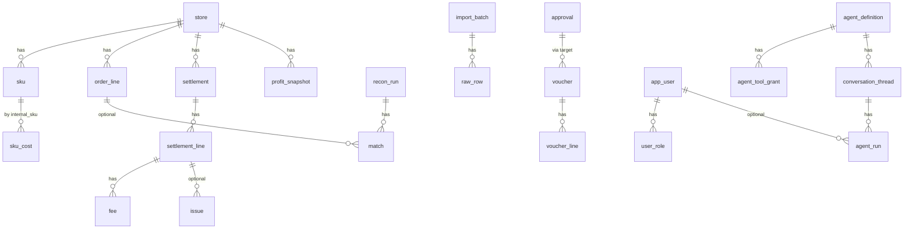

# CrossERP 数据模型

- 文档日期：2026-11-09（Asia/Shanghai）
- 现有表依据：`src/crosserp/db/schema.py`、`docs/architecture.md`、实施方案第 4 节
- 规则：只追加表和列；金额 `Money4`；汇率更高精度；时间 UTC；主键除 `raw_row` 外为应用生成的 UUID；分类字段用字符串，不用数据库原生枚举

本文分两部分：已经存在的表（只记录关键字段，便于对照），以及为 ERP / CRM / 智能体预留的新表。新表在对应模块启用时再做迁移，不必一次全部建完。

---

## 1. 通用约定

- 内存中的钱用精确小数；数据库金额列是 `Money4`。展示时再四舍五入到分。
- 写入与审计尽量同一事务，避免「改了却没记下」。
- 业务审计表、安全日志表只插入、不更新、不删除。
- 字符串列要有长度；需要建索引的字符串不超过 255（与现有三库规则一致）。
- 长文本用通用 `Text`，MySQL 上使用 `MEDIUMTEXT`。
- 后期若出现多公司共用，再追加 `company_id`，不改变现有主键。
- 智能体和导入产生的外部文本只当数据，不当指令。

关系总图（核心，不含所有后期表）：

---

## 2. 已经存在的表

下列名称与字段以本地 `schema.py` 为准，并与实施方案第 4 节对齐。若两者有细节差异，以代码为准。

### 2.1 导入与主数据

| 表 | 关键字段 | 说明 |
|---|---|---|
| `import_batch` | id, connector_id, connector_version, file_name, file_sha256, done_sha256, retry_of_batch_id, failure_code, failure_reason, imported_at, row_count, status, error_count | 只有成功批次按哈希拒绝重复 |
| `raw_row` | id（自增）, batch_id, row_no, payload_json | 出处的根基 |
| `store` | id, platform, marketplace, name, currency | 平台取值含 amazon/shopify/lingxing/sellfox/other |
| `sku` | id, store_id, platform_sku, internal_sku, title, active | 唯一约束 (store_id, platform_sku) |
| `sku_cost` | id, internal_sku, valid_from, valid_to, unit_cost, currency, freight_per_unit, source_batch_id | 按生效期取成本 |
| `fee_reference` | id, store_id, internal_sku, fee_category, currency, expected_per_unit, valid_from, valid_to, source_batch_id | 费用参考 |
| `fx_rate` | id, period, from_ccy, to_ccy, rate, source | 用户提供的月汇率，唯一 (period, from_ccy, to_ccy) |

### 2.2 订单、结算、对账、利润

| 表 | 关键字段 | 说明 |
|---|---|---|
| `order_line` | id, store_id, platform_order_id, order_item_id, platform_sku, qty, order_date, item_price, currency, source_batch_id, raw_row_id | 现有订单粒度是「行」 |
| `settlement` | id, store_id, platform, external_id, period_start, period_end, deposit_date, total, currency, source_batch_id | 唯一 (platform, external_id) |
| `settlement_line` | id, settlement_id, transaction_type, order_id, order_item_code, sku, qty, amount_type, amount_description, amount, posted_at, raw_row_id | |
| `fee` | id, settlement_line_id, fee_category, amount | 分类由映射得到 |
| `recon_run` | id, store_id, period, as_of, rule_set_version, started_at, finished_at, status, groups_total, groups_matched, non_order_lines, created_by | 一次对账运行 |
| `match` | id, recon_run_id, settlement_line_id, order_line_id, rule_id, status, diff, matched_at | settlement_line_id 可空表示组级匹配 |
| `issue` | id, kind, severity, settlement_line_id, order_line_id, detail_json, status, resolution_note, created_at | 原因码来自实施方案 6.1 |
| `profit_snapshot` | id, period, internal_sku, store_id, revenue, fees, refunds, cogs, freight, ads, profit, currency, calc_version, inputs_hash | 可复算；ads 可空表示未计入广告 |

### 2.3 审批、凭证、导出

| 表 | 关键字段 | 说明 |
|---|---|---|
| `approval` | id, target_type, target_id, state, requested_by, approver, decided_at, comment, payload_hash 等 | 批准时锁定内容哈希 |
| `voucher` | 期间、凭证字、日期、状态、批次等 | 状态含 draft/pending/approved/rejected/exported |
| `voucher_line` | seq, summary, account_code, debit, credit, currency, aux_json | 一行只在借或贷一侧有数 |
| `export_artifact` | approval_id, target_id, 文件路径或外部引用, sha256, created_at | 写账产物 |

### 2.4 用户、设置、审计、智能体监控

| 表 | 关键字段 | 说明 |
|---|---|---|
| `app_user` | username, display_name, password_hash, is_active, failed_logins, locked_until | 密码哈希为 argon2 |
| `user_role` | user_id, role | 角色可叠加 |
| `user_session` | 会话 id、用户、过期、IP、是否作废 | 可强制下线 |
| `api_token` | user_id, name, token_hash, scopes, created_at, last_used_at, revoked_at | 只存哈希 |
| `app_setting` | key, value_json, updated_by, updated_at | 现有单人模式等 |
| `audit_log` / `audit_head` / `audit_checkpoint` / `audit_export` | 见实施方案 4 与 ADR 0003 | 只追加哈希链 |
| `security_event` | 登录和权限事件，独立哈希链 | 不记密码 |
| `prompt_version` | name, version, file_path, created_at | 提示词版本 |
| `llm_call` | 模型、token、费用、耗时、状态、脱敏问答、引用 | 每次模型调用 |
| `llm_tool_call` | llm_call_id, tool_name, 脱敏参数, 返回记录 id | 工具明细 |
| `llm_budget` / `llm_alert` | 预算与告警 | |
| `eval_run` | 模型、提示词版本、得分、逐题结果 | 评测 |

以上表在加后期模块时保持兼容：例如订单中心应**追加** `sales_order` 头表，并通过 `order_line` 增加可空的 `sales_order_id` 来关联，而不是改写已有订单行的主键含义。

---

## 3. 平台与权限补充表

| 表 | 关键字段 | 关系 | 阶段 |
|---|---|---|---|
| `app_module` | code, title, enabled, version | 无外键强绑 | 后期模块开关；现在先做也可只放配置 |
| `user_store_grant` | user_id, store_id, granted_by, granted_at | 用户多对多店铺 | v1.0 或按需；未配置时「推断」保持看全部店铺 |
| `integration_account` | id, provider, display_name, status, config_ref, last_checked_at, created_by | provider 如 amazon_sp_api / shopify / lingxing / sellfox / deerflow / feishu | v1.0。真正密钥放本机引用 `config_ref`，表内不存明文 |
| `dict_item` | group_code, item_code, label, active, sort_no | 同组编码唯一 | 后期。已使用的项只停用、不删除 |
| `job_run` | id, job_type, payload_json, status, progress, error, created_by, started_at, finished_at | 可选关联业务对象 | 现在先做导入/评测异步化时即可使用 |
| `stored_file` | id, purpose, original_name, sha256, storage_path, size_bytes, uploaded_by | 被导入批次、知识库文档、导出产物引用 | 与 `files` 模块对应 |
| `notification_rule` | id, event_name, channel, dest_ref, enabled | dest_ref 指向本机Webhook配置 | v1.0 `notify` |
| `notification_log` | id, rule_id, sent_at, status, detail_json | 发送记录 | 不把密钥写入 detail |

---

## 4. 商品、订单扩展

在现有 `sku` 之上追加，不替换。

| 表 | 关键字段 | 关系 | 阶段 |
|---|---|---|---|
| `catalog_category` | id, parent_id, name, sort_no, active | 自关联 | 后期 |
| `catalog_brand` | id, name, active | | 后期 |
| `catalog_listing` | id, store_id, sku_id, platform_listing_id, title, status, price, currency | 指向 store、sku | 后期 |
| `sku_bundle` | id, parent_internal_sku, child_internal_sku, qty | 组合装 | 后期 |
| `sales_order` | id, store_id, platform_order_id, order_date, buyer_ref, status, currency, source_batch_id | 与 store 唯一 (store_id, platform_order_id) | 现在先做只读时可以先用 order_line 聚合，表在完整订单中心时加 |
| 给 `order_line` 追加 | `sales_order_id`（可空） | 旧数据可空 | 追加列 |
| `sales_return` | id, store_id, platform_order_id, amount, currency, posted_at, source_settlement_line_id | 退货退款 | 后期 |
| `sales_fulfillment` | id, sales_order_id, status, tracking_no, shipped_at | 履约 | 后期 |

`buyer_ref` 只保存平台给出的、经过脱敏策略允许的标识，不主动收集买家电话地址进模型可见字段（与现有脱敏设计一致）。

---

## 5. 库存、采购、物流

| 表 | 关键字段 | 关系 | 阶段 |
|---|---|---|---|
| `warehouse` | id, code, name, kind, country, active | kind：fba / overseas / domestic / other | 后期 |
| `stock_balance` | id, warehouse_id, internal_sku, on_hand, reserved, in_transit, unfulfillable | 唯一 (warehouse_id, internal_sku) | 后期。数量变动必须同时写流水 |
| `stock_movement` | id, warehouse_id, internal_sku, qty_delta, reason, ref_type, ref_id, occurred_at, created_by | 流水只追加 | 后期 |
| `stock_doc` | id, doc_type, warehouse_id, to_warehouse_id, status, remark, created_by | doc_type：inbound / outbound / transfer / count | 后期 |
| `stock_doc_line` | id, doc_id, internal_sku, qty_expected, qty_actual | | 后期 |
| `stock_alert` | id, warehouse_id, internal_sku, kind, threshold, triggered_at, status | | 后期 |
| `supplier` | id, name, country, currency, status, remark | | 后期 |
| `supplier_contact` | id, supplier_id, name, email, phone | | 后期 |
| `purchase_order` | id, supplier_id, status, currency, expected_at, created_by | | 后期 |
| `purchase_order_line` | id, purchase_order_id, internal_sku, qty, unit_cost, currency | 金额由人录入 | 后期 |
| `purchase_receipt` | id, purchase_order_id, warehouse_id, received_at, status | 可转库存入库单 | 后期 |
| `purchase_receipt_line` | id, receipt_id, purchase_order_line_id, qty | | 后期 |
| `purchase_return` | id, supplier_id, purchase_order_id, status | | 后期 |
| `supplier_statement` | id, supplier_id, period, status, payload_hash | 对账单，提交财务后走审批 | 后期 |
| `carrier` | id, name, active | 物流商 | 后期 |
| `shipment` | id, carrier_id, warehouse_from, warehouse_to, status, departed_at, arrived_at | 头程批次 | 后期 |
| `shipment_line` | id, shipment_id, internal_sku, qty | | 后期 |
| `shipment_charge` | id, shipment_id, charge_type, amount, currency | 人录入账单金额 | 后期 |
| `shipping_rate` | id, carrier_id, dest, unit, price, currency, valid_from, valid_to | 运费模板，仅供参考 | 后期 |
| `tracking_event` | id, shipment_id, occurred_at, description | 轨迹 | 后期 |

库存数量本身不是「钱」，但若以后做成本结转（借主营业务成本、贷库存商品），必须生成凭证草稿并走现有审批，不能在库存服务里直接出总账。这与 maken 此前「有库存模块再加成本结转」的决定一致。

---

## 6. 财务补充、广告

| 表 | 关键字段 | 关系 | 阶段 |
|---|---|---|---|
| `account` | code, name, direction, parent_code, active, note | 现为 YAML，可在 v1.0 落库并继续允许文件导入 | v1.0 |
| `fee_map` | id, platform, amount_type, amount_description, fee_category, status | 未确认的映射不能自动生效 | v1.0 |
| `column_map` | id, connector_id, name, mapping_json, status | 对应现有 mapping YAML | v1.0 |
| `ar_invoice` | id, store_id, source_type, source_id, amount, currency, due_at, status | 应收 | 后期 |
| `ap_invoice` | id, supplier_id, source_type, source_id, amount, currency, due_at, status | 应付 | 后期 |
| `clearing` | id, kind, status, payload_hash, requested_by | 核销头，批准后再生效 | 后期 |
| `clearing_line` | id, clearing_id, side, ref_type, ref_id, amount | 两侧金额由代码核对必须相等 | 后期 |
| `cash_txn` | id, account_ref, occurred_at, amount, currency, source_batch_id | 资金流水 | 后期 |
| `ads_campaign` | id, store_id, platform, external_id, name, status | | 后期 |
| `ads_spend` | id, campaign_id, spent_on, amount, currency, source_batch_id | | 后期 |
| `ads_allocation` | id, spend_id, internal_sku, amount, rule_version | 分摊结果由代码计算 | 后期 |

---

## 7. CRM

客户主档不默认等于平台终端消费者。

| 表 | 关键字段 | 关系 | 阶段 |
|---|---|---|---|
| `crm_account` | id, name, kind, country, owner_user_id, status, source | kind：distributor / wholesale / dtc / partner / other | 后期 |
| `crm_contact` | id, account_id, name, email, phone, title | 属于客户 | 后期 |
| `crm_lead` | id, name, source, status, owner_user_id, account_id | account_id 在转化后可填 | 后期 |
| `crm_opportunity` | id, account_id, name, stage, amount, currency, expected_at, owner_user_id, status | 金额为人报价，不是利润计算 | 后期 |
| `crm_opportunity_line` | id, opportunity_id, internal_sku, qty, price | | 后期 |
| `crm_activity` | id, subject, kind, due_at, owner_user_id, ref_type, ref_id, result | 可挂到客户/线索/商机 | 后期 |
| `crm_ticket` | id, account_id, store_id, platform_order_id, status, priority, subject | 可关联已有订单 | 后期 |
| `crm_ticket_message` | id, ticket_id, author_type, body, created_at | 会话 | 后期 |
| `crm_review` | id, store_id, platform_order_id, internal_sku, rating, content, reviewed_at | | 后期 |
| `crm_tag` / `crm_tag_link` | tag name；link 到 account/lead | 标签 | 后期 |

联系方式属于敏感信息：默认不送进模型；如需智能体协助处理工单，应走现有脱敏。

---

## 8. 智能体相关表（预留增删改查）

已有 `prompt_version`、`llm_call`、`llm_tool_call`、`llm_budget`、`llm_alert`、`eval_run`、`api_token` 继续使用，下面是追加部分。

### 8.1 定义、工具、范围

**`agent_definition`**

| 字段 | 说明 |
|---|---|
| id | UUID |
| name | 内部名称，唯一 |
| title | 界面显示名 |
| description | 职责说明（例如「只解释利润，不改账」） |
| kind | `builtin_ask` / `deerflow` / `other` |
| external_name | DeerFlow 中的智能体名，可空 |
| default_model | 模型名，不含密钥 |
| status | enabled / disabled |
| created_by, created_at, updated_at | 审计辅助字段；正式变更仍写 `audit_log` |

**`agent_tool_catalog`**

| 字段 | 说明 |
|---|---|
| name | 工具名，如 `get_profit`，唯一 |
| description | 给人看的说明 |
| side_effect | `none`（只读）或 `propose`（只建建议）或 `forbidden_write`（占位，禁止真正写账） |
| module_code | 来自哪个业务模块 |
| active | 是否对系统可见 |

**`agent_tool_grant`**

| 字段 | 说明 |
|---|---|
| id | UUID |
| agent_id | 指向 `agent_definition` |
| tool_name | 指向工具目录 |
| allowed | 是否允许 |
| granted_by, granted_at | |

一个智能体默认不能超过授权表；若没有授权记录，则内置问答智能体沿用现在的只读白名单，避免升级后问答突然不可用。

**`agent_store_scope`**

| 字段 | 说明 |
|---|---|
| agent_id, store_id | 联合唯一 |
| 空范围 | 表示不额外限制（仍受用户本人权限约束） |

### 8.2 会话、消息、运行、步骤、任务

**`conversation_thread`**

| 字段 | 说明 |
|---|---|
| id | 本地 UUID |
| agent_id | |
| user_id | 提问人 |
| title | 可由系统生成 |
| external_thread_id | DeerFlow 的 thread id，可空 |
| created_at, archived_at | |

**`conversation_message`**

| 字段 | 说明 |
|---|---|
| id, thread_id, seq | 顺序 |
| role | user / assistant / system / tool |
| content | 长文本，已脱敏后保存 |
| citations_json | 引用的表名与记录 id |
| llm_call_id | 可空，关联现有调用表 |
| created_at | |

**`agent_run`**

| 字段 | 说明 |
|---|---|
| id | |
| thread_id | 可空（定时任务可能无会话） |
| task_id | 可空 |
| agent_id, user_id | |
| external_run_id | DeerFlow run id |
| status | queued / running / succeeded / refused / error / cancelled |
| started_at, finished_at, latency_ms | |
| input_tokens, output_tokens, cost, currency | 费用可空 |
| error_type | |
| request_id | 便于和审计、日志对应 |

**`agent_run_step`**

| 字段 | 说明 |
|---|---|
| id, run_id, seq | |
| step_type | model / tool / note |
| name | 工具名或步骤名 |
| args_json | 已脱敏 |
| result_ref_json | 返回的记录 id 等 |
| status, latency_ms, error_type | |

**`agent_task`**

| 字段 | 说明 |
|---|---|
| id, agent_id, created_by | |
| title, prompt | 任务说明 |
| schedule_expr | 可空；空表示手动 |
| timezone | 默认使用者时区概念，存 IANA 名，如 Asia/Shanghai |
| status | active / paused / disabled |
| last_run_id, next_run_at | |

### 8.3 知识、记忆指针、评测补充、连接

**`knowledge_base`**：id, name, description, status, created_by。

**`knowledge_doc`**：id, knowledge_base_id, title, file_id（指向 `stored_file`）, content_hash, status, source。检索应能回到具体文档，而不是不可追溯的向量片段。是否另外存向量「未定」，默认继续用现有关键词检索思路，需要时再追加表，不删原文。

**`memory_pointer`**：id, agent_id, user_id, external_ref, label, updated_at。只记录 DeerFlow 记忆的指针，不强制镜像全文。

**`eval_suite` / `eval_case`**（可选追加）：把现在文件型问题集落到表里，便于页面维护；`eval_run` 增加可空的 `suite_id`。在未迁表前，页面可以继续读现有问题集文件。

**`deerflow_connection`**：id, base_url, enabled, last_ok_at, last_error, config_ref。`base_url` 应为本机或内网地址；认证信息放 `config_ref` 指向的本机保险柜。一行即可，预留多行是为了以后区分测试与正式。

建议类业务对象不必新造一套「映射建议表」时，可复用 `approval`，`target_type` 取 `column_mapping` / `fee_category` / `issue_note` 等现有设计值。

---

## 9. 和智能体接口的对应

| 接口意图 | 主要表 |
|---|---|
| 维护智能体 | `agent_definition`、`agent_store_scope` |
| 授权工具 | `agent_tool_catalog`、`agent_tool_grant` |
| 发起对话 | `conversation_thread`、`conversation_message`、`agent_run` |
| 查看运行 | `agent_run`、`agent_run_step`、`llm_call`、`llm_tool_call` |
| 定时任务 | `agent_task`、`job_run` |
| 知识库 | `knowledge_base`、`knowledge_doc`、`stored_file` |
| 提示词 | `prompt_version` |
| 评测 | `eval_run`（及可选 suite/case） |
| 预算 | `llm_budget`、`llm_alert` |
| 接入 DeerFlow | `deerflow_connection`、`integration_account` |

---

## 10. 迁移原则

1. 先给「现在先做」的页面补只读接口，能用现有表就不要建新表。
2. 订单头表、科目表、智能体定义表属于「很快会用到」的追加，可在 v1.0 接入 DeerFlow 或做 Vue 重构时建立。
3. 库存、采购、物流、广告、CRM 表随模块开关分批迁移。
4. 所有新表进入 Alembic，并在三种数据库上验证。
5. 不得为了新功能删除 `raw_row`、审计链或把金额改成浮点数。
6. 给旧表加列必须可空或有安全默认值，保证旧数据仍能读。

---

## 11. 未能核实

- 后期表是否覆盖所有卖家的个性流程（例如不同海外仓的库存状态名）。
- 会计科目是否应在 v1.0 完全搬进数据库，还是继续以 `accounts.yaml` 为准、页面只做编辑器。
- 知识库是否需要向量检索；默认不需要即可上线。
- `user_store_grant` 是否在第一批 Vue 重构就启用，需 maken 决定。
