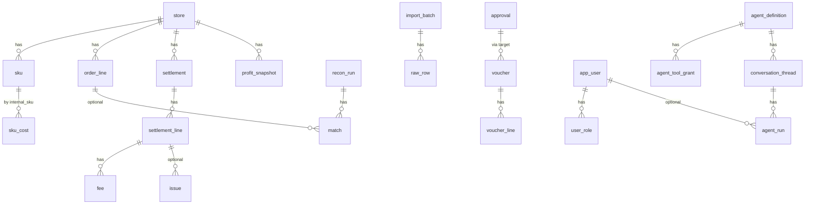

## 状态与关系

- **状态：仅设计**。本文的现有表说明仍可用于迁移对照；新增实体、属性、关系、状态机和动作以 [`08/ontology-entities.yaml`](08/ontology-entities.yaml) 为唯一目录。
- 本文仍有效：金额使用 `Money4`/万分位、UTC 时间、审计只追加和迁移只追加。单法人、不做多租户及审批解析规则以 08 第 4、9、10、12 章为准。
# CrossERP 数据模型

- 文档日期：2026-11-09（Asia/Shanghai）
- 现有表依据：`src/crosserp/db/schema.py`、`docs/architecture.md`、实施方案第 4 节
- 规则：只追加表和列；金额 `Money4`；汇率更高精度；时间 UTC；主键除 `raw_row` 外为应用生成的 UUID；分类字段用字符串，不用数据库原生枚举

本文分两部分：已经存在的表（只记录关键字段，便于对照），以及为 ERP / CRM / 智能体预留的新表。新表在对应模块启用时再做迁移，不必一次全部建完。

---

## 1. 通用约定

- 内存中的钱用精确小数；数据库金额列是 `Money4`。展示时再四舍五入到分。
- 写入与审计尽量同一事务，避免「改了却没记下」。
- 业务审计表、安全日志表只插入、不更新、不删除。
- 字符串列要有长度；需要建索引的字符串不超过 255（与现有三库规则一致）。
- 长文本用通用 `Text`，MySQL 上使用 `MEDIUMTEXT`。
- 后期若出现多公司共用，再追加 `company_id`，不改变现有主键。
- 智能体和导入产生的外部文本只当数据，不当指令。

关系总图（核心，不含所有后期表）：

---

## 2. 已经存在的表

下列名称与字段以本地 `schema.py` 为准，并与实施方案第 4 节对齐。若两者有细节差异，以代码为准。

### 2.1 导入与主数据

| 表 | 关键字段 | 说明 |
|---|---|---|
| `import_batch` | id, connector_id, connector_version, file_name, file_sha256, done_sha256, retry_of_batch_id, failure_code, failure_reason, imported_at, row_count, status, error_count | 只有成功批次按哈希拒绝重复 |
| `raw_row` | id（自增）, batch_id, row_no, payload_json | 出处的根基 |
| `store` | id, platform, marketplace, name, currency | 平台取值含 amazon/shopify/lingxing/sellfox/other |
| `sku` | id, store_id, platform_sku, internal_sku, title, active | 唯一约束 (store_id, platform_sku) |
| `sku_cost` | id, internal_sku, valid_from, valid_to, unit_cost, currency, freight_per_unit, source_batch_id | 按生效期取成本 |
| `fee_reference` | id, store_id, internal_sku, fee_category, currency, expected_per_unit, valid_from, valid_to, source_batch_id | 费用参考 |
| `fx_rate` | id, period, from_ccy, to_ccy, rate, source | 用户提供的月汇率，唯一 (period, from_ccy, to_ccy) |

### 2.2 订单、结算、对账、利润

| 表 | 关键字段 | 说明 |
|---|---|---|
| `order_line` | id, store_id, platform_order_id, order_item_id, platform_sku, qty, order_date, item_price, currency, source_batch_id, raw_row_id | 现有订单粒度是「行」 |
| `settlement` | id, store_id, platform, external_id, period_start, period_end, deposit_date, total, currency, source_batch_id | 唯一 (platform, external_id) |
| `settlement_line` | id, settlement_id, transaction_type, order_id, order_item_code, sku, qty, amount_type, amount_description, amount, posted_at, raw_row_id | |
| `fee` | id, settlement_line_id, fee_category, amount | 分类由映射得到 |
| `recon_run` | id, store_id, period, as_of, rule_set_version, started_at, finished_at, status, groups_total, groups_matched, non_order_lines, created_by | 一次对账运行 |
| `match` | id, recon_run_id, settlement_line_id, order_line_id, rule_id, status, diff, matched_at | settlement_line_id 可空表示组级匹配 |
| `issue` | id, kind, severity, settlement_line_id, order_line_id, detail_json, status, resolution_note, created_at | 原因码来自实施方案 6.1 |
| `profit_snapshot` | id, period, internal_sku, store_id, revenue, fees, refunds, cogs, freight, ads, profit, currency, calc_version, inputs_hash | 可复算；ads 可空表示未计入广告 |

### 2.3 审批、凭证、导出

| 表 | 关键字段 | 说明 |
|---|---|---|
| `approval` | id, target_type, target_id, state, requested_by, approver, decided_at, comment, payload_hash 等 | 批准时锁定内容哈希 |
| `voucher` | 期间、凭证字、日期、状态、批次等 | 状态含 draft/pending/approved/rejected/exported |
| `voucher_line` | seq, summary, account_code, debit, credit, currency, aux_json | 一行只在借或贷一侧有数 |
| `export_artifact` | approval_id, target_id, 文件路径或外部引用, sha256, created_at | 写账产物 |

### 2.4 用户、设置、审计、智能体监控

| 表 | 关键字段 | 说明 |
|---|---|---|
| `app_user` | username, display_name, password_hash, is_active, failed_logins, locked_until | 密码哈希为 argon2 |
| `user_role` | user_id, role | 角色可叠加 |
| `user_session` | 会话 id、用户、过期、IP、是否作废 | 可强制下线 |
| `api_token` | user_id, name, token_hash, scopes, created_at, last_used_at, revoked_at | 只存哈希 |
| `app_setting` | key, value_json, updated_by, updated_at | 现有单人模式等 **【已被 08 v4 第 4.6、12.1 节取代】** |
| `audit_log` / `audit_head` / `audit_checkpoint` / `audit_export` | 见实施方案 4 与 ADR 0003 | 只追加哈希链 |
| `security_event` | 登录和权限事件，独立哈希链 | 不记密码 |
| `prompt_version` | name, version, file_path, created_at | 提示词版本 |
| `llm_call` | 模型、token、费用、耗时、状态、脱敏问答、引用 | 每次模型调用 |
| `llm_tool_call` | llm_call_id, tool_name, 脱敏参数, 返回记录 id | 工具明细 |
| `llm_budget` / `llm_alert` | 预算与告警 | |
| `eval_run` | 模型、提示词版本、得分、逐题结果 | 评测 |

以上表在加后期模块时保持兼容：例如订单中心应**追加** `sales_order` 头表，并通过 `order_line` 增加可空的 `sales_order_id` 来关联，而不是改写已有订单行的主键含义。

---

## 3. 平台与权限补充表

| 表 | 关键字段 | 关系 | 阶段 |
|---|---|---|---|
| `app_module` | code, title, enabled, version | 无外键强绑 | 后期模块开关；现在先做也可只放配置 |
| `user_store_grant` | user_id, store_id, granted_by, granted_at | 用户多对多店铺 | v1.0 或按需；未配置时「推断」保持看全部店铺 |
| `integration_account` | id, provider, display_name, status, config_ref, last_checked_at, created_by | provider 如 amazon_sp_api / shopify / lingxing / sellfox / deerflow / feishu | v1.0。真正密钥放本机引用 `config_ref`，表内不存明文 |
| `dict_item` | group_code, item_code, label, active, sort_no | 同组编码唯一 | 后期。已使用的项只停用、不删除 |
| `job_run` | id, job_type, payload_json, status, progress, error, created_by, started_at, finished_at | 可选关联业务对象 | 现在先做导入/评测异步化时即可使用 |
| `stored_file` | id, purpose, original_name, sha256, storage_path, size_bytes, uploaded_by | 被导入批次、知识库文档、导出产物引用 | 与 `files` 模块对应 |
| `notification_rule` | id, event_name, channel, dest_ref, enabled | dest_ref 指向本机Webhook配置 | v1.0 `notify` |
| `notification_log` | id, rule_id, sent_at, status, detail_json | 发送记录 | 不把密钥写入 detail |

---

## 4. 商品、订单扩展

在现有 `sku` 之上追加，不替换。

| 表 | 关键字段 | 关系 | 阶段 |
|---|---|---|---|
| `catalog_category` | id, parent_id, name, sort_no, active | 自关联 | 后期 |
| `catalog_brand` | id, name, active | | 后期 |
| `catalog_listing` | id, store_id, sku_id, platform_listing_id, title, status, price, currency | 指向 store、sku | 后期 |
| `sku_bundle` | id, parent_internal_sku, child_internal_sku, qty | 组合装 | 后期 |
| `sales_order` | id, store_id, platform_order_id, order_date, buyer_ref, status, currency, source_batch_id | 与 store 唯一 (store_id, platform_order_id) | 现在先做只读时可以先用 order_line 聚合，表在完整订单中心时加 |
| 给 `order_line` 追加 | `sales_order_id`（可空） | 旧数据可空 | 追加列 |
| `sales_return` | id, store_id, platform_order_id, amount, currency, posted_at, source_settlement_line_id | 退货退款 | 后期 |
| `sales_fulfillment` | id, sales_order_id, status, tracking_no, shipped_at | 履约 | 后期 |

`buyer_ref` 只保存平台给出的、经过脱敏策略允许的标识，不主动收集买家电话地址进模型可见字段（与现有脱敏设计一致）。

---

## 5. 库存、采购、物流

| 表 | 关键字段 | 关系 | 阶段 |
|---|---|---|---|
| `warehouse` | id, code, name, kind, country, active | kind：fba / overseas / domestic / other | 后期 |
| `stock_balance` | id, warehouse_id, internal_sku, on_hand, reserved, in_transit, unfulfillable | 唯一 (warehouse_id, internal_sku) | 后期。数量变动必须同时写流水 |
| `stock_movement` | id, warehouse_id, internal_sku, qty_delta, reason, ref_type, ref_id, occurred_at, created_by | 流水只追加 | 后期 |
| `stock_doc` | id, doc_type, warehouse_id, to_warehouse_id, status, remark, created_by | doc_type：inbound / outbound / transfer / count | 后期 |
| `stock_doc_line` | id, doc_id, internal_sku, qty_expected, qty_actual | | 后期 |
| `stock_alert` | id, warehouse_id, internal_sku, kind, threshold, triggered_at, status | | 后期 |
| `supplier` | id, name, country, currency, status, remark | | 后期 |
| `supplier_contact` | id, supplier_id, name, email, phone | | 后期 |
| `purchase_order` | id, supplier_id, status, currency, expected_at, created_by | | 后期 |
| `purchase_order_line` | id, purchase_order_id, internal_sku, qty, unit_cost, currency | 金额由人录入 | 后期 |
| `purchase_receipt` | id, purchase_order_id, warehouse_id, received_at, status | 可转库存入库单 | 后期 |
| `purchase_receipt_line` | id, receipt_id, purchase_order_line_id, qty | | 后期 |
| `purchase_return` | id, supplier_id, purchase_order_id, status | | 后期 |
| `supplier_statement` | id, supplier_id, period, status, payload_hash | 对账单，提交财务后走审批 | 后期 |
| `carrier` | id, name, active | 物流商 | 后期 |
| `shipment` | id, carrier_id, warehouse_from, warehouse_to, status, departed_at, arrived_at | 头程批次 | 后期 |
| `shipment_line` | id, shipment_id, internal_sku, qty | | 后期 |
| `shipment_charge` | id, shipment_id, charge_type, amount, currency | 人录入账单金额 | 后期 |
| `shipping_rate` | id, carrier_id, dest, unit, price, currency, valid_from, valid_to | 运费模板，仅供参考 | 后期 |
| `tracking_event` | id, shipment_id, occurred_at, description | 轨迹 | 后期 |

库存数量本身不是「钱」，但若以后做成本结转（借主营业务成本、贷库存商品），必须生成凭证草稿并走现有审批，不能在库存服务里直接出总账。这与 maken 此前「有库存模块再加成本结转」的决定一致。

---

## 6. 财务补充、广告

| 表 | 关键字段 | 关系 | 阶段 |
|---|---|---|---|
| `account` | code, name, direction, parent_code, active, note | 现为 YAML，可在 v1.0 落库并继续允许文件导入 | v1.0 |
| `fee_map` | id, platform, amount_type, amount_description, fee_category, status | 未确认的映射不能自动生效 | v1.0 |
| `column_map` | id, connector_id, name, mapping_json, status | 对应现有 mapping YAML | v1.0 |
| `ar_invoice` | id, store_id, source_type, source_id, amount, currency, due_at, status | 应收 | 后期 |
| `ap_invoice` | id, supplier_id, source_type, source_id, amount, currency, due_at, status | 应付 | 后期 |
| `clearing` | id, kind, status, payload_hash, requested_by | 核销头，批准后再生效 | 后期 |
| `clearing_line` | id, clearing_id, side, ref_type, ref_id, amount | 两侧金额由代码核对必须相等 | 后期 |
| `cash_txn` | id, account_ref, occurred_at, amount, currency, source_batch_id | 资金流水 | 后期 |
| `ads_campaign` | id, store_id, platform, external_id, name, status | | 后期 |
| `ads_spend` | id, campaign_id, spent_on, amount, currency, source_batch_id | | 后期 |
| `ads_allocation` | id, spend_id, internal_sku, amount, rule_version | 分摊结果由代码计算 | 后期 |

---

## 7. CRM

客户主档不默认等于平台终端消费者。

| 表 | 关键字段 | 关系 | 阶段 |
|---|---|---|---|
| `crm_account` | id, name, kind, country, owner_user_id, status, source | kind：distributor / wholesale / dtc / partner / other | 后期 |
| `crm_contact` | id, account_id, name, email, phone, title | 属于客户 | 后期 |
| `crm_lead` | id, name, source, status, owner_user_id, account_id | account_id 在转化后可填 | 后期 |
| `crm_opportunity` | id, account_id, name, stage, amount, currency, expected_at, owner_user_id, status | 金额为人报价，不是利润计算 | 后期 |
| `crm_opportunity_line` | id, opportunity_id, internal_sku, qty, price | | 后期 |
| `crm_activity` | id, subject, kind, due_at, owner_user_id, ref_type, ref_id, result | 可挂到客户/线索/商机 | 后期 |
| `crm_ticket` | id, account_id, store_id, platform_order_id, status, priority, subject | 可关联已有订单 | 后期 |
| `crm_ticket_message` | id, ticket_id, author_type, body, created_at | 会话 | 后期 |
| `crm_review` | id, store_id, platform_order_id, internal_sku, rating, content, reviewed_at | | 后期 |
| `crm_tag` / `crm_tag_link` | tag name；link 到 account/lead | 标签 | 后期 |

联系方式属于敏感信息：默认不送进模型；如需智能体协助处理工单，应走现有脱敏。

---

## 8. 智能体相关表（预留增删改查）

已有 `prompt_version`、`llm_call`、`llm_tool_call`、`llm_budget`、`llm_alert`、`eval_run`、`api_token` 继续使用，下面是追加部分。

### 8.1 定义、工具、范围

**`agent_definition`**

| 字段 | 说明 |
|---|---|
| id | UUID |
| name | 内部名称，唯一 |
| title | 界面显示名 |
| description | 职责说明（例如「只解释利润，不改账」） |
| kind | `builtin_ask` / `deerflow` / `other` |
| external_name | DeerFlow 中的智能体名，可空 |
| default_model | 模型名，不含密钥 |
| status | enabled / disabled |
| created_by, created_at, updated_at | 审计辅助字段；正式变更仍写 `audit_log` |

**`agent_tool_catalog`**

| 字段 | 说明 |
|---|---|
| name | 工具名，如 `get_profit`，唯一 |
| description | 给人看的说明 |
| side_effect | `none`（只读）或 `propose`（只建建议）或 `forbidden_write`（占位，禁止真正写账） |
| module_code | 来自哪个业务模块 |
| active | 是否对系统可见 |

**`agent_tool_grant`**

| 字段 | 说明 |
|---|---|
| id | UUID |
| agent_id | 指向 `agent_definition` |
| tool_name | 指向工具目录 |
| allowed | 是否允许 |
| granted_by, granted_at | |

一个智能体默认不能超过授权表；若没有授权记录，则内置问答智能体沿用现在的只读白名单，避免升级后问答突然不可用。

**`agent_store_scope`**

| 字段 | 说明 |
|---|---|
| agent_id, store_id | 联合唯一 |
| 空范围 | 表示不额外限制（仍受用户本人权限约束） |

### 8.2 会话、消息、运行、步骤、任务

**`conversation_thread`**

| 字段 | 说明 |
|---|---|
| id | 本地 UUID |
| agent_id | |
| user_id | 提问人 |
| title | 可由系统生成 |
| external_thread_id | DeerFlow 的 thread id，可空 |
| created_at, archived_at | |

**`conversation_message`**

| 字段 | 说明 |
|---|---|
| id, thread_id, seq | 顺序 |
| role | user / assistant / system / tool |
| content | 长文本，已脱敏后保存 |
| citations_json | 引用的表名与记录 id |
| llm_call_id | 可空，关联现有调用表 |
| created_at | |

**`agent_run`**

| 字段 | 说明 |
|---|---|
| id | |
| thread_id | 可空（定时任务可能无会话） |
| task_id | 可空 |
| agent_id, user_id | |
| external_run_id | DeerFlow run id |
| status | queued / running / succeeded / refused / error / cancelled |
| started_at, finished_at, latency_ms | |
| input_tokens, output_tokens, cost, currency | 费用可空 |
| error_type | |
| request_id | 便于和审计、日志对应 |

**`agent_run_step`**

| 字段 | 说明 |
|---|---|
| id, run_id, seq | |
| step_type | model / tool / note |
| name | 工具名或步骤名 |
| args_json | 已脱敏 |
| result_ref_json | 返回的记录 id 等 |
| status, latency_ms, error_type | |

**`agent_task`**

| 字段 | 说明 |
|---|---|
| id, agent_id, created_by | |
| title, prompt | 任务说明 |
| schedule_expr | 可空；空表示手动 |
| timezone | 默认使用者时区概念，存 IANA 名，如 Asia/Shanghai |
| status | active / paused / disabled |
| last_run_id, next_run_at | |

### 8.3 知识、记忆指针、评测补充、连接

**`knowledge_base`**（2026-11-10 起并入第 19 节 `kb_space`，此处保留原设计说明）：id, name, description, status, created_by。

**`knowledge_doc`**：id, knowledge_base_id, title, file_id（指向 `stored_file`）, content_hash, status, source。检索应能回到具体文档，而不是不可追溯的向量片段。是否另外存向量「未定」，默认继续用现有关键词检索思路，需要时再追加表，不删原文。

**`memory_pointer`**：id, agent_id, user_id, external_ref, label, updated_at。只记录 DeerFlow 记忆的指针，不强制镜像全文。

**`eval_suite` / `eval_case`**（可选追加）：把现在文件型问题集落到表里，便于页面维护；`eval_run` 增加可空的 `suite_id`。在未迁表前，页面可以继续读现有问题集文件。

**`deerflow_connection`**：id, base_url, enabled, last_ok_at, last_error, config_ref。`base_url` 应为本机或内网地址；认证信息放 `config_ref` 指向的本机保险柜。一行即可，预留多行是为了以后区分测试与正式。

建议类业务对象不必新造一套「映射建议表」时，可复用 `approval`，`target_type` 取 `column_mapping` / `fee_category` / `issue_note` 等现有设计值。

---

## 9. 和智能体接口的对应

| 接口意图 | 主要表 |
|---|---|
| 维护智能体 | `agent_definition`、`agent_store_scope` |
| 授权工具 | `agent_tool_catalog`、`agent_tool_grant` |
| 发起对话 | `conversation_thread`、`conversation_message`、`agent_run` |
| 查看运行 | `agent_run`、`agent_run_step`、`llm_call`、`llm_tool_call` |
| 定时任务 | `agent_task`、`job_run` |
| 知识库 | `knowledge_base`、`knowledge_doc`、`stored_file` |
| 提示词 | `prompt_version` |
| 评测 | `eval_run`（及可选 suite/case） |
| 预算 | `llm_budget`、`llm_alert` |
| 接入 DeerFlow | `deerflow_connection`、`integration_account` |

---

## 10. 迁移原则

1. 先给「现在先做」的页面补只读接口，能用现有表就不要建新表。
2. 订单头表、科目表、智能体定义表属于「很快会用到」的追加，可在 v1.0 接入 DeerFlow 或做 Vue 重构时建立。
3. 库存、采购、物流、广告、CRM 表随模块开关分批迁移。
4. 所有新表进入 Alembic，并在三种数据库上验证。
5. 不得为了新功能删除 `raw_row`、审计链或把金额改成浮点数。
6. 给旧表加列必须可空或有安全默认值，保证旧数据仍能读。

---

## 11. 未能核实

- 后期表是否覆盖所有卖家的个性流程（例如不同海外仓的库存状态名）。
- 会计科目是否应在 v1.0 完全搬进数据库，还是继续以 `accounts.yaml` 为准、页面只做编辑器。
- 知识库是否需要向量检索；默认不需要即可上线。
- `user_store_grant` 是否在第一批 Vue 重构就启用，需 maken 决定。

---

# 补齐部分（2026-11-10 追加）

规则不变：只追加表和列；金额 `Money4`；所有金额由确定性代码计算；给旧表加的列都可空。每张业务单据表都追加 `origin`（`manual` / `agent` / `import`）和可空的 `agent_suggestion_id`，用来区分「人填的」还是「AI 起草的」——两种来源用同一张表、同一套状态。

## 12. 费用报销、借款、差旅

| 表 | 关键字段 | 关系 | 阶段 |
|---|---|---|---|
| `expense_policy` | id, category, scope_json（职级/城市）, limit_amount, currency, valid_from, valid_to, active | | 现在做 |
| `expense_claim` | id, claimant_user_id, department_id, trip_id, status, total_amount（代码合计）, currency, submitted_at, origin, agent_suggestion_id | status：draft / pending / approved / rejected / paid / void | 现在做 |
| `expense_claim_line` | id, claim_id, category, occurred_on, amount, currency, fx_rate, amount_cny（代码算）, receipt_doc_id, policy_check_json, remark | `receipt_doc_id` 指向 `ocr_document` | 现在做 |
| `expense_loan` | id, borrower_user_id, purpose, amount, currency, status, due_on, balance（代码算） | | 现在做 |
| `expense_loan_settlement` | id, loan_id, kind（repay / offset_claim）, ref_id, amount | 冲抵报销或还款 | 现在做 |
| `travel_request` | id, user_id, destination, start_on, end_on, budget_amount, status | 报销关联 | v1.0 |

## 13. 总账、报表、结账、预算、多币种、税务

| 表 | 关键字段 | 关系 | 阶段 |
|---|---|---|---|
| `accounting_period` | period（YYYY-MM）, status（open / closing / closed）, closed_by, closed_at, checklist_json | 已结账期间不能再生成该期凭证 | 现在做 |
| `gl_entry` | id, period, voucher_id, voucher_line_id, account_code, debit, credit, currency, amount_cny, aux_json, posted_at | 只由已批准凭证生成，只追加 | 现在做 |
| `account_balance` | period, account_code, opening, debit_total, credit_total, closing, currency | 由 `gl_entry` 汇总，可重算 | 现在做 |
| `statement_template` | id, kind（income / balance / cashflow）, version, lines_json（行项目与科目对应） | 默认值标「待会计核实」 | 现在做 |
| `statement_snapshot` | id, kind, period, template_version, data_json, inputs_hash | 可复算 | 现在做 |
| `cogs_run` | id, period, status, voucher_id, inputs_hash, created_by | 成本结转批次 | 现在做 |
| `cogs_run_line` | id, cogs_run_id, movement_id, internal_sku, qty, unit_cost, amount（代码算） | 指向 `stock_movement` | 现在做 |
| `fx_revaluation` | id, period, account_code, currency, balance_fc, rate, diff_cny（代码算）, voucher_id | 汇兑损益 | v1.0 |
| `budget` | id, fiscal_year, department_id, account_code, period, amount, version, status | | v1.0 |
| `budget_usage` | id, budget_id, source_type, source_id, amount, kind（reserve / actual / release） | 审批中占用、批准后实际 | v1.0 |
| `budget_adjustment` | id, budget_id, delta, reason, status, origin | 走审批 | v1.0 |
| `vat_registration` | id, store_id, country, vat_no_masked, filing_frequency | | v1.0 |
| `vat_return` | id, registration_id, period, output_vat, input_vat, payable（代码算）, due_on, status | | v1.0 |
| `export_rebate_case` | id, customs_decl_no, invoice_refs_json, rebate_amount（按规则代码算）, status | | 后期 |

## 14. 供应链补充

| 表 | 关键字段 | 关系 | 阶段 |
|---|---|---|---|
| `rfq` | id, title, status, due_at, created_by, origin | 询价单 | v1.0 |
| `rfq_line` | id, rfq_id, internal_sku, qty, target_date | | v1.0 |
| `rfq_quote` | id, rfq_id, supplier_id, internal_sku, unit_price, currency, lead_days, moq, valid_until, file_id | 报价（人录入或识别后确认） | v1.0 |
| `purchase_contract` | id, supplier_id, contract_no, start_on, end_on, status, file_id | | v1.0 |
| `purchase_contract_price` | id, contract_id, internal_sku, unit_price, currency, min_qty | 框架价 | v1.0 |
| 给 `purchase_order` 追加 | rfq_id, contract_id, source_suggestion_id, origin（均可空） | | 追加列 |
| `supplier_score` | id, supplier_id, period, on_time_rate, pass_rate, price_stability, score（代码算）, inputs_hash | | v1.0 |
| `stock_batch` | id, warehouse_id, internal_sku, batch_no, mfg_date, expiry_date, qty_on_hand | 唯一 (warehouse_id, internal_sku, batch_no) | v1.0 |
| 给 `stock_movement` 追加 | batch_id, unit_cost（可空） | 结转取数 | 追加列 |
| `replenishment_suggestion` | id, internal_sku, warehouse_id, avg_daily_sales, days_of_cover, stockout_date, suggested_qty（代码算）, method_version, status, agent_explanation | 预测由代码算，AI 只写说明 | 现在做 |
| 给 `stock_doc` 追加 | shipment_id, approval_id（可空） | 调拨/盘点差异走审批 | 追加列 |

## 15. 人事与行政（默认关闭）

| 表 | 关键字段 | 关系 | 阶段 |
|---|---|---|---|
| `department` | id, parent_id, name, manager_user_id, active | 自关联 | 现在做（权限的部门范围需要） |
| `employee` | id, user_id（可空）, department_id, name, title, hire_date, status, probation_end | 基本信息 | 后期 |
| `employee_sensitive` | employee_id, id_no_enc, bank_account_enc, salary_base_enc | **加密存储**，字段权限保护，永不送模型 | 后期 |
| `employment_event` | id, employee_id, kind（onboard / transfer / offboard）, effective_on, checklist_json, status | | 后期 |
| `attendance_record` | id, employee_id, work_date, check_in, check_out, status, source_batch_id | 导入 | 后期 |
| `leave_request` | id, employee_id, kind, start_at, end_at, days, status | 走审批 | 后期 |
| `leave_balance` | employee_id, kind, year, total, used | | 后期 |
| `payroll_run` | id, period, scope_json, status（calculating / to_review / reviewed / pending_approval / approved / vouchered / corrected）, rule_set_versions_json, inputs_hash, total_gross, total_net, total_employer_cost（均代码算）, calculated_by, reviewed_by, voucher_id, corrects_run_id | 系统内算薪；发起/复核人不能审批 | 后期 |
| `payroll_line` | id, run_id, employee_id, city_code, base_salary, allowances, overtime, bonus, absence_deduction, gross, si_base, si_employee_json, si_employer_json, hf_employee, hf_employer, ytd_income, ytd_deductions, ytd_special_deductions, ytd_taxable, ytd_tax_withheld, tax_this_month, other_deductions, net, employer_cost, calc_trace_json | 全部代码算；`calc_trace_json` 记每个数字用了哪条规则；字段权限保护 | 后期 |
| `payroll_adjustment` | id, run_id, employee_id, field, before, after, reason, adjusted_by | 复核调整，调整后重新计算 | 后期 |
| `payroll_rule_set` | id, kind（social_insurance / housing_fund / iit_bracket / iit_deduction_standard / rounding / voucher_mapping）, region_code（可空）, version, valid_from, valid_to, verify_status（**pending_verify 待会计/HR 核实** / verified）, verified_by, verified_at | 规则版本；未核实版本不能用于正式算薪 | 后期 |
| `si_region_rule` | id, rule_set_id, city_code, insurance_type（pension / medical / unemployment / injury / maternity / housing_fund）, base_floor, base_ceiling, employee_rate, employer_rate, rounding | 按城市/地区；数值全部是配置 | 后期 |
| `iit_bracket` | id, rule_set_id, ytd_taxable_from, ytd_taxable_to, rate, quick_deduction | 累计预扣率表；配置 | 后期 |
| `iit_deduction_standard` | id, rule_set_id, code（basic_monthly / child_education / continuing_education / serious_illness / housing_loan / housing_rent / elderly_support / infant_care 等）, monthly_amount, rule_json | 减除费用和专项附加扣除标准；配置 | 后期 |
| `employee_special_deduction` | id, employee_id, code, monthly_amount, share_ratio, valid_from, valid_to, evidence_file_id, status | 员工登记的专项附加扣除 | 后期 |
| `employee_payroll_profile` | employee_id, city_code, si_declared_base, hf_declared_base, salary_items_json_enc, bank_account_enc | 加密 + 字段权限 | 后期 |
| `payroll_ytd` | employee_id, tax_year, ytd_income, ytd_tax_withheld, ytd_si_hf, ytd_special_deductions, last_period | 累计预扣用，每次批准后更新 | 后期 |
| `payslip` | id, run_id, employee_id, published_at, viewed_at | 员工本人可见 | 后期 |
| `office_contract` | id, kind, counterparty, start_on, end_on, amount, file_id, status | | 后期 |
| `fixed_asset` | id, asset_no, name, category, cost, acquired_on, useful_months, holder_user_id, status | | 后期 |
| `asset_depreciation` | id, asset_id, period, amount（代码算）, voucher_id | | 后期 |
| `announcement` | id, title, body, publish_at, audience_json, origin | | 后期 |
| `office_supply` / `supply_request` | 物品、库存；领用申请 | | 后期 |

## 16. 统一审批、通知、文档、报表、集成

| 表 | 关键字段 | 关系 | 阶段 |
|---|---|---|---|
| `approval_type` | code（如 `expense.claim`）, module_code, title, active | 各模块注册 | 现在做 |
| `approval_rule` | id, type_code, condition_json（金额区间、部门、店铺）, steps_json（每级审批角色/人）, priority, active | 多级、额度 | 现在做 |
| 给 `approval` 追加 | type_code, step_no, amount, department_id, origin, agent_suggestion_id, on_behalf_of_user_id, cc_user_ids_json, due_at（均可空） | 兼容现有单级审批 | 追加列 |
| `approval_step_log` | id, approval_id, step_no, approver_user_id, decision, comment, decided_at | 多级记录 | 现在做 |
| `approval_delegation` | id, from_user_id, to_user_id, type_codes_json, start_at, end_at | 代批 | v1.0 |
| 给 `approval_rule` 追加 | im_allowed（是否可在 IM 批）, require_web_above（超过此金额须回网页确认） | IM 审批门槛 | v1.0 |
| 给 `approval_step_log` 追加 | channel（web / feishu / wecom）, im_user_id, im_message_id | 记录渠道 | v1.0 |
| `channel_binding`（原设计名 `im_identity_binding`） | id, user_id, channel_code（feishu / wecom / dingtalk / 其他插件）, channel_user_id, tenant_ref, status, bound_at, unbound_at, bound_via | 唯一 (channel_code, channel_user_id) | v1.0 |
| `im_approval_card` | id, approval_id, step_no, provider, im_user_id, message_id, payload_hash, expires_at, status（sent / acted / expired / superseded） | 推送出去的卡片 | v1.0 |
| `im_callback_log` | id, provider, received_at, signature_ok, timestamp_ok, nonce, binding_ok, hash_ok, permission_ok, threshold_ok, result, card_id | 只追加；任一检查失败写安全日志并告警 | v1.0 |
| `notify_channel`（合并原 `im_channel_setting`） | id, channel_code, plugin_code, display_name, enabled, capabilities_json, config_ref, allowed_approval_types_json, default_require_web_above, last_health_at | 渠道插件实例；内置 feishu / wecom / dingtalk / email / webhook | v1.0 |
| `notify_rule` | id, event_name, channel_id, audience_json, enabled | 哪些事件发到哪个渠道（原 `notification_rule` 的升级） | v1.0 |
| `notification_message` | id, user_id, kind, title, body, ref_type, ref_id, read_at, created_at | 站内消息 | 现在做 |
| `notification_subscription` | id, user_id, event_name, channel（in_app / feishu / wecom / email）, enabled | | v1.0 |
| （原 `doc_folder` / `doc_item` / `doc_version`） | 并入第 19 节企业知识库表 | | — |
| `report_definition` | id, code, title, module_code, query_ref, params_schema_json, permission, builtin | 自定义报表只允许选已有数据源 | 现在做 |
| `report_run` | id, report_id, params_json, run_by, row_count, file_id | | 现在做 |
| `sync_job` | id, provider, scope_json, schedule_expr, status, last_run_at, last_error | 平台 API 同步 | v1.0 |
| `sync_cursor` | provider, store_id, resource, cursor_value, updated_at | 增量位置 | v1.0 |
| `external_ref` | id, provider, external_id, local_type, local_id | 外部编号对照 | v1.0 |
| `ledger_target` | id, kind（kingdee_excel / erpnext）, display_name, config_ref, enabled | 写账目标；密钥只在 `config_ref` | v1.0 |

## 17. 端到端链的关联字段

| 改动 | 内容 | 说明 |
|---|---|---|
| 给 `sales_order` 追加 | customer_id（→ `crm_account.id`）, opportunity_id（→ `crm_opportunity.id`），均可空 | **断点 1**（2026-11-10 端到端测试发现）：销售订单没有客户/商机字段；订单详情显示客户和商机链接，商机详情反向列出订单 |
| `sales_order_line`（新） | id, sales_order_id, internal_sku, qty, unit_price, currency | 完整订单中心；旧 `order_line` 继续保留并通过 `sales_order_id` 关联 |
| 给 `sales_return` 追加 | stock_movement_id, voucher_id, disposition（restock / scrap） | 退货回库存 |
| `purchase_return_line`（新） | id, purchase_return_id, purchase_order_line_id, internal_sku, batch_id, warehouse_id, qty, unit_cost, amount（代码算）, stock_movement_id | **断点 2**：采购退货没有明细行和数量、不扣库存；确认退货时每行写一条 `stock_movement`（qty_delta 为负，ref_type=`purchase_return`），并生成应付冲减 |
| 给 `purchase_return` 追加 | warehouse_id, status（draft / pending / confirmed / void）, confirmed_at, ap_adjustment_id | 头表补状态 |
| 给 `voucher` 追加 | source_type, source_id, origin, agent_suggestion_id, voucher_rule_id（可空） | 订单→凭证、报销→凭证、结转→凭证 |
| `voucher_rule`（新） | id, code, source_type（sales_order / settlement / sales_return / expense_claim / cogs_run / payroll_run …）, granularity（per_order / per_settlement / per_period_summary）, store_id（可空）, lines_template_json（借贷科目、金额取哪个已算好的字段）, active, version | **断点 3**：没有订单级凭证。按规则选择「逐单」或「按结算单」生成凭证草稿；金额只取已存的确定性字段，不现场估算 |
| `voucher_source_link`（新） | voucher_id, source_type, source_id, amount_part | 一张汇总凭证对应多张订单/结算时逐条关联，便于追溯 |
| `sales_shipment_link`（新） | id, sales_order_id, sales_fulfillment_id, shipment_id（→ `shipment`）, tracking_no, linked_at | **断点 4**：订单发货没有关联物流运单；自发货订单关联运单号，FBA 订单关联头程批次（多对多） |
| 给 `sales_fulfillment` 追加 | shipment_id（可空） | 简单场景一对一时直接存 |
| `document_link`（新） | id, from_type, from_id, to_type, to_id, link_kind, created_at, created_by | 业务链追溯页一次查全；只追加 |

## 18. 权限、操作日志、智能体可控管理

### 18.1 权限

| 表 | 关键字段 | 说明 | 阶段 |
|---|---|---|---|
| `role` | code, title, parent_role_code（可空，继承）, is_template, template_code, active, created_by, copied_from | 16 个预置模板 `is_template=true`，可编辑可复制；禁止继承成环 | 现在做 | **【已被 08 v4 第 4、10、12 章取代】**
| `role_permission` | role_code, permission_code, effect（allow / deny） | deny 为显式拒绝，计算时优先 | 现在做 |
| `user_role` | （已有）user_id, role | 一人多角色；`role` 改为引用 `role.code` | 已有，追加约束 |
| `user_permission_override` | id, user_id, permission_code, effect（allow / deny）, reason, valid_until, created_by | 用户级例外 | 现在做 |
| `effective_permission_cache` | user_id, computed_at, version, result_json（含每条来源说明） | 变更后失效重算；「有效权限查看」页读取 | 现在做 |
| `permission` | code, module_code, level（menu / action / field）, object_type, field_name（字段级时）, sensitive, description | 模块注册的权限点目录 | 现在做 |
| `data_scope_rule_type` | code（store / department / own / owner / warehouse / amount）, description | 数据范围规则类型 | 现在做 |
| `field_policy` | id, role_code 或 user_id, object_type, field_name, mode（visible / hidden / masked / readonly）, forced（强制隐藏 = 显式拒绝） | 后端序列化时执行 | 现在做 |
| `data_scope` | id, subject_type（user / role / agent / tool）, subject_id, dimension（store / department / own / owner / warehouse / amount）, value_json, effect（allow / deny） | 多角色取并集；deny 与金额上限优先 **【已被 08 v4 第 4.4、4.6 节取代】**；agent/tool 规则只能收窄，与用户结果取交集 | 现在做 |
| `user_store_grant` | （已设计）| 归入 data_scope 的店铺维度 | v1.0 |
| `user_department` | user_id, department_id, is_manager | 部门范围 | 现在做 |
| `temp_grant` | id, user_id, permission_code 或 role_code, scope_json, reason, start_at, end_at, granted_by, revoked_at | 到期自动失效 | v1.0 |
| `access_review` | id, period, reviewer_user_id, status, due_at | 复核任务 | v1.0 |
| `access_review_item` | id, review_id, user_id, permission_code, last_used_at, decision（keep / revoke）, decided_at | | v1.0 |
| `sod_rule` | id, action_a, action_b, scope（same_object / any）, active | 职责分离 | 现在做 |

### 18.2 统一操作日志（给现有 `audit_log` 追加列）

现有 `audit_log` 是只追加的哈希链（ADR 0003）。**不新建第二张日志表**，只追加可空列：

| 追加列 | 说明 |
|---|---|
| actor_type | human / agent / system（旧数据视为 human 或 system） |
| agent_id | 智能体身份 |
| on_behalf_of_user_id | 代谁 |
| reason | 原因（人填） |
| evidence_json | AI 证据引用（表名 + 记录编号） |
| approval_id | 审批链接 |
| ip, user_agent, token_name | 来源 |
| model, prompt_version, agent_run_id, llm_call_id, tool_call_ids_json | AI 专属 |
| autonomy_level, confidence | AI 专属 |
| request_id | 串联同一请求 |
| channel | web / feishu / wecom / mcp / system |
| im_user_id, im_message_id | IM 渠道时填写 |
| sensitive | 是否敏感动作 |

新增配套表：

| 表 | 关键字段 | 说明 | 阶段 |
|---|---|---|---|
| `audit_alert` | id, audit_log_id, rule_code, severity, status, notified_at, handled_by | 敏感操作告警 | v1.0 |
| `audit_alert_rule` | code, condition_json, severity, active | | v1.0 |
| `audit_retention_policy` | category（business / ai_detail / security）, keep_months, archive_to, updated_by | | v1.0 |
| `audit_archive` | id, category, range_start, range_end, file_id, sha256, created_at | 归档包本身可校验 | v1.0 |
| `agent_read_log` | id, agent_run_id, object_type, object_id, fields_json, read_at | AI 读了哪些数据（追溯用；也可放在 `llm_tool_call` 的返回记录 id 中，二选一，「推断」单独表更好查） | 现在做 |

### 18.3 智能体可控管理

| 表 | 关键字段 | 说明 | 阶段 |
|---|---|---|---|
| `agent_action` | code（如 `procurement.po.draft`）, module_code, kind（read / propose / execute）, max_level（硬上限）, touches_money, l3_allowlisted, daily_cap | 动作目录；白名单动作第一天默认 L3（maken 2026-11-10 已定），`touches_money=true` 的动作 max_level 固定 L2 | 现在做 | **【已被 08 v4 第 4、10、12 章取代】**
| `agent_autonomy_policy` | id, action_code, role_code（可空）, department_id / store_id（可空）, amount_threshold, level（L0–L3）, updated_by | 多条命中取最低；不得超过 `max_level` | 现在做 |
| `ai_mode_state` | id, mode（normal / degraded / off）, reason, changed_by（user 或 system）, changed_at | 只追加，最后一条为当前状态 | 现在做 |
| `agent_suggestion` | id, agent_id, on_behalf_of_user_id, action_code, level, target_type, target_id（草稿单据）, title, content, confidence, evidence_json, rule_check_json, status（open / submitted / accepted / modified / rejected / expired / executed / undone）, expires_at, agent_run_id | 建议生命周期 | 现在做 |
| `agent_undo` | id, suggestion_id, undo_payload_json, deadline_at, undone_by, undone_at | L3 撤销 | 现在做 |
| `ocr_document` | id, file_id, source（upload / email）, kind（invoice / receipt / quote / itinerary）, fields_json, confidence, status, linked_type, linked_id | 票据收件箱；金额字段需人确认 | 现在做 |
| `agent_alert` | id, agent_id, user_id, module_code, kind, title, ref_type, ref_id, status | 主动提醒 | 现在做 |
| `agent_trust_daily` | date, action_code, suggestions, accepted, modified, rejected, eval_score | 可信度看板 | v1.0 |
| `agent_data_scope` | （可复用 `data_scope`，subject_type = agent） | AI 数据范围 | 现在做 |

### 18.4 AI 工具注册表（扩展原 `agent_tool_catalog` / `agent_tool_grant`）

| 表 | 关键字段 | 说明 | 阶段 |
|---|---|---|---|
| `agent_tool` | name, kind（builtin / web_search / web_fetch / mcp / http）, module_code, description, rw_class（read / propose / execute_l3）, max_level, enabled, rate_per_min, rate_per_day, config_ref（密钥引用）, params_schema_json, untrusted_output（联网类固定为 true） | 原 `agent_tool_catalog` 追加列 | 现在做（内置）/ v1.0（其他） | **【已被 08 v4 第 4、10、12 章取代】**
| `agent_tool_grant` | id, tool_name, subject_type（role / agent）, subject_id, allowed | 按角色或智能体授权（原表追加 subject_type） | 现在做 |
| `mcp_server` | id, name, transport（stdio / http）, command_or_url, config_ref, enabled, last_ok_at, discovered_tools_json | 外部 MCP 服务器；发现的工具导入 `agent_tool` 后默认停用 | v1.0 |
| `http_tool_def` | tool_name, method, url_template, headers_ref, body_template, response_map_json, timeout_ms | 自定义 HTTP 工具 | v1.0 |
| `agent_tool_usage` | tool_name, date, calls, errors, throttled | 频率控制与统计 | v1.0 |

## 19. 企业知识库与新人上手

| 表 | 关键字段 | 说明 | 阶段 |
|---|---|---|---|
| `kb_space` | id, name, kind（company / accumulated / personal / help）, owner_user_id, default_acl_json, active | 空间；`personal` 为员工档案空间 | 现在做 |
| `kb_folder` | id, space_id, parent_id, name, sort_no | 文件夹树 | 现在做 |
| `kb_doc` | id, space_id, folder_id, title, kind（policy / sop / product / supplier / help / qa / ticket_lesson / lesson / contract / id_copy / certificate）, status（draft / in_review / published / archived）, current_version_id, sensitive, expires_on, owner_user_id, employee_id（个人档案时）, origin（manual / agent）, source_ref（如工单编号） | 文档 | 现在做 |
| `kb_doc_version` | id, doc_id, version_no, body（Text）, file_id, content_hash, created_by, created_at, published_at | 版本只追加 | 现在做 |
| `kb_tag` / `kb_doc_tag` | 标签与关联 | | 现在做 |
| `kb_acl` | id, target_type（space / folder / doc）, target_id, subject_type（role / department / user）, subject_id, can_read, can_edit, can_download, effect（allow / deny） | 文档权限不能宽于空间 | 现在做 |
| `kb_review` | id, doc_id, version_id, submitted_by, reviewer_user_id, decision, comment, decided_at | 发布审核（AI 建议同样走） | v1.0 |
| `kb_chunk` | id, version_id, seq, text, heading_path, token_count | 检索切段 | v1.0 |
| `kb_index_job` | id, scope, status, started_at, finished_at, error | 重建索引 | v1.0 |
| `kb_embedding`（可选） | chunk_id, model, vector_ref | 需要向量检索时再加（「推断」） | 后期 |
| `kb_access_log` | 不单独建表，写统一 `audit_log`（category = kb_sensitive，动作 view / download，含 AI 读取） | | v1.0 |
| `kb_expiry_reminder` | id, doc_id, remind_at, status, notified_user_ids_json | 到期提醒 | 现在做 |
| `onboarding_checklist` | id, role_code, title, items_json（步骤、目标页面、引导编号） | 按角色模板 | 现在做 |
| `onboarding_progress` | user_id, checklist_id, item_code, done_at | | 现在做 |
| `page_tour` | id, route, steps_json（目标元素、说明）, version, active | Shepherd 页面引导内容 | v1.0 |
