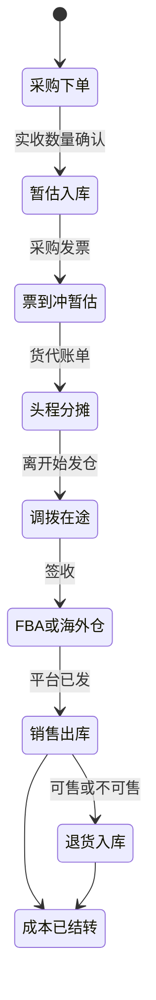
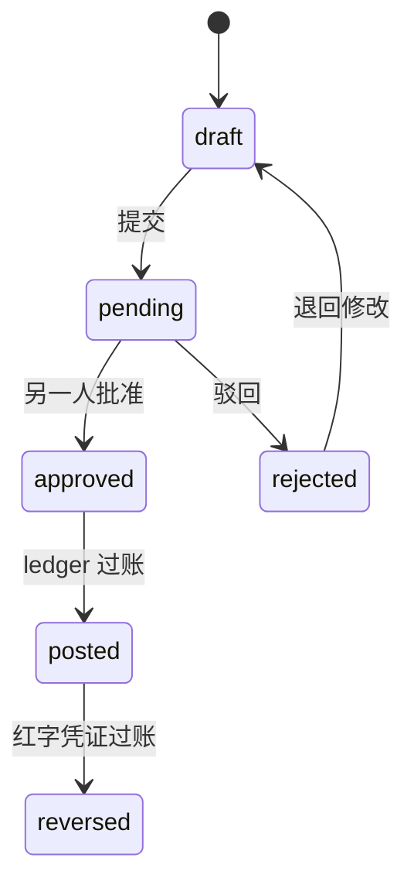
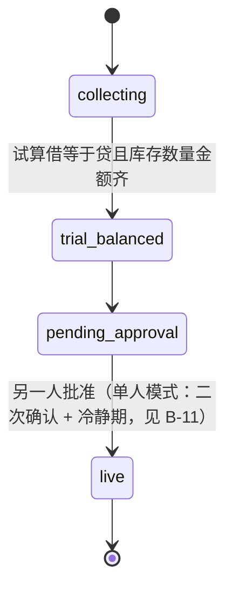
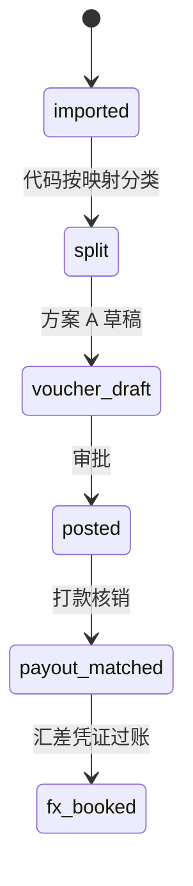
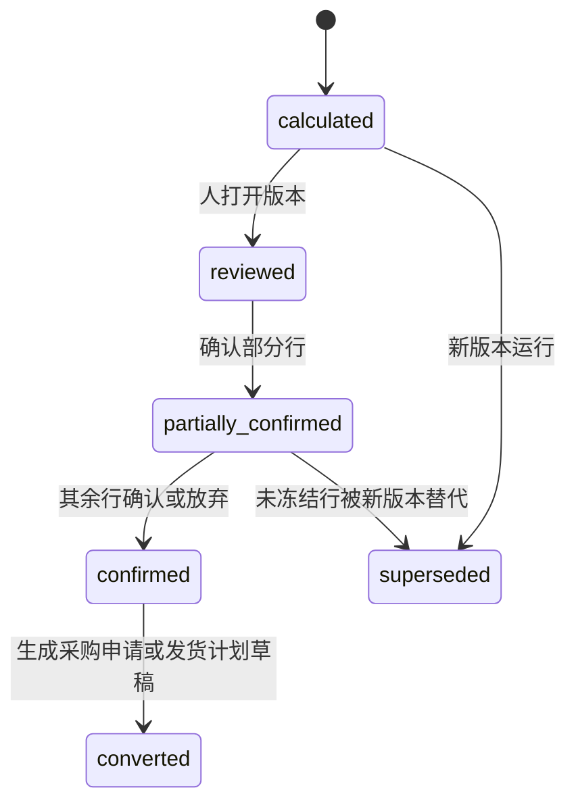

## 状态与关系

- **状态：仅设计，业务口径为演示默认值**。成本、记账和补货的领域细节仍可参考；实体目录、动作、接口、风险和分期以 [08](08-后端模块与API设计.md) 与 [`08/ontology-entities.yaml`](08/ontology-entities.yaml) 为准。
- 本文仍有效：金额万分位、确定性计算、人工审批和 AI 关闭后的人工路径。单人模式、金额上限 **【已被 08 v4 第 4.6 节取代】**、IM 审批等旧约定已被 08 v4 第 4、10、12 章取代；会计口径真实使用前需核实。
# 07 成本记账与补货计划补齐

- 文档日期：2026-11-10（Asia/Shanghai）。第三轮（同日）按 maken 同意的 12 项核对结论更新默认值，核对表和来源见附录 G
- 定位：产品对外演示用设计稿，不是真实上线使用。所有原待拍板项已按演示默认值确定（maken，2026-11-10）；会计相关项真实使用前需会计核实
- 适用场景：中国境内主体做出口跨境电商。会计口径按中国企业会计准则 / 小企业会计准则，本位币人民币；国内 ERP（领星、妙手、店小秘）为主要参照，ERPNext / Odoo 为补充
- 文档性质：设计稿，不含应用代码
- 读者：产品、财务、后端、前端
- 精度：金额以整数存储，`SCALE = 10000`（1 元 = 10000）。这与 `ref/04-数据模型.md` 的 `Money4`（四位小数）是同一精度
- 许可：ERPNext 为 GPL-3.0，Odoo 企业版（含完整 Accounting、部分 Landed Costs）非开源。本文只借鉴公开文档里的业务模型、流程和规则，不复制代码、不复制 DocType 或模型结构原文

本文件补三块能力，不推翻 00–06 已验收的对账、利润快照、方案 A 凭证和审批。

1. 成本核算：移动加权平均的库存台账，到岸成本、暂估、汇兑、负库存、调拨和两套利润。
2. 财务记账：冲销、期初、结账、平台结算清分、应收核销、多法人扩展点、税的计提。
3. 补货计划：可用量、安全天数、交期、取整、多仓、计划版本、与未完成采购的冲突、确定性预测。

全局红线（三块共用，后文不再重复论证）：

| 约束 | 落地 |
|---|---|
| 金额只由确定性代码计算 | 分摊、移动加权、汇兑、结转、预测数量全部是整数运算。LLM 不产出金额，也不产出预测的最终数量 |
| 科目在 `accounts.yaml` | 下文键名是设计默认值，编码一律【演示默认值，真实使用前需会计核实】。方向 `debit` / `credit` / `either` 与 `ref/repo/vouchers_accounts.py` 一致 |
| 方案 A | 见第 0.2 节。结算收入、费用、退款仍成对增减 `platform_receivable` |
| AI 对钱和账最高 L2 | 只生成草稿，人工审批后才过账。AI 关闭时，下列每个流程都能手填走完 |
| 权限 | 权限点目录 + 角色继承 + 数据范围（店铺 / 仓库 / 法人）。制单人不能审核自己的单。单人模式沿用 02 **【已被 08 v4 第 4.6、12.1 节取代】**，但期初启用和反结账不能自批，改为二次确认 + 冷静期 + 敏感操作提醒，见 B-11。人和 AI 的操作都进现有 `audit_log` |
| 页面 | Vuexy 页面。新页面 id 已对照 `ref/repo/pages.ts`，不与其中任何 id 冲突 |
| 法人 | 已定（演示默认值）：v1.0 单法人多店铺，表上预留可空 `company_id`；多法人和公司间账只留扩展点 |
| 已结账不可改 | 更正用红字冲销 + 重录或差额调整。禁止改历史后从最早月份整体重算 |

数量 v1.0 用整数件。重量、体积只作为分摊权重（克、立方厘米，整数），不作为库存数量。若以后有布料等非整数商品，按 SKU 增加 `qty_scale`（数量精度扩展口），默认 1，不改已有行的「件」含义。已定（演示默认值）：整数件 + 数量精度扩展口，v1.0 不开放非 1 的 `qty_scale`

舍入：正向金额用四舍五入到 `SCALE`（半进位，远离零的一侧；正数即 `ROUND_HALF_UP`）。负数先取绝对值再加回符号。分摊尾差 = 待分摊总额 − 各行四舍五入之和，加到绝对值最大的一行；并列时加到行号最大的一行（最后一行）。库存金额的真相是「结存数量 + 结存金额」，不要求「单价 × 数量」在整数 `SCALE` 上还原到分。

---

## 0. 阅读约定

### 0.1 与现有金额类型的对应

| 现有说法 | 本文件 |
|---|---|
| `Money4` | 数据库金额列，四位小数，等价于整数 `SCALE` |
| `profit_calc.round2` | 只用于利润快照展示到分，不用于新台账过账 |
| `voucher_line.debit` / `credit` | 仍是非负金额，一行不能借贷同时有数，也不能同时为零（`vouchers_model.py`） |
| `fx_rate` | 继续表示用户提供的月汇率，服务现有利润快照。日汇率是新表，不改这张表的含义 |

过账边界四舍五入到 `SCALE`。报表展示到分时再四舍五入一次，与 04「展示时再四舍五入到分」一致。展示尾差不回写台账。

### 0.2 方案 A（沿用，不改名）

`ref/00-总览.md` 第 2 节称「凭证分录方向采用方案 A」。代码里的对应实现是 `ref/repo/vouchers_builder.py`：利润快照里的费用和退款按利润口径存成负数，生成凭证时转成借方正数；每个经济事项同时增加或减少 `platform_receivable`，所以借贷成对相等。

本文件沿用这个口径，对应关系如下。

| 经济事项 | 借方键 | 贷方键 | 金额从哪来 |
|---|---|---|---|
| 销售收入 | `platform_receivable` | `sales_revenue` | 结算单已分类的销售收入 × 结算单结束日（或过账日）汇率 |
| 平台佣金、FBA 费等费用 | `platform_fee` 或专用费用键 | `platform_receivable` | 结算单已分类金额的绝对值 × 结算单结束日（或过账日）汇率 |
| 广告费 | `ad_cost` | `platform_receivable` | 同上，且 `ads_included` 为真才入账 |
| 退款冲减收入 | `refund_revenue` | `platform_receivable` | 退款绝对值 × 结算单结束日（或过账日）汇率 |
| 平台退回的费用 | `platform_receivable` | `refund_fee` | 费用冲回绝对值 × 结算单结束日（或过账日）汇率 |

结算清分在 v1.0 用结算单结束日（或过账日）的单一汇率，不用订单交易日。理由和扩展见 A-5.3、B-5.4。

库存、应付、头程、汇兑、结转是方案 A 之外的新模板。它们不挤进平台应收，但遵守同一套凭证约束：金额取已算好的字段，一行只借或只贷，整张凭证借贷相等，未审批不过账。

### 0.3 新增科目键（全部【演示默认值，真实使用前需会计核实】）

现有 `ref/repo/accounts.example.yaml` 的键保留。下表是增量。`code` 在真实记账前必须换成公司科目表编码；加载器今天会拒绝以「待会计核实」开头的编码，这个行为保留。

| 键 | 建议中文名 | direction | 为什么是这个方向 |
|---|---|---|---|
| `inventory` | 库存商品 | either | 入库借、出库贷 |
| `inventory_in_transit` | 在途物资 | either | 发出借、到达贷 |
| `grni` | 暂估应付 | either | 暂估贷、冲销借。对应 ERPNext 的 Stock Received But Not Billed |
| `ap` | 应付账款 | either | 发票贷、付款借 |
| `landed_cost_clearing` | 计入存货的费用 | either | 对应 ERPNext 的 Expenses Included In Valuation |
| `cogs` | 主营业务成本 | either | 结转借、退货冲回贷 |
| `fba_fee` | FBA 配送费 | debit | 方案 A 下只出现在借方；冲回走 `refund_fee` |
| `bank_charge` | 银行手续费 | debit | 收款、结汇、付款的银行或收款通道手续费。默认挂财务费用，见 0.3.1 |
| `platform_reserve` | 平台预留款 | either | 增加借、重估或释放时可能贷 |
| `fx_unrealized` | 未实现汇兑损益 | either | 与已有 `fx_diff`（已实现）分开 |
| `current_year_profit` | 本年利润 | either | 结账贷记盈利、借记亏损 |
| `opening_equity` | 期初余额对方 | either | 只用于期初启用凭证 |
| `inventory_gain` | 盘盈 | credit | 盘盈贷记 |
| `inventory_loss` | 盘亏及报废 | debit | 盘亏、报废借记 |
| `vat_output` | 应交增值税销项 | credit | 只计提，不申报。只在税务配置为「卖家自行负责」的站点 / 店铺使用；平台代扣代缴的不用，见 B-5.7 |
| `vat_input` | 应交增值税进项 | debit | 只计提，不申报 |
| `intercompany_ar` | 公司间应收 | either | v1.0 不启用 |
| `intercompany_ap` | 公司间应付 | either | v1.0 不启用 |

`bank_deposit` 在示例文件里是 `debit`。付款要贷记银行存款，默认改为 `either`（可借可贷，正常余额在借方）。依据：应用指南 1002「存入借记、支出贷记、期末借方余额」。【演示默认值，真实使用前需会计核实】。已验收的收入凭证只借这个科目，改方向不改变那些分录。

#### 0.3.1 建议科目编号与归属（全部【演示默认值，真实使用前需会计核实】）

编号按财政部《企业会计准则——应用指南》附录「会计科目和主要账务处理」（财会〔2006〕18 号）给建议值，来源见附录 G。编号只是 `accounts.yaml` 的建议填写值，正式编码以公司实际科目表为准；加载器仍拒绝占位编码。小企业会计准则企业由会计按其科目表替换。

| 键 | 建议一级科目 | 建议编号 | 备注 |
|---|---|---|---|
| `bank_deposit` | 银行存款 | 1002 | 可借可贷 |
| `platform_receivable` | 应收账款—平台 | 1122 | 明细挂平台 / 店铺【推断】 |
| `platform_reserve` | 其他应收款—平台预留 | 1231 | 【推断】 |
| `inventory_in_transit` | 在途物资 | 1402 | |
| `inventory` | 库存商品 | 1405 | 演示默认值用 1405（常见科目表写法；本次核对的第三方转载版附录写作 1406） |
| `grni` | 应付账款—暂估 | 2202 | 【推断】 |
| `ap` | 应付账款 | 2202 | |
| `vat_output` / `vat_input` | 应交税费—应交增值税（销项 / 进项） | 2221 | 只用于卖家自行负责的税 |
| `current_year_profit` | 本年利润 | 4103 | |
| `sales_revenue` / `refund_revenue` | 主营业务收入 | 6001 | 退款作收入减项【推断】 |
| `cogs` | 主营业务成本 | 6401 | |
| `platform_fee`、`fba_fee`、`ad_cost`、`refund_fee` | 销售费用—平台佣金 / FBA 费 / 广告 | 6601 | 平台佣金、FBA 费记销售费用【推断：应用指南 6601 未逐项列出平台佣金】 |
| `bank_charge` | 财务费用—手续费 | 6603 | 应用指南 6603 含「汇兑差额以及相关的手续费」；小企业会计准则第六十五条财务费用含银行相关手续费 |
| `fx_diff` / `fx_unrealized` | 财务费用—汇兑损益 | 6603 | 已实现、未实现分明细 |
| `inventory_gain` / `inventory_loss` | 待处理财产损溢 | 1901 | 批准后再转营业外收支或管理费用【推断】 |

### 0.4 单据状态

新单据用 06 第 1b 节的两层状态：`docstatus` 0 草稿 / 1 已提交 / 2 已取消，再加业务状态。已过账（`posted`）的凭证和库存流水只追加，不更新金额。取消已过账单据的唯一路径是红字冲销。

### 0.5 缺口落到哪一节

| 缺口 | 规则 | 数据 | 流程 | 验收 |
|---|---|---|---|---|
| A1–A9 | A-5 | A-6 | A-4 | A-12 |
| B1–B7 | B-5 | B-6 | B-4 | B-12 |
| C1–C10 | C-5 | C-6 | C-4 | C-12 |

端到端数字在第 D 章，不替代各块自己的小例子。

---

## A. 成本核算

本块补了什么：

- 财务口径用移动加权平均，每笔库存变动留下数量、金额和结存。
- 头程、关税、清关、港杂、仓储和辅料按选定基准分到「批次 × SKU」；货已卖掉的部分进销售成本，没卖掉的进库存。
- 暂估、发票差额、晚到的头程账单用差额凭证处理，不重算已结账月份。
- 调拨把成本原样带走，并允许在途段叠加头程。
- 管理利润继续用现有利润快照；财务利润用实际出库成本。两套并存，用差异表解释。

### A-1. 角色与业务问题

| 角色 | 要解决的问题 |
|---|---|
| 会计 | 库存科目必须等于库存台账；已结账月份不能被一次「重算」改掉 |
| 采购 / 仓储 | 货到了票没到，仓里要能看到数量，财务要有暂估 |
| 物流 | 头程账单往往晚于入 FBA，晚到费用要能拆到还在库的和已经卖掉的 |
| 财务主管 | 要同时看「今天大概赚多少」（管理）和「结账后认多少」（财务） |
| 审计 | 每一分钱能回到入库、分摊、出库或调整单 |

不做制造业 BOM、产能和生产工单。简单套装用已有组合装（`sku_bundle`）在出库时拆成组件成本。制造模块以后再接，见 A-5.9。

### A-2. ERPNext / Odoo / 竞品怎么做

只借鉴流程，不复制代码。

| 主题 | 他们怎么做 | 来源 |
|---|---|---|
| 永续盘存 | 库存移动实时生成会计分录。默认科目包括 Stock In Hand、Stock Received But Not Billed、Cost of Goods Sold、Expenses Included In Valuation | [ERPNext Perpetual Inventory](https://docs.frappe.io/erpnext/user/manual/en/perpetual-inventory) |
| 计价 | FIFO 与移动平均都有计算公式；移动平均用结存金额 / 结存数量 | [ERPNext FIFO 与移动平均](https://docs.frappe.io/erpnext/user/manual/en/calculation-of-valuation-rate-in-fifo-and-moving-average) |
| 库存台账 | Stock Ledger 每笔变动一行，带数量、计价率、结存数量和结存金额 | [ERPNext Stock Ledger](https://docs.frappe.io/erpnext/user/manual/en/stock-ledger) |
| 到岸成本 | Landed Cost Voucher 把运费、关税追加进采购入库的计价率，并可追溯到采购入库分录 | [ERPNext Landed Cost Voucher](https://docs.frappe.io/erpnext/user/manual/en/landed-cost-voucher) |
| Odoo 计价 | 成本方法 Standard / AVCO / FIFO；计价 Manual（定期）或 Automated（永续） | [Odoo 库存计价配置](https://www.odoo.com/documentation/18.0/applications/inventory_and_mrp/inventory/product_management/inventory_valuation/inventory_valuation_config.html) |
| Odoo 永续 | 永续计价时库存移动实时生成分录 | [Odoo 使用库存计价](https://www.odoo.com/documentation/18.0/applications/inventory_and_mrp/inventory/product_management/inventory_valuation/using_inventory_valuation.html) |
| Odoo 到岸成本 | 分摊方式 Equal / By Quantity / By Current Cost / By Weight / By Volume；只用于 AVCO 或 FIFO；Compute 后看原值、追加、新值，Validate 才过账 | [Odoo Landed Costs](https://www.odoo.com/documentation/18.0/applications/inventory_and_mrp/inventory/product_management/inventory_valuation/landed_costs.html) |
| 领星头程 | 头程含物流费、税费、其他费用。默认按计费重占比分摊，计费重 = max(体积 / 材积参数, 毛重)。可选计费重、实重、体积重、SKU 数量、自定义、箱子体积。官方例子：A 1000 件计费重 4.8 kg、B 2000 件 1.6 kg，物流 450 + 其他 50 = 500，A 税费 200、B 税费 400，结果 A 单件头程 0.5、B 0.3 | [领星头程分摊](https://www.lingxing.com/help/article/headDistanceStatistics) |
| 领星发货单 | 上传总费用分摊是独立权限，默认关闭；整批成功或整批失败。本地到海外仓的头程进库存明细；海外仓到 FBA 取库存明细里已含的成本 | [领星发货单](https://www.lingxing.com/help/article/deliveryOrder) |
| 领星重算 | FIFO；改发货单成本后必须从最早计价月重算，否则利润报表不更新 | [领星成本排查](https://www.lingxing.com/help/article/shujupaicha2) |
| 采购运费入成本 | 采购运费和其他费用可按到货批次分摊，方式为不分配 / 按金额 / 按数量 | [领星版本日志](https://www.lingxing.com/help/article/gengxinrizhi001) |

Odoo 写明到岸成本不能用于标准成本。这是 v1.0 财务口径不选标准成本的直接原因之一：头程账单晚到时，标准成本不会把差额写进存货。

### A-3. CrossERP 的取舍

| 决定 | 理由 |
|---|---|
| v1.0 财务口径用移动加权平均【演示默认值，真实使用前需会计核实】 | 跨境卖家同一 SKU 在本地仓、海外仓、FBA 之间频繁移动，批次一旦拆散，FIFO 层要跟着仓走，实施和解释成本高。移动加权把「这个仓这个 SKU 现在多少钱」收成一个结存金额，会计和仓库都能对上 |
| FIFO 留扩展点，不作为 v1.0 财务口径 | ERPNext 和 Odoo 都支持 FIFO。我们保留 `stock_valuation_layer` 空表和 `valuation_method` 字段。切换只允许在未结账、且该 SKU 结存数量为 0 或已做截止调整的期间生效，避免两套层混在已结账月份 |
| 标准成本不作为财务口径 | Odoo 的到岸成本不支持标准成本。标准成本适合管理利润的「即时估计」，不适合「账单晚到还要改存货」。管理利润继续读 `sku_cost` 和 `profit_snapshot`，不把标准成本写进总账 |
| 永续盘存，出库当时结转 | 与 06 批次 A「已确认出库 → 借主营业务成本、贷库存商品」同一方向。金额来源改为台账结存，不再用页面手填单价 |
| 已结账不重算 | 领星帮助中心要求从最早计价月重算。那会改写已经关闭的月份。我们用差额调整单，只影响未结账期间：还在库的进库存，已售的进当期销售成本 |
| 组合装代替 BOM | 卖的是跨境贸易商品，不是工厂。出库时按 `sku_bundle` 拆组件。工单、产能、在制品留扩展点，v1.0 不建那些表的业务流 |

### A-4. 业务流程与状态机

#### A-4.1 主流程（A1、A2、A4、A6）



采购下单本身不过账。承诺金额只出现在采购单，不进总账。

#### A-4.2 到岸成本单

| 业务状态 | docstatus | 谁能做 | 下一步 |
|---|---|---|---|
| 草稿 | 0 | 物流或会计编制 | 提交 |
| 待审批 | 0 | 提交人不能自审 | 批准或驳回 |
| 已过账 | 1 | 系统写台账和凭证 | 只能冲销 |
| 已冲销 | 2 | 红字凭证 + 反向流水 | 另做一张新单 |

分摊预览在批准前由代码算好。人可以改分摊基准（计费重 / 实重 / 体积 / 数量 / 货值 / 自定义权重），不能手改分摊后的金额。自定义权重也是输入，金额仍由代码乘出来。

#### A-4.3 负库存个案（A5）

默认每个仓库 `allow_negative = false`，出库使结存小于 0 时拒绝。仅当仓库打开「平台先发后补」且原因码是 `platform_shipped_before_receipt` 时，允许结存为负，并生成 `negative_stock_case`。个案状态：`open` → `filled`（补单入库已覆盖负数量）→ `cost_corrected`（差额凭证已过账）→ `closed`。未结账期间存在 `open` 或 `filled` 未修正的个案时，结账清单为失败。

#### A-4.4 成本调整单（发票差额、晚到费用、负库存修正）

`cost_adjustment`：草稿 → 待审批 → 已过账。过账时按 A-5.2 把差额拆成「进库存」和「进销售成本」。已结账月份的出库不改原流水，已售部分进当前未结账期间的销售成本。

### A-5. 规则和公式

以下例子的金额同时写元和 `SCALE`。运算在整数上进行。

#### A-5.1 移动加权与库存台账（A1）

维度：`company`（v1.0 只有一个）× `warehouse` × `internal_sku` × `batch`（无批次时用空批次）。FBA、海外仓、本地仓各自一条结存，不把三个仓加成一个单价。

入库（数量 `q > 0`，金额 `a > 0`）：

```text
new_qty = old_qty + q
new_amount = old_amount + a
```

出库 `q_out > 0`，且 `old_qty > 0`：

```text
issue_amount = round_half_up(old_amount * q_out / old_qty)
new_qty = old_qty - q_out
new_amount = old_amount - issue_amount
```

`round_half_up(n / d)` 对正数实现为 `(n + d // 2) // d`。台账每一行写入：`qty_delta`、`amount_delta`、`balance_qty`、`balance_amount`。展示单价 = `balance_amount / balance_qty`，只展示，不回写。

例子：结存 10 件、金额 7,850,001（785.0001 元）。出 4 件。

```text
issue = round_half_up(7850001 * 4 / 10) = round_half_up(3140000.4) = 3140000
```

即 314.0000 元。结存变为 6 件、4,710,001。0.4 个 `SCALE` 留在结存里，不进销售成本。这是规则，不是误差。

为什么不选 FIFO 做 v1.0 财务口径：同一批发往 FBA 后，平台不按我们的批次扣减可售库存，FIFO 层和平台库存对不上，月末库存总账核对会失真。FIFO 层表先建好，方法字段默认 `moving_average`。

为什么不选标准成本做财务口径：标准成本不随头程账单变化。Odoo 也因此不允许对标准成本品类做 Landed Costs。标准成本只放在 `sku_cost`，给现有 `profit_calc.py` 和管理利润用。

切换扩展点：`sku_valuation_policy.method` 取值 `moving_average`（v1.0）、`fifo`（预留）、`standard`（禁止作为财务过账方法）。变更要满足：该 SKU 在所有仓的结存数量为 0，或先做一张截止调整把结存调平；变更日必须落在未结账期间；变更本身走审批。

#### A-5.2 到岸成本分摊（A2）

分摊对象是「批次 × SKU」行，不是整张发货单一个单价。费用类型：头程运费、关税、清关、港杂、仓储、辅料。每种费用可以单独选基准。

| 基准键 | 权重 |
|---|---|
| `chargeable_weight` | 计费重，克。计费重 = max(长×宽×高 / 材积参数, 毛重)，与领星默认口径一致，参数放物流渠道，不写死 |
| `actual_weight` | 实重，克 |
| `volume` | 体积，立方厘米 |
| `qty` | 件数 |
| `value` | 当前库存金额，`SCALE` |
| `custom` | 人填的正整数权重，金额仍由代码算 |

第 i 行：

```text
rounded_i = round_half_up(pool * weight_i / weight_sum)
tail = pool - sum(rounded_i)
```

`tail` 加到 `|rounded|` 最大的行；并列则加到最后一行。

等权尾差例子（第 D 章会再用一次）：费用池 1,200,001（120.0001 元），两行权重都是 20,000 克。

```text
每行四舍五入 = round_half_up(1200001 / 2) = round_half_up(600000.5) = 600001
两行合计 = 1200002
尾差 = 1200001 - 1200002 = -1
```

最后一行减 1。结果 600,001 与 600,000。这 1 个 `SCALE` 就是规则要体现的尾差。真实账单多为「分」，算法对任意 `SCALE` 整数相同；本例用 0.0001 元是为了让尾差出现。

货未售完：全部分摊额借记 `inventory`，贷记 `landed_cost_clearing`。

已部分售出：按「分摊基准数量」在「仍在库」和「已从本批次出库」之间拆。设本批次原数量 `q0`，已售 `qs`，仍在库 `qr`，`qs + qr = q0`（调拨走了的算仍在库，跟到目标仓；报废的算已离开存货）。

```text
to_cogs = round_half_up(alloc * qs / q0)
to_stock = alloc - to_cogs
```

这里用「先算已售、剩余归库存」，避免两行各自四舍五入后再出尾差。已售部分借记当期 `cogs`，在库部分借记该仓 `inventory`。已结账期间的销售不回写，`to_cogs` 进当前未结账期间。

小例子：批次 10 件，已售 4，在库 6，晚到费用分到该批次 1,000,000（100.00 元）。

```text
to_cogs = round_half_up(1000000 * 4 / 10) = 400000
to_stock = 600000
```

即 40.00 元进销售成本，60.00 元进库存。4:6 拆分在四舍五入下没有尾差；尾差规则见上面的等权例子和第 D 章。

辅料若按整单而不是按 SKU 归集，先按所选基准摊到 SKU，再按上面的在库 / 已售比例拆。与领星「辅料可按商品或整单」同一业务选择，计算由我们的代码做。

#### A-5.3 多币种（A3）

本位币 v1.0 为 CNY（人民币）。依据：小企业会计准则第七十五条「应当选择人民币作为记账本位币」；企业会计准则第 19 号第四条「通常应选择人民币」。【演示默认值，真实使用前需会计核实】

入账汇率优先级：

1. 该单据上已审批的手工汇率（`fx_rate_daily.source = manual`，提交人不能自审）。
2. 交易日的导入汇率（文件导入，来源字段必填，例如「中国货币网中间价」或公司指定银行牌价）。导入动作记审计。
3. 都没有则禁止过账外币单据。不允许 LLM 填写汇率，也不默认接实时行情。这与现有 F15「不调用实时汇率」一致。月汇率表 `fx_rate` 继续只服务利润快照。

结算清分不按订单交易日逐笔取汇率。v1.0 一张结算单的所有清分行统一用结算单结束日的汇率；没有结束日则用过账日。采购发票、收货暂估、头程账单和打款到账仍按各自单据日期走上面的优先级。单一汇率才能让 B-5.4 的净额断言成立，也避免逐笔四舍五入留下尾差。逐笔交易日汇率只作为扩展，启用后的断言和尾差见 B-5.4。

外币金额折本位币：

```text
amount_cny = round_half_up(amount_fc * rate_num / rate_den)
```

汇率用分子分母整数存储，避免二进制浮点。例如 7.2000 存 `rate_num = 72000`、`rate_den = 10000`。

已实现汇兑损益：外币余额按入账汇率的本位币账面，与结算日（付款、收款）实际本位币金额的差。差记 `fx_diff`。

未实现汇兑损益：月末对仍有外币余额的货币性科目（应付、平台应收、平台预留款、外币银行存款）按期末汇率重估，差记 `fx_unrealized`。存货按历史本位币成本，不重估。

重估凭证在结账清单通过前生成草稿，批准后过账。

默认不冲回：重估后的本位币账面就是该外币余额的新账面，下月重估、付款或收款都以这个新账面为基数计算差额。依据：企业会计准则第 19 号应用指南「汇兑差额计入当期损益，同时调增或调减外币货币性项目的记账本位币金额」，小企业会计准则第七十七条同义，均未要求下月冲回。【演示默认值，真实使用前需会计核实】

可选冲回：`accounting_policy.fx_unrealized_reversal = reverse_next_period` 时，下月第一天生成方向相反的冲回凭证，冲回后账面回到重估前，下月付款或收款再按原账面算已实现差额。冲回也是新凭证，不改原凭证。两种方式在下月的损益合计相同，只是在「未实现」和「已实现」两个明细间的分布不同，例子见 D-9。默认值 `no_reversal`，切换要财务主管批准，只对切换后新开期间生效。

#### A-5.4 暂估与差额（A4）

货到票未到：按采购单单价 × 收货数量 × 收货日汇率暂估。

```text
Dr inventory
Cr grni
```

票到：先全额借记 `grni` 冲掉暂估，再按发票金额贷记 `ap`。差额 = 发票本位币 − 暂估本位币。

| 差额去向 | 条件 |
|---|---|
| 全部进 `inventory` | 该收货行对应数量仍全部在库（含在途、含已调拨未售） |
| 按在库 / 已售拆 | 已有销售出库。在库部分进库存，已售部分进当期 `cogs` |
| 进 `ap` 对方 | 发票金额本身 |

头程账单晚到走 A-5.2，不走暂估应付的采购价差额。若发货时已按运费模板预估头程，预估进存货，账单差额再走 `cost_adjustment`。运费模板仍只是预估，与 L04 现有说明一致，不替代账单。

#### A-5.5 负库存（A5）

默认拒绝使结存数量小于 0 的出库。例外只覆盖「平台已经发货、入库数据还没到」。

临时出库用最近一次正结存的单位成本；没有历史结存时用该 SKU 已审批的标准成本（`sku_cost`），并在个案上标记 `priced_from = standard`。

```text
provisional = round_half_up(last_amount * q_out / last_qty)
Dr cogs
Cr inventory
```

结存数量和金额都可以为负。负的金额表示「已按临时成本结转、货还没入库」。

补单入库后修正：设补单覆盖了负数量 `q_fill`，补单单位成本对应金额 `actual`，临时出库金额中属于这 `q_fill` 的部分为 `provisional_fill`。

```text
delta = actual - provisional_fill
```

`delta` 进当期 `cogs`（这些件已经卖掉）。补单多出来的数量按补单成本进库存。

例子：上次正结存单位成本 785,000（78.50 元）。平台先发 2 件，临时结转 1,570,000。随后入库 5 件，实际 800,000 / 件，共 4,000,000。

```text
覆盖 2 件的实际成本 = 1600000
delta = 1600000 - 1570000 = 30000 进当期 cogs
剩余 3 件进库存 2400000
```

修正后结存 3 件、2,400,000，等于 3 × 80.00 元。

未关闭的负库存个案阻止结账。财务主管可以批一张「例外放行」，必须写原因，审计标记为敏感，且下期仍要看到这张个案。

#### A-5.6 调拨成本跟随（A6）

调拨不产生损益。发出仓结存金额按 A-5.1 算出 `move_amount`，在途仓增加同一金额，总库存科目（`inventory` + `inventory_in_transit`）不变。

```text
发出：Dr inventory_in_transit / Cr inventory
到达：Dr inventory（目标仓） / Cr inventory_in_transit
```

该段头程在在途或到达时用 A-5.2 叠加，不改「调拨本身不产生损益」。

仓库类型在现有 `fba` / `overseas` / `domestic` / `other` 上追加 `transit`。追加枚举值，不改旧值含义。

FBA 移除回海外仓或本地仓：按 FBA 当前移动加权转出，路径与调拨相同。

| 移除后的处置 | 库存 | 凭证 |
|---|---|---|
| 可售 | 目标仓可售结存增加 | 只调拨 |
| 不可售 | 目标仓不可售结存增加，仍是存货 | 只调拨。不可售不参与补货可用量 |
| 报废 | 数量离开存货 | 借 `inventory_loss`，贷 `inventory` |

退货重新入库见 A-5.9。

#### A-5.7 库存子账与总账（A7）

核对式：

```text
sum(stock_ledger.balance_amount) 按存货科目归集
= gl_entry 中 inventory 与 inventory_in_transit 的净额
```

在途如果使用 `inventory_in_transit`，两边都要含它。差异报表按仓库、SKU、科目列出。差异不为 0 时不允许结账。

处理顺序：先查未过账的库存凭证草稿，再查手工改过的流水（系统不允许改，若发现哈希不一致则告警），最后用 `cost_adjustment` 补当前期间。禁止用「重算全部历史流水」消差异。

#### A-5.8 管理利润与财务利润（A8）

| 口径 | 成本 | 收入费用 | 何时可看 |
|---|---|---|---|
| 管理利润 | 现有 `profit_snapshot`：`sku_cost.unit_cost` 与 `freight_per_unit` 乘数量。公式不改 | 结算分类金额，月汇率折人民币只在展示 | 导入后即可，结账前也能看 |
| 财务利润 | 台账实际出库成本，含已过账的到岸成本和差额调整 | 方案 A 凭证，结算单结束日（或过账日）汇率；另含已实现和未实现汇兑 | 凭证批准并过账后；结账后冻结 |

两套不互相覆盖。差异解释表至少拆这些行：成本方法差（标准或期间成本 vs 移动加权）、头程账单晚到、发票与暂估的差额、汇率（月汇率 vs 结算单汇率或单据日汇率）、未实现汇兑、预留款（管理利润不计预留款变动，财务把它放资产负债表）。数字都从已存字段取，页面只展示。

第 D 章给出一个月内两套口径的完整桥。

#### A-5.9 组合装、盘点、报废、退货（A9）

组合装：`sku_bundle` 已有父件、子件、数量。v1.0 组合装本身无库存金额。卖出 1 套时，按子件数量写出库流水，成本用各组件在出库仓的移动加权。需求计划按组件展开，见 C-5.9。

例子（说明规则，不进入第 D 章已结账数字）：结存 A 单位成本约 78.50 元，B 为 46.00 元。套装 = 2A + 1B。卖 1 套的财务成本 = 2 件 A 的出库金额 + 1 件 B 的出库金额，由代码按 A-5.1 分别计算。

盘盈：借 `inventory`，贷 `inventory_gain`，数量按实盘，金额按当前移动加权；当前结存为 0 时用标准成本，并标记金额来源【演示默认值，真实使用前需会计核实】。盘亏：借 `inventory_loss`，贷 `inventory`，金额按 A-5.1 出库。盘点差异沿用 I15 的审批，批准后才写流水和凭证。

报废：同盘亏，原因码 `scrap`。不可售不等于报废，不可售仍在存货。

退货重新入库：

| 处置 | 成本 | 凭证 |
|---|---|---|
| 可售，且能指回原出库行 | 按原出库行的单位成本退回 | 借 `inventory`，贷 `cogs` |
| 可售，指不回原出库行 | 按当前移动加权退回 | 同上 |
| 不可售 | 按可售规则计价，进不可售结存 | 同上，不进费用 |
| 退货后报废 | 先入库再报废，两张流水 | 入库冲成本，报废进 `inventory_loss` |

指回原出库行时，单位成本 = 该行 `amount_delta` 的绝对值 / 该行数量。第 D 章退 1 件用的就是这条。

制造扩展点：将来若要工单，新增 `work_order` 消耗组件、产出父件，父件金额 = 组件出库金额 + 已审批的加工费。v1.0 不建工单页面，不把组合装出库写成生产。

### A-6. 数据表与字段增量

只追加表和可空列，不改已有列含义。金额列都是 `Money4` / `SCALE`。每张业务单追加 `origin`（`manual` / `agent` / `import`）和可空 `agent_suggestion_id`，与 04 第 12 节一致。

| 动作 | 对象 | 字段或新表 | 对接 |
|---|---|---|---|
| 追加列 | `warehouse` | `kind` 允许新值 `transit`；`allow_negative` 默认 false | 不改 fba / overseas / domestic |
| 追加列 | `stock_movement` | `amount_delta`、`balance_qty`、`balance_amount`、`valuation_method`、`rate_id`、`cost_adjustment_id` | 04 已有 `qty_delta`、`batch_id`、`unit_cost`。`unit_cost` 仍是展示用快照，过账以 `amount_delta` 为准 |
| 新表 | `stock_ledger` | 与 `stock_movement` 一对一的结存快照视图来源。实施时可以是同一行的追加列；若拆表，必须同一事务写入 | 避免两套数量 |
| 新表 | `stock_valuation_layer` | `id, movement_id, qty_remaining, amount_remaining, method` | FIFO 扩展。v1.0 不写业务数据 |
| 新表 | `sku_valuation_policy` | `internal_sku, method, effective_from, status` | 默认 `moving_average` |
| 新表 | `landed_cost_voucher` | `id, shipment_id, status, docstatus, pool_amount, basis, period, voucher_id` | 关联现有 `shipment` |
| 新表 | `landed_cost_charge` | `voucher_id, charge_type, amount, currency, rate_id, amount_cny, basis` | charge_type：freight / duty / customs / port / storage / accessory |
| 新表 | `landed_cost_allocation` | `charge_id, batch_id, internal_sku, warehouse_id, weight, amount, to_stock, to_cogs, tail_flag` | 代码写入 |
| 新表 | `cost_adjustment` | `id, reason, period, status, voucher_id, source_type, source_id` | reason：invoice_diff / late_landed / negative_fill / count |
| 新表 | `cost_adjustment_line` | `adjustment_id, internal_sku, warehouse_id, qty_on_hand, qty_sold, amount_stock, amount_cogs` | |
| 新表 | `negative_stock_case` | `id, warehouse_id, internal_sku, movement_id, qty, provisional_amount, status` | |
| 追加列 | `stock_balance` | `amount_on_hand`、`qty_unsellable`、`amount_unsellable` | 04 已有数量字段。金额是追加 |
| 追加列 | `shipment_charge` | `basis`、`landed_cost_voucher_id`、`rate_id` | 原金额仍由人录入 |
| 追加列 | `cogs_run_line` | `amount` 的取数说明改为台账 `amount_delta` 绝对值之和 | 不改列名。06 的结转方向不变 |
| 新表 | `fx_rate_daily` | `rate_date, from_ccy, to_ccy, rate_num, rate_den, source, status, requested_by, approved_by` | 不改 `fx_rate` 月汇率 |
| 追加列 | `fx_revaluation` | `kind` 固定 `unrealized`；`base_cny`（本次重估基数 = 上次重估后账面或入账账面）；`reversal_voucher_id` 可空，只有选冲回时才有值 | 04 已有该表 |
| 新表 | `accounting_policy` | `company_id, key, value, effective_from, approved_by`。v1.0 的键：`fx_unrealized_reversal`（`no_reversal` 默认 / `reverse_next_period`）、`valuation_method`（`moving_average` 默认） | 会计政策放配置，不写死 |
| 新表 | `profit_bridge_line` | `period, store_id, internal_sku, bridge_code, amount, source_ref` | 管理 vs 财务 |

`sku_cost` 继续给管理利润和 `profit_calc.py` 用。财务过账不读它作为出库金额。可以把「当前移动加权」同步成一行新的 `sku_cost`（新的 `valid_from`），这是追加，不改旧行。

### A-7. 凭证分录模板

金额都是代码字段。科目键对应第 0.3 节。下表「借 / 贷」是方向，不是让人填数字。

| 模板 | 借 | 贷 | 金额字段 |
|---|---|---|---|
| 暂估入库 | `inventory` | `grni` | `receipt_line.estimated_amount` |
| 票到（冲暂估 + 差额） | `grni` 原暂估；差额为正时另借 `inventory`、`cogs` | `ap` 发票金额；差额为负时在库 / 已售差额改贷 | 原暂估、发票本位币、`amount_stock`、`amount_cogs`。完整分录见下 |
| 头程账单 | `landed_cost_clearing` | `ap` | `landed_cost_charge.amount_cny` 合计 |
| 头程进库存 | `inventory` | `landed_cost_clearing` | `allocation.to_stock` |
| 头程进已售 | `cogs` | `landed_cost_clearing` | `allocation.to_cogs` |
| 调拨发出 | `inventory_in_transit` | `inventory` | 发出流水 `amount_delta` 绝对值 |
| 调拨到达 | `inventory` | `inventory_in_transit` | 同一金额 |
| 销售出库结转 | `cogs` | `inventory` | 出库流水金额。对应 06 的成本结转方向 |
| 可售退货 | `inventory` | `cogs` | 原出库单位成本 × 数量，或当前加权 |
| 报废 / 盘亏 | `inventory_loss` | `inventory` | 出库金额 |
| 盘盈 | `inventory` | `inventory_gain` | 计价规则算出的金额 |
| 负库存修正 | `cogs` | `inventory` | `delta`，可正可反；反向时借贷对调，不允许负数额 |
| 未实现汇兑 | 见 B-7 模板 | | 月末重估，存货不参与 |

票到用一张凭证。分录是：借 `grni`（原暂估），借或贷 `inventory`（在库部分差额），借或贷 `cogs`（已售部分差额），贷 `ap`（发票金额）。差额 = 发票本位币 − 暂估本位币。差额为正，在库和已售部分都在借方；差额为负，这两行方向对调，改到贷方。`grni` 与 `ap` 的方向不对调。行金额一律非负。某一侧差额为 0 时不生成该行，避免一行借贷都是 0。在库与已售按数量拆，尾差进绝对额较大的一侧，并列时进已售行，与 A-5.2 同一规则。

已售部分有差额的验算。收货 10 件，暂估 80.00 元 = 800,000，发票 90.00 元 = 900,000，差额 +100,000。过账时在库 4 件、已售 6 件。

```text
在库差额 = round_half_up(100000 * 4 / 10) = 40000
已售差额 = 100000 - 40000 = 60000
```

| 科目键 | 借方 SCALE | 贷方 SCALE |
|---|---:|---:|
| `grni` | 800,000 | 0 |
| `inventory` | 40,000 | 0 |
| `cogs` | 60,000 | 0 |
| `ap` | 0 | 900,000 |

借方 800,000 + 40,000 + 60,000 = 900,000，贷方 900,000，借贷平衡。这组数字只验证模板，不是第 D 章的凭证，不改 VCH-01 至 VCH-12。

差额为负时方向对调。同一 10 件，暂估仍是 800,000，发票改为 700,000，差额 −100,000，在库 4、已售 6。借 `grni` 800,000；贷 `inventory` 40,000、贷 `cogs` 60,000、贷 `ap` 700,000。借方 800,000 = 贷方 40,000 + 60,000 + 700,000。金额非负。

每张凭证过账前调用与 `VoucherDraft.validate_balance` 相同的规则：借方合计 = 贷方合计，行金额非负，一行只占一侧。

### A-8. 页面增量

新页面 id 已在 `ref/repo/pages.ts` 中逐个查找，下列 id 均不存在。拟登记条目按该文件的 `page()` 形状，实施时只在文件末尾追加。

| id | 路由 | 分组 | 权限点 `requiredPermissions` | 阶段 | 说明 |
|---|---|---|---|---|---|
| I16 | `/inventory/ledger` | inventory | `stock_ledger:read` | now | 库存台账：数量、金额、结存数量、结存金额 |
| I17 | `/inventory/gl-reconcile` | inventory | `stock_ledger:report` | now | 台账与库存科目核对 |
| I18 | `/inventory/negative` | inventory | `stock_ledger:read` | now | 临时负库存个案 |
| F35 | `/finance/landed-costs` | finance | `landed_cost_voucher:read` | now | 到岸成本分摊单列表 |
| F36 | `/finance/landed-costs/:id` | finance | `landed_cost_voucher:read` | now | 分摊预览与审批 |
| F37 | `/finance/grni` | finance | `purchase_receipt:read` | now | 暂估应付余额与冲销进度 |

登记时建议：`module: 'inventory'` 或 `'finance'`，`batch: 'F'`，`phase: 'now'`，`icon` 沿用同组已有 Tabler 图标。`erpnextRef` 写 `Stock Ledger` / `Landed Cost Voucher`，`odooRef` 写 `stock.valuation.layer` / `stock.landed.cost`。这些是对照名，不是把对方页面搬过来。

已有页面改什么：

| 页面 | 改动 |
|---|---|
| I02 库存总览 | 增加结存金额、不可售数量。数量仍来自台账合计 |
| I06 库存流水 | 增加金额、结存数量、结存金额列，链到 I16 |
| I09 / I14 调拨 | 显示在途仓、发出金额、到达金额、本段头程是否已叠加 |
| I10 / I15 盘点 | 差异金额由代码按 A-5.9 计算，人只填实盘数量 |
| P03 SKU 成本 | 标明这是管理用标准或期间成本，不是财务台账 |
| P09 组合装 | 增加「出库时按组件展开」说明和最近一次展开结果（只读） |
| L02 头程运单 | 增加计费重、分摊基准、关联 F35 |
| F29 成本结转 | 金额改为读取已确认出库流水的 `amount_delta`，方向仍是借 `cogs`、贷 `inventory` |
| F14 科目表 | 能看到第 0.3 节新键，编码空着时显示【演示默认值，真实使用前需会计核实】 |
| F32 汇兑损益 | 分开已实现 `fx_diff` 与未实现 `fx_unrealized` |

### A-9. 权限点与审批

页面权限用 `pages.ts` 的 `对象:动作`。权限目录同时给 02 的点号风格，实施时两列都注册，避免两套文档对不上。

| 02 风格 | pages.ts 风格 | 现有/新增 | 谁默认有 | 说明 |
|---|---|---|---|---|
| `inventory.ledger.read` | `stock_ledger:read` | 现有 | 会计、仓储、审计、财务主管 | 仓储看本仓库范围 |
| `inventory.ledger.report` | `stock_ledger:report` | 新增 | 会计、财务主管、审计 | 总账核对 |
| `inventory.adjustment.submit` | `stock_reconciliation:submit` | 新增 | 会计、仓储 | 制单 |
| `inventory.adjustment.approve` | `stock_reconciliation:approve` | 新增 | 财务主管 | 不能审自己提交的单 |
| `landed_cost.submit` | `landed_cost_voucher:submit` | 新增 | 物流、会计 | |
| `landed_cost.approve` | `landed_cost_voucher:approve` | 新增 | 财务主管 | 不能自审 |
| `grni.read` | `purchase_receipt:read` | 现有 | 会计、采购 | 采购只看自己的供应商范围 |
| `negative.case.manage` | `stock_ledger:write` | 新增 | 会计 | 打开仓库例外开关是敏感动作，要第二个管理员确认 |

数据范围：仓库维度限制仓储；店铺维度限制运营查看金额；字段权限沿用 02，只读角色看不到成本金额。`inventory_gain` / `inventory_loss` 的凭证走现有 `finance.voucher` 审批类型。

职责分离新增 `sod_rule`：`landed_cost.submit` 与 `landed_cost.approve` 不能是同一人；`inventory.adjustment.submit` 与 `approve` 不能是同一人。AI 代谁提交，谁就不能批。

新增点挂到哪个角色模板，见 C-9 下的「需在 permissions.ts 新增的权限点」。F35、F36 用的 `landed_cost_voucher:read` 不在上表，核对结果同样是新增。

### A-10. AI 可做什么，以及人工保底

| 动作 | 等级 | AI 做什么 | 人工保底 |
|---|---|---|---|
| 计算出库金额、分摊、汇兑 | 不参与 | 不做 | 代码算，页面展示过程 |
| 解释台账与总账差异 | L1 | 指出可能的未过账单据，附单据号 | 人在 I17 筛选 |
| 起草到岸成本单 | L2 | 只填发货单号和费用类型建议 | 人录入账单金额，或从已导入账单选；金额以导入值为准 |
| 起草成本调整说明 | L2 | 写摘要 | 金额字段只读，来自代码 |
| 负库存提醒 | L3 白名单仅限提醒 | 发消息 | 出库拦截和修正凭证仍是人和审批 |
| 改计价方法、结账、过账 | 最高 L2，过账本身必须人批 | 可起草，不能批准 | AI 关闭后按钮仍在 |

AI 关闭：I16、F35、F37、盘点、调拨、结转都能手填或手点「按规则计算」。计算按钮调用的是同一段代码，不依赖模型。

### A-11. 异常与边界

| 情况 | 处理 |
|---|---|
| 结存数量为 0 但仍有金额 | 禁止再出库。必须先做金额调整（盘盈盘亏或成本调整）把金额归零，才能继续 |
| 结存数量不为 0、金额为 0 | 出库金额为 0，并生成警告。结账前会计要确认是赠品还是漏记成本 |
| 分摊权重合计为 0 | 拒绝过账，整单失败。与领星「缺包装规格则整批失败」同一失败策略，避免悄悄按 0 分摊 |
| 外币单据没有已审批汇率 | 拒绝过账 |
| 试图修改已过账流水 | 接口拒绝。只提供冲销 |
| 已结账期间的晚到账单 | 差额进当前开放期间，原期间不动 |
| 组合装子件库存不足 | 默认拒绝出库。不自动把父件出成负库存 |
| 同一收货重复暂估 | 以收货行 id 唯一，第二次提交被拒绝 |
| 尾差导致单行被减成负数 | 拒绝这张分摊，要求改基准或拆费用池。正常尾差只有 ± 行数个 `SCALE`，减成负数说明权重数据坏了 |

### A-12. 验收用例

| 编号 | 覆盖 | 前置 | 操作 | 期望 |
|---|---|---|---|---|
| A-ACC-01 | A1 | 空账，SKU 入库 10 件、金额 7,200,000 | 打开 I16 | 一行入库，结存 10 / 7,200,000。再出 4 件，出库金额 = round_half_up(7200000×4/10) = 2,880,000 |
| A-ACC-02 | A1 | A-ACC-01 的结存 | 把计价方法改成 FIFO | 结存数量不为 0，保存被拒绝 |
| A-ACC-03 | A2 | 两 SKU 计费重相等，费用池 1,200,001 | 预览分摊 | 一行 600,001，最后一行 600,000，合计 1,200,001 |
| A-ACC-04 | A2 | 批次 10 件已售 4 | 晚到费用 1,000,000 分到该批次 | 销售成本 400,000，库存 600,000，凭证借贷相等 |
| A-ACC-05 | A2 | 缺一个 SKU 的重量 | 提交分摊 | 整单失败，不产生半张凭证 |
| A-ACC-06 | A3 | 无日汇率 | 过账外币采购发票 | 拒绝。导入汇率并经另一人批准后可以过账 |
| A-ACC-07 | A4 | 暂估 7,200,000，发票本位币 7,250,000，货都在 | 票到 | `grni` 清零，库存增加 50,000，应付 7,250,000 |
| A-ACC-08 | A5 | 仓库未开例外 | 出库超过结存 | 拒绝，无流水 |
| A-ACC-09 | A5 | 例外已开，临时成本 78.50 元，先出 2 件 | 再入库 5 件 × 80.00 元并修正 | 销售成本追加 30,000，结存 3 件、2,400,000，个案 `closed` |
| A-ACC-10 | A6 | 本地仓有金额 7,850,001 | 调拨到在途再入 FBA，中途不加费用 | 两张凭证各自借贷相等；`inventory` + `inventory_in_transit` 净额不变 |
| A-ACC-11 | A7 | 台账合计与科目差 1 | 运行 I17 并尝试结账 | 差异报表有一行；结账被拒 |
| A-ACC-12 | A8 | 同一月有利润快照和已过账出库 | 打开差异表 | 管理成本与财务成本的差能点到出库流水和 `sku_cost` |
| A-ACC-13 | A9 | 组合装 2A+1B，组件有结存 | 销售出库 1 套 | 两条组件出库，没有父件库存金额 |
| A-ACC-14 | A9 | 可售退货指回原出库行 | 退 1 件 | 冲回金额 = 原出库金额 / 原出库数量，贷 `cogs` |
| A-ACC-15 | 人工保底 | AI 总开关关闭 | 手填到岸成本单并审批 | 分摊金额与 AI 打开时同一函数的结果一致 |
| A-ACC-16 | 职责分离 | 同一用户提交分摊单 | 该用户点批准 | 前后端都拒绝 |

### A-13. 开发批次与依赖

沿用 06 的字母批次，排在 E 之后。工作量【估算】。

| 批次 | 内容 | 依赖 | 后端 | 前端静态 |
|---|---|---|---|---|
| F0 | 科目键追加、`SCALE` 整数分摊函数、台账写入与冲销原语、日汇率表 | 批次 0 的权限引擎；批次 A 的凭证草稿 | 3–4 人日 | 不含新页面 |
| F | A1–A9：I16–I18、F35–F37，扩展 I06 / I09 / I14 / I15 / P03 / P09 / L02 / F29 | F0；批次 B 的仓库、调拨、盘点、批次表 | 12–16 人日 | 8–10 小时 |

F 的前端仍按 06 的规则：复用 `ListPage`、`DetailPage`、`MoneyText`，金额只显示不算。验收包括 AI 关闭重跑 A-ACC-15。

---

## B. 财务记账

本块补了什么：

- 已过账凭证不能改，只能红字冲销后再录，链路能追。
- 期初要试算平衡后才能启用；库存期初数量和金额同时进台账。
- 结账有清单；反结账必须另一个人批，并记下原因。
- 平台结算按方案 A 拆开收入、费用、退款、预留款和打款，API 与手工导入分开。
- 应收核销用确定性规则，匹配不上的进人工队列。多法人和增值税只做扩展和计提。

### B-1. 角色与业务问题

| 角色 | 要解决的问题 |
|---|---|
| 会计 | 错账要用留痕的方式改，不能改已经导出给金蝶的凭证 |
| 财务主管 | 结账前要知道还有哪些未过账单、暂估、汇率和库存差异 |
| 出纳 | 平台打了款，要核到哪一张结算单，汇差和手续费要单独看见 |
| 审计 | 冲销能指回原凭证；反结账能看到谁批的、为什么 |
| 老板 | v1.0 只有一个法人；以后如果拆公司，账不能推倒重来 |

税只做到计提和开票数据。不做申报代办，【演示默认值，真实使用前需会计核实】。

### B-2. ERPNext / Odoo / 竞品怎么做

| 主题 | 他们怎么做 | 来源 |
|---|---|---|
| 期间关闭 | Accounting Period 关闭后按单据类型限制过账 | [ERPNext Accounting Period](https://docs.frappe.io/erpnext/user/manual/en/accounting-period) |
| 损益结转 | Period Closing Voucher 把损益结到留存收益或本年利润 | [ERPNext Period Closing Voucher](https://docs.frappe.io/erpnext/user/manual/en/period-closing-voucher) |
| 期初应收应付 | Opening Invoice Creation Tool 按单据导入，对方是临时期初科目 | [ERPNext Opening Invoice Creation Tool](https://docs.frappe.io/erpnext/user/manual/en/opening-invoice-creation-tool) |
| 冲销 | Journal Entry 有 Reverse Journal Entry | [ERPNext Journal Entry](https://docs.frappe.io/erpnext/user/manual/en/journal-entry) |
| 付款核销 | Payment Reconciliation 把付款和发票配平 | [ERPNext Payment Reconciliation](https://docs.frappe.io/erpnext/user/manual/en/payment-reconciliation) |
| 汇率重估 | 月末按期末汇率重估外币余额，生成未实现汇兑损益 | [ERPNext Exchange Rate Revaluation](https://docs.frappe.io/erpnext/user/manual/en/exchange-rate-revaluation) |
| 凭证维度 | Accounting Dimensions 把店铺、成本中心放在凭证行上；多公司以 Company 隔离 | [ERPNext Accounting Dimensions](https://docs.frappe.io/erpnext/user/manual/en/accounting-dimensions) |
| 锁账 | Lock dates 锁定日及之前不能新建或修改分录 | [Odoo 年末与锁账日](https://www.odoo.com/documentation/18.0/applications/finance/accounting/reporting/year_end.html) |
| 红字 | Credit notes：Reverse，或 Reverse and create invoice | [Odoo Credit notes](https://www.odoo.com/documentation/18.0/applications/finance/accounting/customer_invoices/credit_notes.html) |
| 对账模型 | Reconciliation models 按规则自动建议或匹配银行行，规则可写对冲科目 | [Odoo Reconciliation models](https://www.odoo.com/documentation/18.0/applications/finance/accounting/bank/reconciliation_models.html) |
| 多币种 | 交易汇率、已实现与未实现汇兑差额 | [Odoo Multi-currency](https://www.odoo.com/documentation/18.0/applications/finance/accounting/get_started/multi_currency.html) |
| 多公司 | 公司间数据隔离和公司间交易规则 | [Odoo Multi-company](https://www.odoo.com/documentation/18.0/applications/general/companies/multi_company.html) |
| 领星 VAT | 欧洲和中东店铺生成并上传发票，不等于申报代办 | [领星 VAT 发票管理](https://www.lingxing.com/help/article/VATManagement)。审阅已核实可访问 |
| 领星结算 API | OpenAPI 有结算、供应商对账、头程对账端点。有端点不等于每个卖家都有权限 | 具体端点路径【未核实】。本行不引用未核实 URL |
| Temu 结算 | 半托管结算报告不能直接走 API，需要手动或插件导入；暂无法获取销售单价 | [领星 TEMU 半托管接入](https://www.lingxing.com/help/article/TEMUSemiShopInitiate)。审阅已核实可访问 |
| Reconify | 确定性规则匹配，支持一对一、一对多、多对多，不是 LLM。MIT，确定性对账库，v0.7.0 早期项目，非 AI | [Reconify](https://github.com/ReconifyHQ/reconify)。审阅已核实可访问 |

### B-3. CrossERP 的取舍

| 决定 | 理由 |
|---|---|
| 冲销用红字新凭证，原凭证状态改为 `reversed`，金额不动 | Odoo 的 Reverse 和 ERPNext 的 Reverse Journal Entry 都是另做一张。已导出的金蝶文件哈希不能变 |
| 反结账要另一个人批 | Odoo 锁账日后默认不能改。我们允许反结账，因为跨境账单经常晚到，但必须留下原因和影响清单，且制单人不能自审 |
| 结算清分沿用方案 A，不改成「只记净额打款」 | 净额打款看不出佣金、FBA 费、广告和预留款。现有利润快照已经按这些分类存储，凭证应和它同一粒度 |
| 核销先规则、后人工队列 | Odoo 对账模型和 Reconify 都是确定性规则。匹配不上的不让模型「猜一个金额」 |
| v1.0 不启用多法人过账 | 00 和 04 已定单公司。表上预留可空 `company_id`，默认指向上面那一个法人 |
| VAT 按站点 × 店铺配置责任方；只对卖家自行负责的部分计提和保留开票数据 | 领星的 VAT 也是开票上传而不是申报。英国、欧盟对境外卖家经平台销售规定由平台代扣代缴，这部分只记备查。申报口径各国不同，【演示默认值，真实使用前需会计核实】前不生成申报文件。见 B-5.7 |

### B-4. 业务流程与状态机

#### B-4.1 凭证与冲销（B1）



`posted` 和 `reversed` 的行不能编辑。红字凭证的 `reverses_voucher_id` 指向原凭证，原凭证的 `reversed_by_voucher_id` 指向红字。一张原凭证只能有一张有效红字。红字过账后，才能就同一业务重录一张新凭证，`replaces_voucher_id` 指向原凭证。

差额调整是另一条路：不冲原凭证，另做一张只记差额的凭证，`adjusts_voucher_id` 指向原凭证。用于晚到费用、汇差，不用于「整张凭证科目选错」。科目选错必须红字重录。

#### B-4.2 期初启用（B2）



未到 `live` 之前，业务单据可以草稿，不能过账。启用后期初凭证视为已过账，更正走 B1。

#### B-4.3 结账与反结账（B3）

现有 `accounting_period.status`：`open` / `closing` / `closed`。追加 `reopening`。

结账清单全部通过后，财务主管批准，状态到 `closed`，并生成损益结转凭证草稿。结转凭证再按普通凭证审批过账。顺序不能反：先清单，再结转草稿，再批准结转，期间才算关死。

反结账：申请人提交原因和影响范围（哪些凭证要冲、哪些报表快照会过期）。批准人不能是申请人，也不能是原结账人。单人模式下没有第二个人，也不能自批，改走 B-11 的二次确认 + 冷静期 + 敏感操作提醒。批准后期间回到 `open`，已过账的结转凭证自动生成红字草稿，人确认后过账。不自动删除结转凭证。

#### B-4.4 结算清分与打款（B4、B5）



映射未确认的行停在 `split`，不进凭证。这与现有 `fee_map.status` 未确认不能自动生效一致。

### B-5. 规则和公式

#### B-5.1 红字冲销（B1）

红字凭证的每一行：原借方变成贷方，原贷方变成借方，金额绝对值相同。不允许只冲其中几行。若只想改一部分，先全额冲销，再重录正确的整张。

追溯字段：`reverses_voucher_id`、`reversed_by_voucher_id`、`replaces_voucher_id`。页面从任意一张能走到另外两张。

例子：原凭证借 `cogs` 920,000、贷 `inventory` 920,000。红字为借 `inventory` 920,000、贷 `cogs` 920,000。台账同时写一条数量和金额相反的流水，结存回到冲销前。已结账期间不能选为红字的会计期间；红字日期必须落在当前开放期间。

#### B-5.2 期初（B2）

三类一起导入，缺一不可启用：

| 类 | 必填 | 对方科目 |
|---|---|---|
| 科目余额 | 科目键、借或贷、金额、外币金额（如有） | `opening_equity` |
| 库存 | SKU、仓库、批次、数量、金额 | 同一张启用凭证的 `inventory` 借方，必须等于库存科目期初 |
| 应收应付单据 | 对方、单据号、到期日、原币、本位币 | `platform_receivable` 或 `ap`，对方仍是 `opening_equity` |

试算：

```text
sum(debit) = sum(credit)
库存台账期初金额合计 = inventory 科目期初
各外币科目原币 × 期初汇率 四舍五入 = 本位币金额
```

例子：库存 8,000,000，平台应收 2,000,000，银行存款 5,000,000，应付 3,000,000。

```text
借 inventory 8000000
借 platform_receivable 2000000
借 bank_deposit 5000000
贷 ap 3000000
贷 opening_equity 12000000
```

借方 15,000,000 = 贷方 15,000,000。库存台账开一张期初行：数量与金额同时写入，不能只有数量。

启用前若试算不平，差 1 个 `SCALE` 也不行。不允许用「尾差进本年利润」把不平的期初抹平。

#### B-5.3 结账清单与反结账（B3）

清单项，任何一项失败都不能到 `closed`：

| 项 | 通过条件 |
|---|---|
| 未过账单据 | 该期间没有 `draft` 或 `pending` 的凭证、到岸成本单、成本调整、盘点差异 |
| 库存与总账 | A-5.7 差异为 0 |
| 汇率重估 | 有外币余额的货币性科目都已生成并过账未实现汇兑凭证 |
| 暂估 | `grni` 余额要么为 0，要么每笔都有未到票原因且财务主管确认「留到下期」 |
| 负库存 | 没有 `open` 个案；例外放行必须已批准 |
| 损益结转 | 结转凭证借贷相等，且结转后损益科目净额为 0 |
| 方案 A 完整 | 该期间已导入的结算单都已生成凭证或明确标记「不入账」并写原因 |

反结账影响记录：期间、申请人、批准人、原因、将被红字的结转凭证号、过期的 `statement_snapshot` id。批准后这些快照标记 `stale`，不删除。

#### B-5.4 平台结算清分（B4）

一张结算单拆成下列桶。分类来自已确认的 `fee_map`，不是模型临时判断。

| 桶 | 科目键 | 方案 A 方向 |
|---|---|---|
| 销售收入 | `sales_revenue` | 借 `platform_receivable` |
| 平台佣金 | `platform_fee` | 贷 `platform_receivable` |
| FBA 费 | `fba_fee` | 贷 `platform_receivable` |
| 广告费 | `ad_cost` | 贷 `platform_receivable` |
| 退款 | `refund_revenue` | 贷 `platform_receivable` |
| 费用冲回 | `refund_fee` | 借 `platform_receivable` |
| 预留款增加 | `platform_reserve` | 贷 `platform_receivable` |
| 预留款释放 | `platform_reserve` 贷方 | 借 `platform_receivable` |
| 其他扣费 | `platform_fee`，辅助核算记原始描述 | 贷 `platform_receivable` |
| 打款净额 | 不在结算凭证里重复记银行存款 | 结算凭证之后，打款凭证才借 `bank_deposit` |

结算凭证过账后，`platform_receivable` 增加的净额必须等于「打款净额 × 结算单结束日（或过账日）汇率」。v1.0 同一张结算单的清分行共用这一汇率，所以该等式成立，且没有逐笔折算尾差。代码断言这个等式，不平则草稿不能提交。

扩展：若改为按订单交易日逐笔取汇率，断言改为「各行本位币之和等于 `platform_receivable` 净额」，不再用「打款净额 × 单一汇率」。各行单独 `round_half_up` 之后，合计可能与「打款净额 × 某一参考汇率」差几个 `SCALE`。这笔尾差不进 `fx_diff`。按 A-5.2 摊进绝对额最大的清分行，并列时进最后一行，使凭证仍与打款净额的本位币对齐；摊不进去的余额留在草稿，人确认后才能提交。v1.0 不启用该扩展。

打款到账：

```text
实收本位币 = round_half_up(payout_fc * payout_rate)
账面应收 = 结算凭证留下的 platform_receivable 本位币
已实现汇差 = 账面应收 - 实收本位币 - 银行手续费
```

汇差为正是损失，借 `fx_diff`；为负是收益，贷 `fx_diff`。银行或收款通道手续费默认借 `bank_charge`（财务费用—手续费）；平台在结算单里扣的佣金、FBA 费仍走 `platform_fee` / `fba_fee`（销售费用）。两者不混。【演示默认值，真实使用前需会计核实】第 D 章例子手续费为 0，汇差单独成行，数字不受影响。

来源分开：

| 平台 | v1.0 取数 | 说明 |
|---|---|---|
| Amazon Settlement | 有 SP-API 权限则 API，否则文件导入 | 00 已写权限不一定申请得到。两种来源进同一张 `settlement`，`source` 分别为 `sp_api` 与 `file` |
| Shopify 打款 | 沿用现有导入；API 同步是后期 | 不新造一套打款表 |
| Temu 结算报告 | 必须文件或插件导入 | 参考资料已写明不能直接 API。销售单价缺失时收入行允许为空，该行不能过账，进人工队列 |
| 其他平台 | 文件导入 | 未列入上表的平台能力【未核实】 |

领星 OpenAPI 的结算端点只作为「外部系统可以有结算接口」的对照，CrossERP 不调用领星接口来替代亚马逊官方结算，除非卖家已经把领星当作导入来源并走 INT01。那是导入，不是第二本账。

#### B-5.5 应收核销（B5）

平台应收的核销对象是：结算凭证留下的 `platform_receivable` 行，对打款 `cash_txn`。

自动匹配规则，按顺序，命中即停。金额由代码比，不允许模型改金额。

| 顺序 | 规则 | 条件 |
|---|---|---|
| 1 | 外部单号相等 | 结算 `external_id` = 打款备注中的结算号，且原币金额相等 |
| 2 | 店铺 + 期间 + 原币金额 | 同一店铺、打款日落在结算结束后 N 天内（默认 15，【估算】可配置），原币差额为 0 |
| 3 | 一对多 | 多笔打款原币合计 = 一笔结算净额，且都在窗口内 |
| 4 | 进人工队列 | 以上都不中 |

人工队列允许：确认规则 2 的模糊候选、拆分手续费、挂账未达。不允许手改已过账凭证金额。核销单 `clearing` 两侧金额必须相等，与 04 已有约束一致。差额用汇差或手续费行补平，补平行也要借贷平衡。

Odoo 对账模型的可取之处是「规则写出对冲科目」。我们的规则表 `recon_rule` 只允许写到已配置的科目键，不能写任意编码。

#### B-5.6 多法人扩展（B6）

v1.0 只有一个法人，所有凭证的 `company_id` 为空时视为该公司。已定（演示默认值）：单法人 + 预留法人字段。参照：领星把财务凭证推给金蝶等财务系统（多组织在财务系统里做，见附录 G 第 1 项）；ERPNext 按公司隔离、有公司间日记账；Odoo 有多公司和公司间交易。

扩展时追加，不改主键：

| 点 | 做法 |
|---|---|
| 法人维度 | `company` 表；`voucher`、`stock_movement`、`gl_entry`、`warehouse`、`store` 追加可空 `company_id` |
| 公司间往来 | 内部调拨若跨法人，源公司借 `intercompany_ar`、贷 `inventory`；目标公司借 `inventory`、贷 `intercompany_ap`。金额用同一转移价，转移价由人维护，代码只检查两边相等 |
| 合并抵消 | `elimination_entry` 在合并视图生成，不写入任一个法人的法定账。抵消内部收入、内部存货未实现利润、内部往来 |
| 权限 | 数据范围增加法人维度。没有授权的法人，列表和 AI 都看不见 |

v1.0 不出现这些凭证。页面 F42 只展示「当前单法人」和未启用的扩展说明，避免实施时把空表当成已上线。

#### B-5.7 税（B7）

场景：中国境内主体向境外销售。税的处理按「站点 × 店铺」逐行配置，不按全局一个开关。税率和责任方都放配置，不写进代码。全部配置值【演示默认值，真实使用前需会计核实】，必要时由税务顾问逐站点确认。

**国内出口侧**：按出口免税或出口退税配置（`cn_export_mode = exempt / refund / none`）。例如跨境电商综试区零售出口未取得有效进货凭证的货物，符合条件可适用增值税、消费税免税（财税〔2018〕103 号）；所得税核定征收见税务总局公告 2019 年第 36 号。v1.0 只记录模式和单据，退税计算仍在 04 的 `export_rebate_case` 跟踪，不展开。

**海外站点侧**，`tax_site_config` 每行一个站点 × 店铺：

| `liability` | 含义 | 系统动作 | 典型情形（官方依据见附录 G 第 11 项） |
|---|---|---|---|
| `marketplace_collects` | 平台作为视同销售方代扣代缴 | 结算单里平台代扣的 VAT 只记备查（`vat_memo_line`），不计提 `vat_output`，不进收入和费用 | 英国：境外卖家经平台销售、货物已在英国，或 ≤ £135 的进口包裹，平台负责（HMRC）。欧盟：非欧盟卖家经平台销售、货物已在欧盟（不论金额）或 ≤ €150 进口，平台为视同供应商（EU OSS 说明） |
| `seller_self` | 卖家自行负责 | 按配置税率计提 `vat_output` / `vat_input`，保留开票数据；不申报 | 独立站（如 Shopify）卖到英国、欧盟；B2B；平台不代扣的情形。必须单独配置，未配置时该店铺销售行不能过账，进人工队列 |
| `not_applicable` | 不涉及 VAT | 不计提 | 例如美国站。美国各州销售税由平台代收的说法本次【未核实】，不进本系统 VAT |

卖家进口环节的进口增值税、关税仍由卖家（或其代理）承担，按采购 / 头程费用入账，不因平台代扣而免除（HMRC 原文写明）。德国等各国的平台连带责任细则本次【未核实】。

计提，不申报（只用于 `seller_self`）：

```text
含税销售额已知、税率为 r 时：
销项 = round_half_up(gross * r_num / (r_den + r_num))
不含税收入 = gross - 销项
```

例如税率 20% 即 `r_num = 20`、`r_den = 100`。Amazon 美国站本文件的端到端例子是 `not_applicable`，不计提 VAT，D 章数字不受这次改动影响。欧洲、英国站若是平台代扣，走 `marketplace_collects` 只记备查；独立站走 `seller_self` 和本函数。

进项：采购发票上的税额借 `vat_input`，存货按不含税金额入账。发票未区分税额时，整笔记存货，不估算进项。国内采购进项能否抵扣或退税，随该业务的 `cn_export_mode`（免税时进项一般不得抵扣、退税时按退税规则，此句为推断【未核实】），【演示默认值，真实使用前需会计核实】。

开票数据：保留对方税号（脱敏显示）、税率、不含税金额、税额、发票号。不生成各国申报 XML，不代缴。领星 VAT 帮助文档的定位也是开票上传，我们连上传平台都不做，除非以后单独立项。

出口退税仍以 04 的 `export_rebate_case` 为后期跟踪，本文件不展开计算。【演示默认值，真实使用前需会计核实】退税率和适用免税还是退税。

月末重估模板（给 A-5.3 和结账清单用）：

| 余额性质 | 期末本位币高于账面 | 分录 |
|---|---|---|
| 外币资产（预留款、应收、外币银行） | 收益 | 借该资产，贷 `fx_unrealized` |
| 外币资产 | 损失 | 借 `fx_unrealized`，贷该资产 |
| 外币负债（应付） | 负债变小，收益 | 借 `ap`，贷 `fx_unrealized` |
| 外币负债 | 负债变大，损失 | 借 `fx_unrealized`，贷 `ap` |

存货不在表内。

### B-6. 数据表与字段增量

| 动作 | 对象 | 内容 |
|---|---|---|
| 追加列 | `voucher` | `reverses_voucher_id`、`reversed_by_voucher_id`、`replaces_voucher_id`、`adjusts_voucher_id`、`company_id` 均可空。04 已追加 `source_type` 等，这里继续追加 |
| 追加列 | `accounting_period` | `reopen_request_id`；status 允许 `reopening` |
| 新表 | `period_reopen_request` | `id, period, reason, impact_json, requested_by, approved_by, status` |
| 新表 | `opening_batch` | `id, status, trial_debit, trial_credit, approved_by, voucher_id` |
| 新表 | `opening_stock_line` | `batch_id, warehouse_id, internal_sku, qty, amount, lot_no` |
| 新表 | `opening_invoice_line` | `side(ar/ap), partner_ref, doc_no, currency, amount_fc, amount_cny, due_on` |
| 追加列 | `settlement` | `source`（`sp_api` / `file` / `plugin`）、`reserve_delta`、`payout_amount_fc` |
| 新表 | `settlement_split_line` | `settlement_id, bucket, amount_fc, amount_cny, fee_map_id, raw_row_id` |
| 追加列 | `clearing` | `rule_id`、`queue_status`（`auto` / `manual` / `suspended`） |
| 新表 | `recon_rule` | `id, seq, match_key, window_days, amount_tolerance, active`。tolerance v1.0 固定 0 |
| 新表 | `company` | `id, code, name, currency, active`。v1.0 种子一行 |
| 新表 | `elimination_rule` | 仅结构，v1.0 无数据 |
| 追加列 | `vat_return` | `accrual_only` 默认 true；`filing_status` v1.0 固定 `not_applicable` | **【已被 08 v4 第 4、10、12 章取代】**
| 新表 | `tax_site_config` | `company_id, store_id, site, liability(marketplace_collects / seller_self / not_applicable), vat_rate_num, vat_rate_den, cn_export_mode(exempt / refund / none), effective_from, approved_by`。逐站点 × 店铺一行，【演示默认值，真实使用前需会计核实】后才能启用 |
| 新表 | `vat_memo_line` | `settlement_id, store_id, site, amount_fc, amount_cny, source_row_id`。平台代扣 VAT 的备查记录，不生成凭证 |
| 追加列 | `period_reopen_request`、`opening_batch` | `solo_confirmed_at`、`cooldown_until`、`alert_id`：单人模式下的二次确认、冷静期和敏感提醒记录 |
| 追加列 | `gl_entry` | `company_id`、`store_id`、`warehouse_id` 均可空，作核算维度。对应 ERPNext Accounting Dimensions 的用法，不复制其表结构 |

`account_balance` 已能按期间重算。冲销和反结账后标记该期间余额 `stale` 并重算，重算的是「凭证行汇总」，不是库存历史重放。

### B-7. 凭证分录模板

| 模板 | 借 | 贷 | 金额 |
|---|---|---|---|
| 红字 | 原凭证贷方科目 | 原凭证借方科目 | 原金额 |
| 期初启用 | 借方期初科目 | 贷方期初科目与 `opening_equity` | 导入文件，代码只加总 |
| 结算收入 | `platform_receivable` | `sales_revenue` | `split.amount_cny` |
| 结算费用 | 费用键 | `platform_receivable` | 同上 |
| 预留款增加 | `platform_reserve` | `platform_receivable` | 同上 |
| 打款 | `bank_deposit` | `platform_receivable` | 实收本位币；差额走下一行 |
| 已实现汇兑损失 | `fx_diff` | `platform_receivable` | 账面减实收，为正时 |
| 已实现汇兑收益 | `platform_receivable` | `fx_diff` | 实收大于账面时 |
| 未实现汇兑 | 见 B-5.7 | | `fx_revaluation.diff_cny` |
| 损益结转，盈利 | 各收入科目 | 各费用科目与 `current_year_profit` | 该期间损益净额 |
| 损益结转，亏损 | 各收入科目与 `current_year_profit` | 各费用科目 | 净额在借方 |
| VAT 销项（仅 `seller_self`） | `platform_receivable` 或收入的拆分 | `sales_revenue` 不含税 + `vat_output` | 配置税率算出的税额 |
| 平台代扣 VAT（`marketplace_collects`） | 无凭证 | 无凭证 | 只写 `vat_memo_line` 备查 |
| 银行手续费 | `bank_charge` | `bank_deposit` 或 `platform_receivable` | 银行回单金额 |
| 未实现汇兑冲回（仅选 `reverse_next_period`） | 原重估凭证贷方科目 | 原重估凭证借方科目 | 原重估金额，下期第一天 |
| 公司间转移（扩展，v1.0 不启用） | `intercompany_ar` | `inventory` | 已审批转移价 |

结算模板就是方案 A。第 D 章 VCH-09、VCH-10、VCH-11、VCH-12 是这些模板的数字实例。

### B-8. 页面增量

新 id 均未出现在 `pages.ts`。

| id | 路由 | 分组 | requiredPermissions | 阶段 | 说明 |
|---|---|---|---|---|---|
| F38 | `/finance/opening` | finance | `journal_entry:create` | now | 期初导入、试算、启用 |
| F39 | `/finance/settlements/:id/split` | finance | `payment_reconciliation:read` | now | 结算清分明细 |
| F40 | `/finance/profit-bridge` | finance | `report:read` | now | 管理利润与财务利润差异 |
| F41 | `/finance/reversals` | finance | `journal_entry:write` | now | 冲销工作台，只创建红字草稿 |
| F42 | `/finance/companies` | finance | `company:read` | later | 多法人扩展说明，v1.0 只读展示单法人 |

已有页面：

| 页面 | 改动 |
|---|---|
| F12 / F13 凭证 | 显示冲销链；已过账隐藏「编辑」，只留「红字冲销」 |
| F04 / F05 结算 | 增加来源标签 API / 文件 / 插件；链到 F39 |
| F15 汇率 | 增加日汇率页签。月汇率页签保持原样，继续服务利润快照 |
| F18 应收 | 显示未核销结算与在途回款 |
| F20 核销 | 自动匹配结果与人工队列两个页签 |
| F28 结账 | 清单加上 B-5.3 的行；增加反结账入口，不能自审 |
| F32 汇兑 | 已实现、未实现分列 |
| F33 VAT | 标题下固定说明「只计提，不申报」；隐藏任何「提交税局」按钮 |

F40 放在财务分组，不新造报表中心页面。RP02 可以挂同一数据源。

### B-9. 权限点与审批

| 02 风格 | pages.ts 风格 | 现有/新增 | 默认角色 | 约束 |
|---|---|---|---|---|
| `voucher.reverse` | `journal_entry:cancel` | 新增 | 会计 | 只能生成草稿 |
| `voucher.reverse.approve` | `journal_entry:approve` | 现有 | 财务主管 | 不能审自己的红字 |
| `opening.import` | `journal_entry:create` | 现有 | 会计 | |
| `opening.activate` | `journal_entry:submit` | 现有 | 财务主管 | 试算不平按钮不可用。该点只在旧角色兼容表，见 C-9 下的核对说明 |
| `period.close` | `period_closing_voucher:approve` | 现有 | 财务主管 | 已有 F28 权限点，沿用 |
| `period.reopen` | `period_closing_voucher:cancel` | 新增 | 财务主管 | 不能是原结账人，也不能是申请人 |
| `settlement.split` | `payment_reconciliation:read` | 新增 | 会计、审计 | |
| `clearing.match` | `payment_entry:write` | 现有 | 出纳提交，会计批准 | 出纳不能批核销 |
| `fx.rate.approve` | `exchange_rate_revaluation:write` | 新增 | 财务主管 | 手工汇率不能自审 |
| `company.read` | `company:read` | 新增 | 会计、老板 | v1.0 只读 |

数据范围：结算和应收按店铺；期初和结账无店铺范围，但要有法人范围（v1.0 只有一个）。审计对写动作显式拒绝，与 02 角色模板一致。

新增点的角色挂载见 C-9 下的「需在 permissions.ts 新增的权限点」。

### B-10. AI 可做什么，以及人工保底

| 动作 | 等级 | AI | 人工 |
|---|---|---|---|
| 起草红字凭证 | L2 | 选中原凭证后生成方向相反的草稿，金额复制原值 | 人可以自己点「红字」 |
| 结账清单解释 | L1 | 说明哪一项失败，链到单据 | 清单由代码判定通过与否 |
| 费用分类建议 | L2 | 对未映射的结算描述给 `fee_map` 建议 | 未确认映射不能过账。F16 已有同一规则 |
| 核销建议 | L1 | 解释为什么没自动匹配 | 匹配由规则引擎做。AI 不写金额 |
| 汇率、结账、反结账、启用期初 | 最高 L2，批准只能人 | 可提醒缺汇率 | 表单在 AI 关闭时完整 |
| 申报 VAT | L0 | 不做 | 不做 |

### B-11. 异常与边界

| 情况 | 处理 |
|---|---|
| 对已冲销凭证再冲销 | 拒绝 |
| 红字期间已结账 | 拒绝，改到开放期间 |
| 结算净额与清分合计差 1 个 `SCALE` | 草稿不能提交。尾差不自动进汇兑，先查分类遗漏 |
| Temu 行没有销售单价 | 该行留在人工队列，整张结算单可以部分过账已分类行，未分类行生成 `issue` |
| 打款金额大于应收 | 多出的部分不自动当收益。进人工队列，由出纳选「汇兑收益」或「未识别收款」 |
| 反结账后改历史出库成本 | 仍然禁止。晚到费用走当前期间调整 |
| 期初库存数量有、金额空 | 不能启用 |
| 单人模式 | 沿用 02 第 13.4 节：其他单据允许自批，但每次打敏感标记并进敏感告警。期初启用和反结账不能自批（已定）：没有第二个人时，改为①二次确认（重新输入原因并逐项勾选影响清单）；②冷静期定为一个自然日（演示默认值，可配置）；③敏感操作提醒，提交时和冷静期结束生效时各发一次；④全程写 `audit_log`，记录申请、确认、生效时间和影响清单。冷静期内可撤回。已过账凭证直接修改、AI 代替批准，不因单人模式放开。依据：会计基础工作规范要求填制与稽核分开、企业内部控制基本规范第二十九条不相容职务分离，见附录 G 第 5 项 |

### B-12. 验收用例

| 编号 | 覆盖 | 前置 | 操作 | 期望 |
|---|---|---|---|---|
| B-ACC-01 | B1 | 一张已过账凭证，借 920,000 贷 920,000 | 做红字并过账 | 新凭证方向相反；原凭证不可编辑；两张互相引用；科目净额回到过账前 |
| B-ACC-02 | B1 | B-ACC-01 已冲销 | 再点冲销 | 拒绝 |
| B-ACC-03 | B2 | 期初借 15,000,000 贷 14,999,999 | 点启用 | 拒绝。补平 1 后，另一人才能启用 |
| B-ACC-04 | B2 | 库存期初金额与 `inventory` 科目差 1 | 点启用 | 拒绝，并指出是库存而不是科目试算 |
| B-ACC-05 | B3 | 有一张 pending 凭证 | 结账 | 清单该项失败，期间仍为 open |
| B-ACC-06 | B3 | 期间已 closed | 原结账人申请反结账并自己批 | 拒绝。另一人批准后，结转凭证出现红字草稿，原结转凭证还在 |
| B-ACC-07 | B4 | Amazon 结算含收入、佣金、FBA、广告、退款、预留款 | 生成草稿 | 每桶一对分录；清分行共用结算单结束日汇率；`platform_receivable` 净额 = 打款净额 × 该汇率 |
| B-ACC-08 | B4 | Temu 文件导入，缺销售单价 | 过账 | 该行不进凭证，队列里看得到；来源标记为 file |
| B-ACC-09 | B4 | 打款汇率低于结算汇率 | 登记到账 | 借银行实收，借 `fx_diff` 差额，贷应收账面。借贷相等 |
| B-ACC-10 | B5 | 打款备注含结算号且原币相等 | 运行自动匹配 | 生成核销草稿，状态 auto，无需模型 |
| B-ACC-11 | B5 | 金额差 0.01 美元 | 运行自动匹配 | 不自动核销，进人工队列 |
| B-ACC-12 | B6 | v1.0 数据 | 打开 F42 | 显示单法人；公司间凭证按钮不存在 |
| B-ACC-13 | B7 | 税率未核实 | 打开 F33 | 页面标明只计提不申报；没有申报提交按钮 |
| B-ACC-14 | 人工保底 | AI 关闭 | 从 F13 做红字、从 F20 手工核销 | 两条都能走完并进审计 |
| B-ACC-15 | B3 单人 | 单人模式，期间 closed | 本人申请反结账并点「批准」 | 没有自批按钮；二次确认后进入冷静期，`cooldown_until` 至少到次日；发出敏感提醒；冷静期结束才生效；审计里有申请、确认、生效三条 |
| B-ACC-16 | B2 单人 | 单人模式，期初试算平衡 | 启用 | 同 B-ACC-15，冷静期前不能过账业务单据 |
| B-ACC-17 | B7 | 英国站店铺配置 `marketplace_collects`，结算含平台代扣 VAT 20.00 GBP | 生成草稿 | 不出现 `vat_output` 分录；`vat_memo_line` 有一行；方案 A 其他分录借贷仍相等 |
| B-ACC-18 | B7 | 独立站卖英国，店铺未配置 `tax_site_config` | 过账销售 | 拒绝，进人工队列，提示先配置税务责任 |
| B-ACC-19 | A3 | 默认 `no_reversal`，11 月已重估 | 生成 12 月第一天凭证 | 不生成冲回凭证；12 月重估基数 = 11 月重估后账面 |

### B-13. 开发批次与依赖

| 批次 | 内容 | 依赖 | 后端 | 前端静态 |
|---|---|---|---|---|
| G | B1–B7：F38–F42，扩展 F12 / F13 / F04 / F05 / F15 / F18 / F20 / F28 / F32 / F33 | 批次 A 的总账、结账、凭证；批次 F 的库存核对与暂估（结账清单要用） | 10–14 人日【估算】 | 8–10 小时【估算】 |

G 可以在 F 的台账写入器完成后开工。结算清分（B4）只依赖现有结算表和方案 A，可以比库存核对先做，但结账清单的最后验收要等 F。

---

## C. 补货计划

本块补了什么：

- 可用量按仓、按在途类型、按预留拆开，不把「下了单」当成「已经能卖」。
- v1.0 用安全天数，不用服务水平法。交期按采购、质检、头程渠道、上架相加。
- 建议量经过 MOQ、装箱数和资金上限。每次运行留下计划版本，已确认行冻结。
- 已有未完成采购和发货计划会抵扣，不重复建议。采纳后只生成采购申请草稿。
- 预测由加权日均和系数算出。AI 只能建议系数。任何渠道都来不及的数量单独提示，不加进采购量。

### C-1. 角色与业务问题

| 角色 | 要解决的问题 |
|---|---|
| 店铺运营 | FBA 还能卖几天，本地仓该发多少，发海运还是空运 |
| 采购 | 建议不要和已经下的采购单重复；采纳后要有一张可以改的申请，而不是直接下单 |
| 仓储 | 待检、已付款未发货、FBA 待发货计划不能再被当成可售 |
| 财务 | 建议金额不能超过资金上限。金额 = 数量 × 已维护单价，不是模型估的 |
| 老板 | 要能看出「买了也来不及」的断货，避免把必断货量误当成采购量 |

领星把补货定为高风险建议、不自动执行。我们同样不自动下采购单。参考资料已核实该要点。

### C-2. ERPNext / Odoo / 竞品怎么做

| 主题 | 他们怎么做 | 来源 |
|---|---|---|
| 预计可用量 | Projected Qty = Actual + Planned + Requested + Ordered − Reserved − 生产或委外预留 | [ERPNext Projected Quantity](https://docs.frappe.io/erpnext/user/manual/en/projected-quantity) |
| 再订货 | 按 Reorder Level / Reorder Qty，用预计可用量触发物料请求 | [ERPNext 自动物料请求](https://docs.frappe.io/erpnext/user/manual/en/auto-creation-of-material-request) |
| Odoo 再订货 | Min / Max / Multiple Quantity，按 Forecasted 触发；有 Visibility days、Horizon days、Just-in-time | [Odoo Reordering rules](https://www.odoo.com/documentation/18.0/applications/inventory_and_mrp/inventory/warehouses_storage/replenishment/reordering_rules.html) |
| 交期 | Vendor lead time、Purchase security lead time、Days to purchase；销售侧另有 Customer lead time | [Odoo Lead times](https://www.odoo.com/documentation/18.0/applications/inventory_and_mrp/inventory/warehouses_storage/replenishment/lead_times.html) |
| 领星采购建议 | 建议采购量 = 备货时长 × 动态日销 −（FBA 库存 + FBA 在途 + 海外仓在途 + 海外仓可用 + 本地可用 + 待检 + 待交付 + 本地在途 + 采购计划），且只扣除备货时长内到货且会被消耗的库存。备货时长 = 采购计划天数 + 采购交期 + 质检 + 本地至 FBA 时效 + 安全天数 + 补货频率 | [领星补货建议](https://www.lingxing.com/help/article/replenishmentAadvice) |
| 领星发 FBA | 本地仓发 FBA 量 =（本地至 FBA 时效 + 安全天数 + 补货频率）× 日销 −（FBA 库存 + FBA 在途 + 海外仓在途 + 海外仓可用） | 同上 |
| 领星其他口径 | 扣除必断货量；排除断货期销量；默认日销权重 7 天 50% / 14 天 30% / 30 天 20%；FBA 库存 = 可售 + 待调仓 + 调仓中；FBA 在途只计 6 个月内进行中货件；可按 ASIN / MSKU / SKU / 父 ASIN；北美或欧洲可共享库存；物流时效按海运或空运，默认取最长 | 同上 |
| 全平台 | SKU 采购建议还要加上本地自发货预测、海外仓建议发货、全托管待配货、订单待审核，再减本地供给。暂不支持沃尔玛和全托管平台仓补货建议 | [领星全平台补货](https://www.lingxing.com/help/article/allPlatformReplenishmentAdvice) |

领星帮助中心没有把「服务水平法」写成默认算法。网上若有「旺季系数由 AI 自动改销量」一类说法，本文不采用，标【第三方说法，未核实】，也不写进公式。

### C-3. CrossERP 的取舍

| 决定 | 理由 |
|---|---|
| v1.0 安全库存用安全天数 | 服务水平法要历史标准差和目标缺货率。新店、断货、活动会把标准差打歪。安全天数运营能解释，会计也能核对。服务水平法留 `safety_method = service_level` 扩展点，v1.0 界面不出现 |
| 只扣除计划窗口内会到且会被消耗的供给 | 与领星同一业务原因：三个月后才到的采购单不能抵扣这次建议，否则会少买 |
| 必断货量只提示，不加进采购量 | 来不及的销售补不回来。加进采购量会造成重复购买 |
| 建议采纳生成采购申请草稿，不生成已确认采购单 | 05 已规定补货草稿最高 L2。06 批次 B 的补货流程也是人批准。本文件把数量公式写死，避免静态页各自假算 |
| 预测最终数由代码算 | 加权日均、断货剔除、系数相乘都是确定性的。AI 只建议系数，系数不进公式，除非人批准 |
| 不做 BOM 展开以外的制造计划 | 组合装按 `sku_bundle` 展开组件需求。工单扩展点与 A-5.9 同一处 |
| 默认日销权重采用 7/14/30 = 50/30/20，可按商品改 | 与领星帮助中心公开默认值一致（妙手也提供近期 / 长期加权方案），放在配置里，不写死。SKU 级覆盖 `sku_weight_override`，改权重要留版本【已定，演示默认值】 |
| 北美 / 欧洲共享库存进 v1.0，默认关闭，按店铺开启 | 领星补货支持北美远程配送、欧洲泛欧共享库存汇总补货；Amazon 官方的远程配送（美国库存卖加拿大、墨西哥、巴西）、泛欧计划（五国自动分仓）是店铺级计划，所以开关也放店铺上【已定，演示默认值】 |

### C-4. 业务流程与状态机



已确认行 `frozen = true`。新版本必须原样复制冻结行，只重算未冻结行。放弃的行记 `rejected`，下一次运行仍重新计算，但页面显示上次放弃原因。 **【已被 08 v4 第 4、10、12 章取代】**

冲突处理在 `calculated` 之后、确认之前完成：代码先扣未完成采购和未完成发货计划，建议量里不再包含已覆盖的数量。

### C-5. 规则和公式

符号都是整数。日销在计算过程中用「件 × SCALE」表示，避免过早四舍五入。例如日销 2.5 件存 `daily_scaled = 25000`，含义是 2.5 × 10000。最终建议件数用四舍五入到整数件，再做装箱取整。

本节用一个独立例子，不改第 D 章已结账库存。SKU-C，日销加权后为 2 件/天（`daily_scaled = 20000`）。

供给快照：

| 桶 | 数量 | 预计可售日 |
|---|---:|---|
| FBA 可售 | 20 | 今天 |
| FBA 待发货计划预留 | 2 | 从 FBA 可售扣 |
| FBA 在途 | 10 | 第 12 天 |
| 海外仓可用 | 8 | 今天，但发 FBA 还要头程 |
| 本地可售 | 30 | 今天 |
| 已付款未发货预留 | 3 | 从本地可售扣 |
| 待检 | 4 | 质检 2 天后释放 |
| 已下单未到 | 12 | 第 18 天到本地，还没算头程 |

#### C-5.1 可用量（C1）

按用途分三张口径，不混用一个「库存」数字。

| 口径 | 公式 | 用于 |
|---|---|---|
| 可售现货 | 可售结存 − 已付款未发货预留 − FBA 待发货计划预留 | 能不能发 |
| 预计入库 | 采购在途 + 头程在途 + 调拨在途 + 已下单未发 + 待检 | 只在到货日落入窗口时抵扣建议 |
| 补货供给 | 可售现货 + 窗口内预计入库 | 建议量的减项 |

FBA 可售现货 = 20 − 2 = 18。本地可售现货 = 30 − 3 = 27。待检 4 件不是可售。

在途再拆开，因为交期不同：`po_in_transit`（供应商已发、未入本地）、`first_mile_in_transit`（已离开始发仓）、`transfer_in_transit`（仓间调拨）。已下单未发是 `po_open`，还没形成在途。

FBA 库存若来自平台报告：可售 + 待调仓 + 调仓中计入 FBA 可售或待调仓供给；不可售不计入。在途只计 6 个月内进行中的货件，超期货件进异常队列，不自动抵扣。这与领星公开口径一致，超期天数可配置，默认 180。

#### C-5.2 安全库存（C2）

v1.0 只启用安全天数。

```text
safety_qty = round_half_up(daily_scaled * safety_days / 10000)
```

安全天数 14、日销 2：`safety_qty = 28` 件。

服务水平法扩展（v1.0 不算）：`safety_qty = z * sigma_daily * sqrt(lead_days)`。`z` 和 `sigma` 没有稳定样本时不允许启用。启用条件：该 SKU 连续 90 天有销量且断货日已被剔除，否则保存被拒绝。

#### C-5.3 交期与渠道（C3）

```text
lead(channel) = purchase_plan_days + purchase_lead_days + qc_days + first_mile_days(channel) + putaway_days
horizon(channel) = lead(channel) + safety_days + review_cycle_days
```

例子参数：采购计划 3，采购交期 10，质检 2，上架 2，安全 14，补货频率 7。海运 30 天，空运 8 天。

| 渠道 | lead | horizon |
|---|---:|---:|
| 海运 | 3+10+2+30+2 = 47 | 47+14+7 = 68 |
| 空运 | 3+10+2+8+2 = 25 | 25+14+7 = 46 |

本地发 FBA 不含采购段：`ship_lead(海运) = 30+2 = 32`，窗口 = 32+14+7 = 53 天。

渠道切换：每个 SKU 可设默认渠道。建议页同时算海运和空运。若默认海运的到货日晚于可售覆盖日，而空运来得及，页面把空运行标成「可切换」，不自动改渠道。人点切换后，发货计划草稿使用空运交期和空运费用模板（费用模板只供资金占用估计，不进财务账）。

#### C-5.4 取整与上限（C4）

顺序固定，不能颠倒：

```text
raw = max(0, demand_in_horizon - supply_in_horizon)
carton_qty = ceil(raw / carton_size) * carton_size
raised = max(carton_qty, moq) 若 raw > 0；raw = 0 则建议 0，不抬到 MOQ
capped = min(raised, max_qty, capital_qty)
capped 再向下取整到 carton_size
若 capped < moq 且 raw > 0：仍输出 capped，并标记 below_moq
```

`capital_qty = floor(capital_cap / unit_price)`。`unit_price` 取已审批的采购合同价或最近采购价，没有价格则资金上限不截断，并标记 `price_missing`。价格缺失时不让 AI 填价。

#### C-5.5 多仓与 FBA（C5）

两段建议，分开冻结。

本地发 FBA（海运窗口 53 天，日销 2，需求 106）：

```text
抵扣 = FBA可售现货 18 + 窗口内 FBA 在途 10 + 海外仓可用 8 = 36
建议发货 raw = 106 - 36 = 70
```

本地可售只有 27，待检 4 件在质检后还要再走 32 天头程，到货日 = 2+32 = 34，落入 53 天窗口，可参与抵扣发货缺口，但不能今天就发。今天能发的上限是 27。建议拆成：今天发 27，待检释放后另议。70 − 27 − 4 = 39 只说明本地仓今天可发加上待检仍不够发货建议，是「本地仓可发不足」的提示，不进入采购建议的输入。发货建议与采购建议是两条独立公式。采购建议用全链路 horizon 的总需求减去窗口内全部供给，不把发货缺口再加一次，避免同一段需求被算两遍。

采购建议（海运 horizon 68 天，需求 136）：

窗口内供给：

| 供给 | 数量 | 为什么落入窗口 |
|---|---:|---|
| FBA 可售现货 | 18 | 今天 |
| FBA 在途 | 10 | 第 12 天 |
| 海外仓可用 | 8 | 视为可在头程时效内运到 |
| 本地可售 | 27 | 今天可发 |
| 待检 | 4 | 第 2 天释放，再加头程仍在 68 天内 |
| 已下单未到 | 12 | 第 18 天到本地，再加海运 32 天，约第 50 天可售，68 天内 |
| 合计 | 79 | |

```text
raw = 136 - 79 = 57
```

装箱数 6，MOQ 24，最大件数 48，资金上限足够。

```text
ceil(57 / 6) * 6 = 60
60 > 48，向下取整到装箱数 = 48
48 >= 24，不标记 below_moq
```

建议采购 48 件。60 被资金或最大件数截断的 12 件记在计划行的 `capped_by`，让人看见是上限切掉的，不是日算少了。

北美 / 欧洲共享库存（v1.0 内，默认关闭；只有店铺开启 `store.shared_inventory_enabled` 后，其仓库才可加入池）：`supply_pool` 把同一父 ASIN 或同一内部 SKU 在一组仓库上汇总。需求按池计算，供给按池抵扣，然后再按各仓可售天数从短到长分配发货量。共享只影响建议，不自动调拨。调拨仍走 I09，人确认。

池的例子：美国仓可售 18 天、加拿大仓可售 40 天，池内需求一起算。分配时先补美国仓到目标覆盖，加拿大仓有剩余才建议调拨。没有共享标记的仓库不参与，避免把英国库存算进美国建议。

#### C-5.6 计划版本（C6）

每次运行写 `replenishment_plan`：`version_no`、`method_version`、`inputs_hash`、运行人、运行时间。行上有 `suggested_qty`、`frozen`、`prev_qty`、`delta_qty`。

差异比较只比较同一 SKU、同一仓库、同一建议类型（采购 / 发 FBA / 发海外仓）。冻结行的 `delta_qty` 对未冻结的新计算值可以显示，但不能被新版本覆盖。人要改冻结行，必须先解冻，解冻记审计。

#### C-5.7 与未完成单据的冲突（C7）

抵扣来源：

| 单据 | 抵扣字段 | 不抵扣的情况 |
|---|---|---|
| 未完成采购单 | 未收数量 | 交期晚于 horizon 的不抵扣 |
| 采购申请草稿 | 申请数量 | 已拒绝的不抵扣 |
| 未完成发货计划 | 未发数量 | 已取消的不抵扣 |
| 已冻结的上一版计划行 | 冻结数量 | 避免两版重复建议 |

采纳：选中行生成 `purchase_order` 草稿或发货计划草稿，`source_suggestion_id` 指向计划行。草稿人可以改数量。改了的数量不再自动与建议对齐。审批沿用采购单审批，制单人不能自审。

不生成已确认采购单，不调用供应商接口下单。

#### C-5.8 预测（C8）

```text
avg_n = 近 n 天销量合计 / 有效天数
有效天数 = n - 断货天数
断货日：可售现货为 0 的日期，不把 0 销量算进日均
daily_scaled = round_half_up(w7 * avg7 + w14 * avg14 + w30 * avg30)
默认 w7=5000, w14=3000, w30=2000，分母 10000，即 50% / 30% / 20%
若该 SKU 有已批准的 sku_weight_override，用覆盖值；三项之和必须等于 10000
forecast_daily = round_half_up(daily_scaled * season_num / season_den * promo_num / promo_den)
```

系数默认 1（分子 = 分母）。活动系数和季节系数由人维护在 `demand_factor`。AI 可以起草系数建议（L2），状态 `proposed` 不参与公式。人批准后状态 `active`，下一次计划运行才使用。

新品：上市不足 30 天，或人标记 `new_product`。不用加权日均。必须有手工预测 `manual_daily_scaled`，否则该 SKU 的计划行状态为 `forecast_missing`，建议量为空，不按 0 处理。

预测不输出金额。采购金额在 C-5.4 用单价乘件数。

#### C-5.9 组合装（C9）

销售在父件上，库存和采购在子件上。父件日销 × `sku_bundle.qty` 加到子件需求。父件不产生采购建议。子件若同时单卖，需求相加。

不做工单。制造扩展点：若将来父件有库存，计划改为「先消耗父件库存，不足部分再展开」，并增加工单供给桶。v1.0 父件库存数量应恒为 0；若不为 0，计划行告警 `bundle_parent_has_stock`，人不确认则不展开，避免重复扣减。

#### C-5.10 必断货量（C10）

必断货量是「今天已经启动任何渠道也补不上」的销量。它不是采购建议的加项。

计算分两步，都由代码做：

1. 用已经发生的供给做覆盖：FBA 可售现货，加上已经在途、到货日已知的货。按日销逐日扣，得到第一段断货从哪一天开始。
2. 今天还能启动的动作取最早到货日：本地或海外仓有可售量时，空运时效 + 上架；没有可发库存时，才退到「采购 + 空运」的完整交期。这个日期之前、又没有已在途货物覆盖的需求，就是必断货量。

SKU-C，日销 2 件。FBA 可售现货 18 件，够 9 天，从第 9 天开始断。已在途的 10 件第 12 天才到，补不上第 9 天。本地可售 27 件，今天改空运，时效 8 天 + 上架 2 天，第 10 天到 FBA。所以只有第 9 天来不及。

```text
must_stockout_qty = 1 天 × 2 件 = 2
```

这 2 件只出现在警告列，不加进 C-5.5 的采购 raw 57，也不加进截断后的 48。新采购空运要 25 天，比本地空运慢，不能把它当成「最早渠道」。若本地和海外仓都没有可发库存，最早渠道才是 25 天，必断货量会变大，公式不变。

### C-6. 数据表与字段增量

| 动作 | 对象 | 内容 |
|---|---|---|
| 追加列 | `replenishment_suggestion` | `plan_id`、`line_type`（buy / ship_fba / ship_overseas）、`frozen`、`rejected_reason`、`must_stockout_qty`、`capped_by`、`inputs_hash`。04 已有建议数量和日销字段，含义不变：数量仍由代码写 |
| 新表 | `replenishment_plan` | `id, version_no, run_at, run_by, method_version, weight_version, status, inputs_hash` |
| 新表 | `replenishment_plan_line` | `plan_id, internal_sku, warehouse_id, pool_id, line_type, raw_qty, suggested_qty, frozen, prev_line_id` |
| 新表 | `supply_snapshot_line` | `plan_id, bucket, qty, eta_date, ref_type, ref_id` | 可复算抵扣 |
| 新表 | `demand_factor` | `internal_sku, kind(season/promo), num, den, valid_from, valid_to, status, origin` |
| 新表 | `manual_forecast` | `internal_sku, daily_scaled, valid_from, valid_to, created_by` |
| 新表 | `supply_pool` | `id, code, region(na/eu/other), active` |
| 新表 | `supply_pool_member` | `pool_id, warehouse_id` |
| 追加列 | `warehouse` | `share_region` 可空 |
| 追加列 | `store` | `shared_inventory_enabled` 默认 false |
| 新表 | `sku_weight_override` | `internal_sku, w7, w14, w30, version, approved_by, valid_from`。三项之和 = 10000 |
| 追加列 | `purchase_order` | 04 已有 `source_suggestion_id`。本文件规定它指向 `replenishment_plan_line` |
| 新表 | `ship_plan` | `id, from_warehouse_id, to_warehouse_id, channel, status, source_line_id` |
| 新表 | `ship_plan_line` | `plan_id, internal_sku, qty` |
| 追加列 | `sku` | `carton_size`、`moq`、`max_purchase_qty`、`safety_days`、`default_channel`、`new_product` 均可空 |

资金上限放在 `replenishment_policy`：`id, scope(company/store), capital_cap, currency, active`。不写进 SKU 行，避免每个货一套资金池。

### C-7. 凭证分录模板

补货计划本身不过账，没有库存凭证，也没有付款凭证。

采纳之后的单据才可能进已有模板：

| 后续单据 | 凭证 | 何时 |
|---|---|---|
| 采购申请 / 采购单 | 无 | 下单不过账，与 A-4 一致 |
| 收货 | 暂估入库 | 实收之后，模板见 A-7 |
| 发货计划执行成调拨 | 调拨凭证 | 离开始发仓之后，模板见 A-7 |

计划行上的金额只是 `suggested_qty × unit_price` 的只读展示，不写 `voucher_line`。若单价缺失，金额列为空，不显示 0。

### C-8. 页面增量

新 id 均未出现在 `pages.ts`。I13 已是「补货建议」，本文件扩展它，不另造一个同名列表。

| id | 路由 | 分组 | requiredPermissions | 阶段 | 说明 |
|---|---|---|---|---|---|
| I19 | `/inventory/replenishment/plans` | inventory | `material_request:read` | now | 计划版本列表 |
| I20 | `/inventory/replenishment/plans/:id` | inventory | `material_request:read` | now | 版本明细、冻结、差异、必断货提示 |
| I21 | `/inventory/supply-pools` | inventory | `warehouse:read` | v1 | 北美 / 欧洲共享库存组 |

已有页面：

| 页面 | 改动 |
|---|---|
| I02 库存总览 | 可售、在途、预留、待检分列，不再只给一个数量 |
| I03 FBA 库存 | 标明可售、待调仓、不可售、在途是否计入建议 |
| I13 补货建议 | 改为读取最新计划版本的行；按钮是「打开版本」和「生成申请草稿」 |
| S04 新建采购单 | 从计划转入时带 `source_suggestion_id`，数量可改 |
| L01 头程计划 | 能看到由 I20 生成的发货计划草稿 |

`warehouse:read` 已存在，挂在 `warehouse_logistics` 模板。I21 直接使用，不新增，也不复用 `system:read`。

### C-9. 权限点与审批

| 02 风格 | pages.ts 风格 | 现有/新增 | 默认角色 | 约束 |
|---|---|---|---|---|
| `replenishment.read` | `material_request:read` | 现有 | 运营、采购、仓储 | 运营只看授权店铺的 SKU |
| `replenishment.run` | `material_request:create` | 现有 | 采购、运营主管 | 运行产生新版本 |
| `replenishment.freeze` | `material_request:write` | 新增 | 运营主管、采购 | 解冻记审计 |
| `replenishment.convert` | `material_request:submit` | 新增 | 采购 | 只能生成草稿 |
| `purchase_order.approve` | 沿用采购审批 | 现有 | 运营主管或财务，按金额 | 不能审自己转入的草稿。不新增权限点，沿用已有 `approval:approve` |
| `demand_factor.approve` | `material_request:approve` | 新增 | 运营主管 | AI 建议的系数不能自批 |
| `supply_pool.manage` | `warehouse:write` | 现有 | 仓储主管 | |

数据范围：店铺限制能看哪些 SKU 的销量；仓库限制能确认哪些仓的发货。资金上限的修改权限归财务主管，采购不能改自己的上限。

#### 需在 permissions.ts 新增的权限点

对照 `ref/repo/permissions.ts`，本文件不改该文件。判定：权限点字符串已经出现在角色模板、`batchAPermissionKeys`、`gapBPermissionKeys` 或 `legacyCompatibilityPermissions` 里，记为现有；否则记为新增。`docTypes × 动作` 能生成、但没有任何角色持有的 key，仍记为新增。对象不在 `docTypes` 里的，也记为新增。按这个标准再核一遍，与审阅名单一致。

现有：`stock_ledger:read`、`purchase_receipt:read`、`journal_entry:create`、`journal_entry:write`、`journal_entry:approve`、`journal_entry:submit`、`period_closing_voucher:approve`、`payment_entry:write`、`report:read`、`material_request:read`、`material_request:create`、`warehouse:read`、`warehouse:write`、`stock_entry:read`。

`warehouse:read` 与 `warehouse:write` 都在 `warehouse_logistics`。`stock_entry:read` 在 `warehouse_logistics` 和 `gapBPermissionKeys`。`journal_entry:submit` 只出现在 `legacyCompatibilityPermissions.finance`，不在 `finance_manager` 模板列表。模板角色不读兼容表。期初启用要财务主管模板真正持有该点时，实施时补挂到 `finance_manager`。这不改变「现有」判定。`journal_entry:write` 在会计和财务主管模板里，本轮三张表没有单独一行，核对时仍算现有。A-9 把 `stock_ledger:read` 给了审计，该点本身是现有，但 `auditor_template` 目前没有它。审计要看台账时，把这个现有点补挂到 `auditor_template`，不把它改判为新增。

角色名沿用 `ref/02-后端架构与模块.md` 第 13.2 节角色表（约第 507–516 行）。代码模板 id 与继承如下。02 没有单独的仓储主管，07 里的仓储、物流、仓储主管都挂「仓储/物流」。

| 02 模板 | 模板 id | 继承自 |
|---|---|---|
| 老板/总经理 | `owner_manager` | —。代码把 `permissionCatalog` 全量映射进去 |
| 店铺运营 | `store_operator` | — |
| 运营主管 | `operations_manager` | 店铺运营 |
| 采购 | `purchaser` | — |
| 仓储/物流 | `warehouse_logistics` | — |
| 会计 | `accountant` | — |
| 财务主管 | `finance_manager` | 需会计核实 |
| 出纳 | `cashier` | — |
| 审计 | `auditor_template` | —。不继承会计 |
| 只读/外部顾问 | `external_viewer` | — |

拒绝优先，与 02 第 13.1 节一致。财务主管继承会计之后多出来、又和「谁默认有」不一致的点，在财务主管模板上显式拒绝。运营主管的父角色是店铺运营，不是采购，所以采购才有的点不会自动到运营主管。

| 新增点 | 目录现状 | 直接挂载 | 继承得到 | 继承处理 |
|---|---|---|---|---|
| `stock_ledger:report` | 已生成，未授 | 会计、审计 | 财务主管 ← 会计 | 审计不继承会计，必须直接挂。与 A-9 一致 |
| `stock_ledger:write` | 已生成，未授 | 会计 | 财务主管会继承到 | A-9 只给会计。财务主管显式拒绝。打开负库存例外仍要第二个管理员确认 |
| `stock_reconciliation:submit` | 已生成，未授。`read` 已有 | 会计、仓储/物流 | 财务主管会继承到 | A-9 的提交人是会计和仓储。财务主管显式拒绝 submit，只保留 approve。自审另由 `sod_rule` 拦截 |
| `stock_reconciliation:approve` | 已生成，未授 | 财务主管 | 无 | 不挂会计。会计不继承财务主管 |
| `landed_cost_voucher:read` | 对象不在 `docTypes`。F35、F36 要用 | 会计、仓储/物流 | 财务主管 ← 会计 | 只登记 read / submit / approve，不把对象放进 `docTypes` 展开全部动作。A-9 没把审计列入到岸成本。02 文字写审计全部只读，但 `auditor_template` 没有全量 read，v1.0 不默认加挂 |
| `landed_cost_voucher:submit` | 同上 | 会计、仓储/物流 | 财务主管会继承到 | 物流并入仓储/物流。财务主管显式拒绝 submit |
| `landed_cost_voucher:approve` | 同上 | 财务主管 | 无 | 不挂会计 |
| `journal_entry:cancel` | 已生成，未授 | 会计 | 财务主管 ← 会计 | 批准仍用已有 `journal_entry:approve`。主管继承 cancel 后，自审仍由职责分离拦截 |
| `period_closing_voucher:cancel` | 已生成，未授。`approve` 已授财务主管 | 财务主管 | 无 | 不挂会计。运行时仍拒绝原结账人和申请人自批 |
| `payment_reconciliation:read` | 对象不在 `docTypes` | 会计、审计 | 财务主管 ← 会计 | 只登记 read |
| `exchange_rate_revaluation:write` | 已生成。`read` 在 `batchAPermissionKeys`，`write` 未授 | 财务主管 | 无 | 不挂会计，避免会计继承链上的人能写手工汇率 |
| `company:read` | 对象不在 `docTypes` | 会计。key 进入目录后，老板由全量映射得到 | 财务主管 ← 会计 | v1.0 只读。按 `accounts_payable:read` 只 push 这一个 key，不生成 `company:write` |
| `material_request:write` | 已生成，未授 | 采购、运营主管 | 无 | 运营主管不继承采购，两点都要直接挂 |
| `material_request:submit` | 已生成，未授 | 采购 | 无 | |
| `material_request:approve` | 已生成，未授 | 运营主管 | 无 | 系数不能自批，靠职责分离，不靠再加一个点 |

`owner_manager` 会得到 `permissionCatalog` 里的每一个 key。上面这些点一旦 push 进目录，老板自动拥有，不必再写进老板的手写列表。因为只 push 列出的动作，老板不会因此得到 `company:write` 或到岸成本的无关动作。多法人过账在 v1.0 仍然不启用，见 B-5.6。

一个人同时是会计和财务主管时，财务主管上的显式拒绝会盖住会计的允许。负库存例外、盘点提交、到岸成本提交会做不了。单人公司用用户级例外允许，原因和有效期沿用 02，并仍受职责分离和 B-11 的硬拦截约束。不要为了兼任把拒绝拿掉。

### C-10. AI 可做什么，以及人工保底

| 动作 | 等级 | AI | 人工 |
|---|---|---|---|
| 计算日销、建议量、必断货量 | 不参与 | 不产出最终数 | 运行按钮调用代码 |
| 解释为什么是这个数量 | L1 | 引用供给快照行和公式版本 | 人看 I20 的供给明细 |
| 建议季节或活动系数 | L1 提示，L2 起草 `demand_factor` | 系数状态为 proposed | 人在表单里手填系数，效果相同 |
| 起草采购申请 | L2 | 把已确认行转成草稿 | 人在 I20 勾选生成 |
| 自动下采购单、自动发货 | 禁止，高于 L2 的配置会被后端降级并写安全日志 | 不做 | 与领星「补货不自动执行」同一边界 |
| 渠道切换建议 | L1 | 说明空运能否覆盖断货日 | 人点切换 |

AI 关闭：I13、I19、I20 的运行、冻结、生成草稿都在。系数页可以手填。

### C-11. 异常与边界

| 情况 | 处理 |
|---|---|
| 日销有效天数为 0 | 不用 0 除。行状态 `forecast_missing`，除非有手工预测 |
| 新品没有手工预测 | 建议量为空，不显示 0 |
| 供给大于需求 | 建议 0，不抬到 MOQ |
| 装箱取整后超过资金上限 | 向下取整，标记 `capped_by` |
| 向下取整后小于 MOQ | 输出该数量并标记 `below_moq`，不偷偷加单 |
| 未完成采购交期为空 | 不抵扣，并在冲突页列出「缺交期」 |
| 共享池跨区域 | 保存共享组成员时，区域不一致则拒绝 |
| 父件有库存的组合装 | 告警，默认不展开 |
| 计划运行中又点一次运行 | 第二次排队，不并发写同一 SKU 的未冻结行 |
| 冻结行的采购单已关闭 | 冻结不自动取消。人解冻后下一次运行不再抵扣那张已关闭单据 |

### C-12. 验收用例

| 编号 | 覆盖 | 前置 | 操作 | 期望 |
|---|---|---|---|---|
| C-ACC-01 | C1 | FBA 可售 20、待发货计划 2 | 看 I02 | 可售现货 18，待发货计划单独一列 |
| C-ACC-02 | C2 | 日销 2，安全天数 14 | 看计划行 | 安全库存 28。页面没有服务水平法输入框 |
| C-ACC-03 | C3 | 海运 30、空运 8，其余参数同 C-5.3 | 切换渠道 | horizon 从 68 变为 46，建议量重算，财务账无凭证 |
| C-ACC-04 | C4 | raw 57，装箱 6，上限 48，MOQ 24 | 运行 | 建议 48，`capped_by` 含最大件数 |
| C-ACC-05 | C5 | 本地可售 27，发 FBA raw 70 | 看发货建议 | 今天可发 27，不足部分不要求本地仓发出负库存 |
| C-ACC-06 | C5 | 北美共享池两个仓 | 把英国仓加入北美池 | 保存被拒绝 |
| C-ACC-07 | C6 | 已确认一行 | 再运行 | 新版本复制该行，数量不变；未确认行可以变 |
| C-ACC-08 | C7 | 窗口内已有未收采购 12 | 运行 | 建议已扣除 12；再点采纳不会再生成这 12 的申请 |
| C-ACC-09 | C7 | 采纳一行 | 看采购单 | 状态是草稿，`source_suggestion_id` 有值；没有已确认采购单 |
| C-ACC-10 | C8 | 30 天里有 10 天断货，断货日销量为 0 | 算日均 | 分母不含这 10 天 |
| C-ACC-11 | C8 | AI 写入 proposed 系数 1.5 | 运行计划 | 日销不含 1.5。另一人批准后再运行才乘上 |
| C-ACC-12 | C9 | 父件日销 3，套装含子件 2 | 运行 | 子件需求增加 6；父件无采购建议 |
| C-ACC-13 | C10 | FBA 可售现货够 9 天，本地今天空运第 10 天到，日销 2 | 看警告 | 必断货 2 件；采购建议仍是 C-5.5 扣除供给后的数量，不是再加上这 2 件 |
| C-ACC-14 | 人工保底 | AI 关闭 | 手填安全天数并运行 | 生成版本，数量与公式一致 |
| C-ACC-15 | 职责分离 | 采购把建议转成自己的采购草稿 | 同一人批准采购单 | 拒绝 |
| C-ACC-16 | C5 | 店铺未开启共享库存 | 把其仓库加入北美池 | 保存被拒绝；开启后才可加入 |
| C-ACC-17 | C8 | SKU 覆盖权重 7000/2000/1000 | 运行计划 | 该 SKU 用覆盖权重，其他 SKU 仍用 50/30/20；版本记录权重版本 |

### C-13. 开发批次与依赖

| 批次 | 内容 | 依赖 | 后端 | 前端静态 |
|---|---|---|---|---|
| H | C1–C10：I19–I21，扩展 I02 / I03 / I13 / S04 / L01 | 批次 B 的 I13、仓库、采购单。在途数量依赖批次 F 的 `transit` 仓库；在 F 完成前可用调拨单状态近似在途，并在行上标记 `transit_source = document` | 8–10 人日【估算】 | 6–8 小时【估算】 |

H 的数量引擎可以和 F 并行。资金占用若要使用移动加权成本而不是合同价，则等 F。v1.0 资金上限用合同价或最近采购价，不等 F 也能验收 C-ACC-04。

---

## D. 端到端例子

期间 2026-11。单法人，本位币 CNY。店铺 AMZ-US。期初为零，无实收资本。供应商货款和货代费本月未付，所以应付留在资产负债表上，权益只有本期利润。

汇率都已按 B-5 的优先级取得，并经另一人批准。下表是使用的汇率，不是实时行情。

| 时点 | USD→CNY | 用途 |
|---|---:|---|
| 2026-11-05 收货暂估 | 7.2000 | SKU-A 暂估 |
| 2026-11-12 采购发票 | 7.2500 | SKU-A 发票与差额 |
| 2026-11-20 结算 | 7.1000 | 方案 A 收入与费用。结算单结束日，清分行共用 |
| 2026-11-28 打款结汇 | 7.0800 | 实收人民币 |
| 2026-11-30 月末 | 7.1500 | 未实现重估 |

SKU-A 用美元采购，SKU-B 用人民币采购。两 SKU 各 10 件，计费重都是 20 kg，用来演示等权尾差。清关费凑成 120.0001 元，是为了让尾差出现；算法对任意 `SCALE` 整数相同。

管理用标准成本（人维护在 `sku_cost`，不进总账）：SKU-A 78.00 元/件，SKU-B 46.00 元/件。78.00 = 下单估计 72.00 + 计划头程 6.00，不含后来的发票汇率差 0.50，也不含 1 个 `SCALE` 的分摊尾差。

### D-1. 采购下单

| SKU | 数量 | 单价 | 原币金额 | 暂估汇率 | 暂估本位币 | SCALE |
|---|---:|---:|---:|---:|---:|---:|
| SKU-A | 10 | 10.00 USD | 100.00 USD | 7.2000 | 720.00 元 | 7,200,000 |
| SKU-B | 10 | 40.00 CNY | 400.00 CNY | — | 400.00 元 | 4,000,000 |

采购下单不过账。无凭证。

### D-2. 入本地仓（暂估）

VCH-01。借方合计 = 贷方合计 = 11,200,000（1,120.00 元）。

| 科目键 | 借方 SCALE | 贷方 SCALE | 辅助 |
|---|---:|---:|---|
| `inventory` | 7,200,000 | 0 | SKU-A，本地仓，10 件 |
| `inventory` | 4,000,000 | 0 | SKU-B，本地仓，10 件 |
| `grni` | 0 | 7,200,000 | SKU-A，100.00 USD @ 7.2000 |
| `grni` | 0 | 4,000,000 | SKU-B |

台账：SKU-A 本地仓结存 10 件、7,200,000；SKU-B 本地仓结存 10 件、4,000,000。

### D-3. 采购发票与差额

SKU-A 发票 100.00 USD @ 7.2500 = 725.00 元 = 7,250,000。比暂估多 50,000（5.00 元）。10 件都还在库，差额全部进库存。SKU-B 发票与暂估相同。

VCH-02。借方 = 贷方 = 11,250,000（1,125.00 元）。

| 科目键 | 借方 SCALE | 贷方 SCALE | 说明 |
|---|---:|---:|---|
| `grni` | 7,200,000 | 0 | 冲 SKU-A 暂估 |
| `inventory` | 50,000 | 0 | 差额，货仍在 |
| `ap` | 0 | 7,250,000 | SKU-A 应付，100.00 USD |
| `grni` | 4,000,000 | 0 | 冲 SKU-B 暂估 |
| `ap` | 0 | 4,000,000 | SKU-B 应付 |

`grni` 余额变为 0。SKU-A 结存仍是 10 件，金额 7,250,000，展示单价 72.50 元。

### D-4. 头程分摊

费用池：运费 800,000 + 关税 300,000 + 清关 100,001 = 1,200,001（120.0001 元）。基准为计费重，两行权重相等。

```text
每行四舍五入 = 600001
合计 = 1200002
尾差 = -1，进最后一行 SKU-B
SKU-A 分到 600001，SKU-B 分到 600000
```

VCH-03 确认账单。借方 = 贷方 = 1,200,001。

| 科目键 | 借方 SCALE | 贷方 SCALE |
|---|---:|---:|
| `landed_cost_clearing` | 1,200,001 | 0 |
| `ap` | 0 | 1,200,001 |

VCH-04 分进库存。货都未售，没有进销售成本的部分。借方 = 贷方 = 1,200,001。

| 科目键 | 借方 SCALE | 贷方 SCALE | 辅助 |
|---|---:|---:|---|
| `inventory` | 600,001 | 0 | SKU-A |
| `inventory` | 600,000 | 0 | SKU-B，含尾差 −1 |
| `landed_cost_clearing` | 0 | 1,200,001 | 清零 |

分摊后本地仓：SKU-A 10 件、7,850,001；SKU-B 10 件、4,600,000。

### D-5. 调拨入 FBA

调拨本身不改变库存合计。头程已经在 D-4 叠加，所以在途和 FBA 带走的是含头程的金额。

VCH-05 本地仓 → 在途。借方 = 贷方 = 12,450,001（1,245.0001 元）。

| 科目键 | 借方 SCALE | 贷方 SCALE |
|---|---:|---:|
| `inventory_in_transit` | 7,850,001 | 0 |
| `inventory_in_transit` | 4,600,000 | 0 |
| `inventory` | 0 | 7,850,001 |
| `inventory` | 0 | 4,600,000 |

VCH-06 在途 → FBA。金额与 VCH-05 相同，方向相反。借方 = 贷方 = 12,450,001。在途科目净额回到 0。FBA 结存：SKU-A 10 件、7,850,001；SKU-B 10 件、4,600,000。

### D-6. FBA 销售与 1 件可售退货

销售出库：SKU-A 4 件，SKU-B 2 件。出库金额按移动加权。

```text
SKU-A：round_half_up(7850001 * 4 / 10) = round_half_up(3140000.4) = 3140000
SKU-B：4600000 * 2 / 10 = 920000
```

VCH-07。借方 = 贷方 = 4,060,000（406.00 元）。

| 科目键 | 借方 SCALE | 贷方 SCALE | 辅助 |
|---|---:|---:|---|
| `cogs` | 3,140,000 | 0 | SKU-A 4 件 |
| `cogs` | 920,000 | 0 | SKU-B 2 件 |
| `inventory` | 0 | 3,140,000 | FBA |
| `inventory` | 0 | 920,000 | FBA |

退回 SKU-A 1 件，能指回这次出库。单位成本 = 3,140,000 / 4 = 785,000（78.50 元）。

VCH-08。借方 = 贷方 = 785,000。

| 科目键 | 借方 SCALE | 贷方 SCALE |
|---|---:|---:|
| `inventory` | 785,000 | 0 |
| `cogs` | 0 | 785,000 |

净销售成本 = 3,140,000 + 920,000 − 785,000 = 3,275,000（327.50 元）。

期末台账：

| SKU | 仓库 | 数量 | 金额 SCALE | 金额（元） |
|---|---|---:|---:|---:|
| SKU-A | FBA-US | 7 | 5,495,001 | 549.5001 |
| SKU-B | FBA-US | 8 | 3,680,000 | 368.0000 |
| 合计 | | 15 | 9,175,001 | 917.5001 |

SKU-A 的 1 个 `SCALE` 留在剩余 7 件里，没有进本月销售成本。7 × 785,000 = 5,495,000，结存金额多 1。这是 D-4 尾差和出库四舍五入留下的，台账以金额为准。

### D-7. Amazon 结算单

结算单结束日汇率 7.1000。清分行全部用这一汇率，不按订单交易日分拆，所以没有逐笔折算尾差。原币与本位币：

| 桶 | USD | 元 | SCALE | 科目键 |
|---|---:|---:|---:|---|
| SKU-A 销售收入 4×20.00 | 80.00 | 568.00 | 5,680,000 | `sales_revenue` |
| SKU-B 销售收入 2×15.00 | 30.00 | 213.00 | 2,130,000 | `sales_revenue` |
| 退款 1×20.00 | 20.00 | 142.00 | 1,420,000 | `refund_revenue` |
| 佣金 | 16.50 | 117.15 | 1,171,500 | `platform_fee` |
| 退款退回的佣金 | 3.00 | 21.30 | 213,000 | `refund_fee` |
| FBA 费 | 8.00 | 56.80 | 568,000 | `fba_fee` |
| 广告费 | 5.00 | 35.50 | 355,000 | `ad_cost` |
| 预留款增加 | 10.00 | 71.00 | 710,000 | `platform_reserve` |
| 打款净额 | 53.50 | 379.85 | 3,798,500 | 仍留在 `platform_receivable` |

净额核对：110.00 − 20.00 − 16.50 + 3.00 − 8.00 − 5.00 − 10.00 = 53.50 USD。本位币 3,798,500 = 53.50 × 7.1000 × 10000。

VCH-09 按方案 A，每笔都经过 `platform_receivable`。借方合计 = 贷方合计 = 12,247,500（1,224.75 元）。

| 科目键 | 借方 SCALE | 贷方 SCALE |
|---|---:|---:|
| `platform_receivable` | 5,680,000 | 0 |
| `sales_revenue` | 0 | 5,680,000 |
| `platform_receivable` | 2,130,000 | 0 |
| `sales_revenue` | 0 | 2,130,000 |
| `refund_revenue` | 1,420,000 | 0 |
| `platform_receivable` | 0 | 1,420,000 |
| `platform_fee` | 1,171,500 | 0 |
| `platform_receivable` | 0 | 1,171,500 |
| `platform_receivable` | 213,000 | 0 |
| `refund_fee` | 0 | 213,000 |
| `fba_fee` | 568,000 | 0 |
| `platform_receivable` | 0 | 568,000 |
| `ad_cost` | 355,000 | 0 |
| `platform_receivable` | 0 | 355,000 |
| `platform_reserve` | 710,000 | 0 |
| `platform_receivable` | 0 | 710,000 |

过账后该结算的 `platform_receivable` 净额为 3,798,500，等于打款净额的账面。来源标记 `sp_api`；若无权限则同一分录来自文件导入，金额不变。

### D-8. 打款结汇

实收 53.50 USD @ 7.0800 = 378.78 元 = 3,787,800。账面应收 3,798,500。已实现汇兑损失 10,700（1.07 元）。银行手续费为 0。

VCH-10。借方 = 贷方 = 3,798,500。

| 科目键 | 借方 SCALE | 贷方 SCALE |
|---|---:|---:|
| `bank_deposit` | 3,787,800 | 0 |
| `fx_diff` | 10,700 | 0 |
| `platform_receivable` | 0 | 3,798,500 |

`platform_receivable` 对该结算归零。预留款 710,000 仍挂着。

### D-9. 月末重估

存货不重估。仍有外币余额的只有：SKU-A 应付 100.00 USD，账面 7,250,000；预留款 10.00 USD，账面 710,000。期末汇率 7.1500。

| 余额 | 期末本位币 SCALE | 差额 |
|---|---:|---|
| 应付 100.00 USD | 7,150,000 | 负债减少 100,000，收益 |
| 预留款 10.00 USD | 715,000 | 资产增加 5,000，收益 |

VCH-11。借方 = 贷方 = 105,000（10.50 元）。

| 科目键 | 借方 SCALE | 贷方 SCALE |
|---|---:|---:|
| `ap` | 100,000 | 0 |
| `platform_reserve` | 5,000 | 0 |
| `fx_unrealized` | 0 | 105,000 |

默认不冲回（第三轮改）。11 月 30 日之后应付账面就是 7,150,000，预留款账面 715,000。本例停在 11 月 30 日，冲回与否都不进本期数字，所以 VCH-01 至 VCH-12、D-10 试算、D-11 报表和 D-13 JSON 都不变。

两种政策在下月的对照（只作说明，不进 D-13）：假设 12 月 10 日按 7.1300 付清 SKU-A 应付 100.00 USD，实付 7,130,000。

| 政策 | 12-01 | 12-10 付款 | 12 月汇兑损益合计 |
|---|---|---|---|
| 不冲回（默认） | 无凭证 | 借 `ap` 7,150,000；贷 `bank_deposit` 7,130,000，贷 `fx_diff` 20,000。借贷 7,150,000 相等 | 收益 20,000 |
| 冲回（可选） | 借 `fx_unrealized` 100,000，贷 `ap` 100,000 | 借 `ap` 7,250,000；贷 `bank_deposit` 7,130,000，贷 `fx_diff` 120,000。借贷 7,250,000 相等 | −100,000 + 120,000 = 收益 20,000 |

两种政策 12 月损益合计都是 20,000，只是明细分布不同。

### D-10. 结账前试算

结账清单：无未过账凭证，`grni` 为 0，无负库存，重估已过账，库存台账 9,175,001 = `inventory` 净额，在途为 0。

结账前全部凭证借贷合计都是 70,746,004。下表是结账前余额（借方余额为正，贷方余额为负向科目用贷方列表示）。

| 科目键 | 借方余额 SCALE | 贷方余额 SCALE | 元 |
|---|---:|---:|---:|
| `inventory` | 9,175,001 | | 917.5001 |
| `platform_reserve` | 715,000 | | 71.5000 |
| `bank_deposit` | 3,787,800 | | 378.7800 |
| `refund_revenue` | 1,420,000 | | 142.0000 |
| `platform_fee` | 1,171,500 | | 117.1500 |
| `fba_fee` | 568,000 | | 56.8000 |
| `ad_cost` | 355,000 | | 35.5000 |
| `cogs` | 3,275,000 | | 327.5000 |
| `fx_diff` | 10,700 | | 1.0700 |
| `ap` | | 12,350,001 | 1,235.0001 |
| `sales_revenue` | | 7,810,000 | 781.0000 |
| `refund_fee` | | 213,000 | 21.3000 |
| `fx_unrealized` | | 105,000 | 10.5000 |
| 合计 | 20,478,001 | 20,478,001 | |

借方余额合计 = 贷方余额合计 = 20,478,001。`grni`、`inventory_in_transit`、`landed_cost_clearing`、`platform_receivable` 余额为 0，表中省略。

应付 12,350,001 的构成：SKU-A 重估后 7,150,000（100.00 USD @ 7.1500）+ SKU-B 4,000,000 + 货代 1,200,001。

### D-11. 损益结转与利润表

VCH-12 把损益结到 `current_year_profit`。借方 = 贷方 = 8,128,000。

| 科目键 | 借方 SCALE | 贷方 SCALE |
|---|---:|---:|
| `sales_revenue` | 7,810,000 | 0 |
| `refund_fee` | 213,000 | 0 |
| `fx_unrealized` | 105,000 | 0 |
| `refund_revenue` | 0 | 1,420,000 |
| `platform_fee` | 0 | 1,171,500 |
| `fba_fee` | 0 | 568,000 |
| `ad_cost` | 0 | 355,000 |
| `cogs` | 0 | 3,275,000 |
| `fx_diff` | 0 | 10,700 |
| `current_year_profit` | 0 | 1,327,800 |

利润表（结账前同一数字）：

| 项目 | SCALE | 元 |
|---|---:|---:|
| 销售收入 | 7,810,000 | 781.00 |
| 减：退款 | 1,420,000 | 142.00 |
| 营业收入净额 | 6,390,000 | 639.00 |
| 减：营业成本 | 3,275,000 | 327.50 |
| 毛利 | 3,115,000 | 311.50 |
| 减：平台佣金 | 1,171,500 | 117.15 |
| 减：FBA 费 | 568,000 | 56.80 |
| 加：费用冲回 | 213,000 | 21.30 |
| 减：广告费 | 355,000 | 35.50 |
| 经营利润（未含汇兑） | 1,233,500 | 123.35 |
| 减：已实现汇兑损失 | 10,700 | 1.07 |
| 加：未实现汇兑收益 | 105,000 | 10.50 |
| 财务利润 | 1,327,800 | 132.78 |

结账后资产负债表：

| 项目 | SCALE | 元 |
|---|---:|---:|
| 库存商品 | 9,175,001 | 917.5001 |
| 平台预留款 | 715,000 | 71.5000 |
| 银行存款 | 3,787,800 | 378.7800 |
| 资产合计 | 13,677,801 | 1,367.7801 |
| 应付账款 | 12,350,001 | 1,235.0001 |
| 本年利润 | 1,327,800 | 132.7800 |
| 负债及权益合计 | 13,677,801 | 1,367.7801 |

资产 = 负债 + 权益。库存台账 9,175,001 = `inventory` 科目。在途为 0，与 `inventory_in_transit` 一致。

### D-12. 管理利润与财务利润

管理口径使用同一张结算的收入和费用（所以收入侧没有第二套数字），成本用标准成本：净销 SKU-A 3 件 × 780,000 + SKU-B 2 件 × 460,000 = 3,260,000。

| 项目 | SCALE | 元 |
|---|---:|---:|
| 管理经营利润 | 1,248,500 | 124.85 |
| 减：已售部分的发票汇率差 0.50 元 × 3 件 | 15,000 | 1.50 |
| 财务经营利润 | 1,233,500 | 123.35 |
| 减：打款已实现汇兑损失 | 10,700 | 1.07 |
| 加：月末未实现汇兑收益 | 105,000 | 10.50 |
| 财务利润 | 1,327,800 | 132.78 |

1 个 `SCALE` 的头程尾差留在 SKU-A 剩余库存，本月两条利润都不含它。现有 `profit_snapshot` 的公式不改；若有人用月汇率把整段利润再折一次，会和这张本位币桥不同，差异行记「展示汇率」，不回写凭证。

### D-13. 机器可校验的数据块

下面的 JSON 与上文凭证、流水一致。校验方法：每张凭证 `debit` 合计等于 `credit` 合计；全部凭证按 `inventory_account_keys` 汇总的净额等于 `expected_inventory_balance`；`inventory_moves` 的 `amount` 合计也等于该余额。数量合计：SKU-A 在 FBA-US 为 7，SKU-B 在 FBA-US 为 8，其他仓库为 0。

```json
{"vouchers":[{"no":"VCH-01","lines":[{"account":"inventory","debit":7200000,"credit":0},{"account":"inventory","debit":4000000,"credit":0},{"account":"grni","debit":0,"credit":7200000},{"account":"grni","debit":0,"credit":4000000}]},{"no":"VCH-02","lines":[{"account":"grni","debit":7200000,"credit":0},{"account":"inventory","debit":50000,"credit":0},{"account":"ap","debit":0,"credit":7250000},{"account":"grni","debit":4000000,"credit":0},{"account":"ap","debit":0,"credit":4000000}]},{"no":"VCH-03","lines":[{"account":"landed_cost_clearing","debit":1200001,"credit":0},{"account":"ap","debit":0,"credit":1200001}]},{"no":"VCH-04","lines":[{"account":"inventory","debit":600001,"credit":0},{"account":"inventory","debit":600000,"credit":0},{"account":"landed_cost_clearing","debit":0,"credit":1200001}]},{"no":"VCH-05","lines":[{"account":"inventory_in_transit","debit":7850001,"credit":0},{"account":"inventory_in_transit","debit":4600000,"credit":0},{"account":"inventory","debit":0,"credit":7850001},{"account":"inventory","debit":0,"credit":4600000}]},{"no":"VCH-06","lines":[{"account":"inventory","debit":7850001,"credit":0},{"account":"inventory","debit":4600000,"credit":0},{"account":"inventory_in_transit","debit":0,"credit":7850001},{"account":"inventory_in_transit","debit":0,"credit":4600000}]},{"no":"VCH-07","lines":[{"account":"cogs","debit":3140000,"credit":0},{"account":"cogs","debit":920000,"credit":0},{"account":"inventory","debit":0,"credit":3140000},{"account":"inventory","debit":0,"credit":920000}]},{"no":"VCH-08","lines":[{"account":"inventory","debit":785000,"credit":0},{"account":"cogs","debit":0,"credit":785000}]},{"no":"VCH-09","lines":[{"account":"platform_receivable","debit":5680000,"credit":0},{"account":"sales_revenue","debit":0,"credit":5680000},{"account":"platform_receivable","debit":2130000,"credit":0},{"account":"sales_revenue","debit":0,"credit":2130000},{"account":"refund_revenue","debit":1420000,"credit":0},{"account":"platform_receivable","debit":0,"credit":1420000},{"account":"platform_fee","debit":1171500,"credit":0},{"account":"platform_receivable","debit":0,"credit":1171500},{"account":"platform_receivable","debit":213000,"credit":0},{"account":"refund_fee","debit":0,"credit":213000},{"account":"fba_fee","debit":568000,"credit":0},{"account":"platform_receivable","debit":0,"credit":568000},{"account":"ad_cost","debit":355000,"credit":0},{"account":"platform_receivable","debit":0,"credit":355000},{"account":"platform_reserve","debit":710000,"credit":0},{"account":"platform_receivable","debit":0,"credit":710000}]},{"no":"VCH-10","lines":[{"account":"bank_deposit","debit":3787800,"credit":0},{"account":"fx_diff","debit":10700,"credit":0},{"account":"platform_receivable","debit":0,"credit":3798500}]},{"no":"VCH-11","lines":[{"account":"ap","debit":100000,"credit":0},{"account":"platform_reserve","debit":5000,"credit":0},{"account":"fx_unrealized","debit":0,"credit":105000}]},{"no":"VCH-12","lines":[{"account":"sales_revenue","debit":7810000,"credit":0},{"account":"refund_fee","debit":213000,"credit":0},{"account":"fx_unrealized","debit":105000,"credit":0},{"account":"refund_revenue","debit":0,"credit":1420000},{"account":"platform_fee","debit":0,"credit":1171500},{"account":"fba_fee","debit":0,"credit":568000},{"account":"ad_cost","debit":0,"credit":355000},{"account":"cogs","debit":0,"credit":3275000},{"account":"fx_diff","debit":0,"credit":10700},{"account":"current_year_profit","debit":0,"credit":1327800}]}],"inventory_moves":[{"sku":"SKU-A","wh":"LOCAL","qty":10,"amount":7200000},{"sku":"SKU-B","wh":"LOCAL","qty":10,"amount":4000000},{"sku":"SKU-A","wh":"LOCAL","qty":0,"amount":50000},{"sku":"SKU-A","wh":"LOCAL","qty":0,"amount":600001},{"sku":"SKU-B","wh":"LOCAL","qty":0,"amount":600000},{"sku":"SKU-A","wh":"LOCAL","qty":-10,"amount":-7850001},{"sku":"SKU-A","wh":"TRANSIT","qty":10,"amount":7850001},{"sku":"SKU-B","wh":"LOCAL","qty":-10,"amount":-4600000},{"sku":"SKU-B","wh":"TRANSIT","qty":10,"amount":4600000},{"sku":"SKU-A","wh":"TRANSIT","qty":-10,"amount":-7850001},{"sku":"SKU-A","wh":"FBA-US","qty":10,"amount":7850001},{"sku":"SKU-B","wh":"TRANSIT","qty":-10,"amount":-4600000},{"sku":"SKU-B","wh":"FBA-US","qty":10,"amount":4600000},{"sku":"SKU-A","wh":"FBA-US","qty":-4,"amount":-3140000},{"sku":"SKU-B","wh":"FBA-US","qty":-2,"amount":-920000},{"sku":"SKU-A","wh":"FBA-US","qty":1,"amount":785000}],"expected_inventory_balance":9175001,"inventory_account_keys":["inventory","inventory_in_transit"]}
```

---

## 开发批次汇总

排在 06 的批次 E 之后。顺序是 F0 → F → G → H。人日和小时都是【估算】，取自 A-13、B-13、C-13，这里只汇总，不改各批数字。合计是工作量相加，不是日历时间。H 与 F 并行、B4 提前，都不减少合计人日。

| 批次 | 后端人日【估算】 | 前端静态【估算】 | 依赖 | 可并行 |
|---|---|---|---|---|
| F0 | 3–4 | 不含新页面 | 批次 0 的权限引擎；批次 A 的凭证草稿 | 必须先做。F、G、H 都等它的台账原语和日汇率表 |
| F | 12–16 | 8–10 小时 | F0；批次 B 的仓库、调拨、盘点、批次表 | F0 完成后开工。H 可与 F 并行 |
| G | 10–14 | 8–10 小时 | 批次 A 的总账、结账、凭证；结账清单还要批次 F 的库存核对与暂估 | F 的台账写入器完成后可开工。B4 清分只依赖现有结算表和方案 A，可提前到 F 完成前做；结账清单的最后验收仍等 F |
| H | 8–10 | 6–8 小时 | 批次 B 的 I13、仓库、采购单。在途数量依赖 F 的 `transit` 仓库 | 可与 F 并行。F 未完成时在途用调拨单状态近似，行上标记 `transit_source = document`。v1.0 资金上限用合同价或最近采购价，不等 F |
| 合计 | 33–44 | 22–28 小时 | | 并行只缩短日历，不减少合计人日【估算】 |

---

## E. 已按演示默认值确定

07 用于产品对外演示，不是真实使用。原待拍板项已全部按下表默认值确定（maken，2026-11-10）。会计相关项是演示默认值，真实使用前需会计核实；改动只改配置或 `accounts.yaml`，不改凭证结构。依据见附录 G。

### E-1. 产品决定（已定）

| 事项 | 已定值 |
|---|---|
| 法人数量 | v1.0 单法人，表上预留可空 `company_id`。F42 只展示，不启用公司间凭证 |
| 非整数数量商品 | 整数件；`qty_scale` 扩展口保留，默认 1 |
| 北美 / 欧洲共享库存 | 进 v1.0，默认关闭，按店铺开启。I21 标为 v1 |
| 补货日销权重 | 7 天 50%、14 天 30%、30 天 20%，可按商品改，改了留版本 |
| 资金上限 | 用合同价或最近采购价，不等成本批次 |
| 设计文档是否推送 | 沿用 00：只写本地文件 |
| 单人模式期初启用、反结账 | 不能自批。二次确认 + 冷静期一个自然日 + 敏感操作提醒 + 审计。见 B-11 |

### E-2. 会计口径（演示默认值，真实使用前需会计核实）

| 事项 | 已定值 | 依据（附录 G） |
|---|---|---|
| 存货计价方法 | 移动加权平均 | 准则 1 号第十四条、小企业准则第十三条 |
| 新科目编码 | 按 0.3.1；库存商品 1405 | 应用指南附录（第三方转载版） |
| `bank_deposit` 方向 | 可借可贷（`either`），正常余额在借方 | 应用指南 1002 |
| 本位币 | 人民币 | 小企业准则第七十五条；准则 19 号第四条 |
| 手续费 | 银行手续费记财务费用；平台佣金、FBA 费记销售费用 | 应用指南 6603；小企业准则第六十五条 |
| 增值税 | 按站点 × 店铺配置；平台代扣只记备查不计提；独立站卖英国 / 欧盟配置为卖家自缴；国内出口按免税 / 退税配置；美国站例子不计提 | HMRC、EU OSS 说明、财税〔2018〕103 号、总局公告 2019 年第 36 号 |
| 未实现汇兑 | 默认不冲回，冲回为可选政策 | 准则 19 号应用指南、小企业准则第七十七条 |
| 零结存盘盈 | 允许用标准成本，行上标记来源 | — |
| 暂估留到下期 | 财务主管逐笔确认，否则结账清单失败 | — |
| 管理标准成本 | 等于「下单估计 + 计划头程」 | — |

---

## F. 与 00–06 的关系

07 补充成本、结算清分和补货公式。已验收的对账、利润快照公式、方案 A 的平台应收对子、审批后才写账、AI 不算钱，都不改。若实施时 07 与旧文冲突，按下表的优先列。

| 点 | 旧文 | 07 | 谁优先 |
|---|---|---|---|
| 金额精度 | 04 的 `Money4`，展示再四舍五入到分 | `SCALE = 10000`，过账边界就四舍五入到 `SCALE` | 同一精度。过账用 07，展示到分仍按 04 |
| 方案 A | 00 第 8 条；`vouchers_builder.py` 用平台应收对子 | 第 0.2 节原样沿用。库存和应付是追加模板 | 结算收入费用以 07 第 0.2 节和代码为准，二者一致 |
| 利润公式 | `profit_calc.py` 用 `sku_cost` 乘数量，月汇率只用于折人民币展示 | 财务成本改走台账。不改这个函数 | 管理利润以现有函数为准。财务利润以 07 为准。差异看 F40 |
| 成本结转方向 | 06 批次 A：借主营业务成本、贷库存商品 | 方向相同，金额改为出库流水 `amount_delta` | 方向以 06 为准，金额来源以 07 为准 |
| 月汇率 | F15 与 `fx_rate` 按月、不接实时行情 | 日汇率是新表。月汇率表不改含义 | 07 补充。禁止实时行情仍以 F15 为准 |
| 库存流水 | 04 `stock_movement` 有 `qty_delta`，后追加 `unit_cost` | 再追加结存数量和结存金额 | 07 追加。`unit_cost` 仍只是展示，过账以金额为准 |
| 补货 | I13 和 05 写「数量由代码算，AI 只解释」 | 把公式、冻结、冲突写全 | 07 补充，不推翻「不自动下单」 |
| 库存不为负 | 05 的规则检查 | A5 默认仍拒绝。平台先发是显式例外 | 默认以 05 为准。例外只在仓库开关打开时生效 |
| 单法人 | 00、04：以后再追加 `company_id`，不改主键 | B6 同样只追加可空列 | 旧文优先。未确认法人数量前不启用公司间账 |
| 结账 | F28、04 `accounting_period` 关闭后不能再生成该期凭证 | 增加清单和反结账。反结账不删除原凭证 | 07 补充。已关闭期间仍不能直接改凭证 |
| 科目文件 | 示例 YAML 只有收入费用键，占位编码不能加载 | 增加存货、应付、汇兑键，编码按 0.3.1 演示默认值填写【演示默认值，真实使用前需会计核实】 | 加载器拒绝占位编码的行为保留 |
| 领星式重算 | 00–06 未要求从最早月重算 | 明确禁止，用差额调整代替 | 07 填空，不推翻已有凭证不可直接改的规则 |
| 页面 | `pages.ts` 已有 I13、F29、F32、F15 等 | 新 id 为 I16–I21、F35–F42，均已核对不冲突 | 新页以 07 为准。旧页只追加列和按钮 |
| 开发批次 | 06 的 0、A–E | F0、F、G、H 排在 E 之后 | 不改 A–E 的页面范围。F 的结转金额来源在真实后端接入时覆盖静态假数据 |

没有需要推翻已验收内容的项。若会计不确认移动加权，财务过账方法改配置即可，台账行结构和红字规则仍然可用。

---

---

## G. 附录：12 项待确认事项核对表与来源

核对日期 2026-11-10（Asia/Shanghai）。场景：中国境内主体做出口跨境电商。链接均在核对当时打开过原文，例外在表后注明。「营销稿」「第三方转载」照实标出；没找到的写「未找到」。「写入的默认值」已于 2026-11-10 按演示默认值确定（maken）；会计项真实使用前需会计核实。

| # | 事项 | 国内跨境 ERP | ERPNext / Odoo | 准则、法规、平台官方 | 已定值（演示默认） | 真实使用前 |
|---|---|---|---|---|---|---|
| 1 | 法人数量 / 多法人 | 领星官方页：对接金蝶、NetSuite、SAP，自动生成凭证（[selfdev](https://www.lingxing.com/solutions/selfdev)；[article/461](https://www.lingxing.com/article/461.html)，营销稿）。多组织只见于金蝶社区第三方文章；领星帮助中心未找到。妙手、店小秘未找到 | ERPNext 按公司隔离、有公司间日记账（[Accounting Dimensions](https://docs.frappe.io/erpnext/user/manual/en/accounting-dimensions)）；Odoo 多公司与公司间交易（[Multi-company](https://www.odoo.com/documentation/18.0/applications/general/companies/multi_company.html)） | 未找到强制规定 | 单法人 + 预留 `company_id` | 已定 |
| 2 | 非整数数量 | 三家均未找到 | ERPNext UOM「Must be Whole Number」（[UOM](https://docs.frappe.io/erpnext/user/manual/en/uom)）；Odoo 计量单位精度本次未核实原文 | 未找到 | 整数件 + `qty_scale` 扩展口 | 已定 |
| 3 | 北美 / 欧洲共享库存 | 领星支持北美远程配送 / 欧洲统一配送 / 泛欧计划共享库存汇总补货（[buhuocelue](https://www.lingxing.com/help/article/buhuocelue)） | 未找到对应功能 | Amazon：美国 FBA 库存卖到加拿大、墨西哥、巴西（[Remote Fulfillment](https://sell.amazon.com/fulfillment-by-amazon/remote-fulfillment)）；泛欧计划五国自动分仓（[FBA international](https://sell.amazon.com/fulfillment-by-amazon/fba-international)） | 进 v1.0，默认关闭，按店铺开启 | 已定 |
| 4 | 日销权重 50/30/20 | 领星：系统默认 7 天 50% / 14 天 30% / 30 天 20%，可自设（[replenishmentAadvice](https://www.lingxing.com/help/article/replenishmentAadvice)）；妙手：自定义 / 均衡 / 近期加权 / 长期加权 + 节日系数（[article_2247](https://erp.91miaoshou.com/help_center/article_2247.html)）；店小秘：备货天数 × 日均销量（[1938](https://help.dianxiaomi.com/article/procurementManagement/1938)），权重细节原文未确认 | 未找到加权日均做法；Odoo 为补货规则 + 预测（[Reordering rules](https://www.odoo.com/documentation/18.0/applications/inventory_and_mrp/inventory/warehouses_storage/replenishment/reordering_rules.html)） | 不适用 | 50/30/20，可按商品改 | 已定 |
| 5 | 单人模式期初启用 / 反结账自批 | 领星有结账 / 反结账，原文未写审批（[Checkout](https://www.lingxing.com/help/article/Checkout)） | ERPNext 关账期间仅豁免角色可改（[Accounting Period](https://docs.frappe.io/erpnext/user/manual/en/accounting-period)）；Odoo 锁账日后仅管理员例外（[Year-end](https://www.odoo.com/documentation/18.0/applications/finance/accounting/reporting/year_end.html)） | 会计基础工作规范第十二条、第五十一条（[商务部法规库](https://policy.mofcom.gov.cn/claw/clawContent.shtml?id=66633)）；企业内部控制基本规范第二十九条不相容职务分离（[财政部](https://kjs.mof.gov.cn/zhengcefabu/200807/t20080704_55982.htm)） | 不能自批：二次确认 + 冷静期一个自然日 + 敏感提醒 + 审计 | 已定 |
| 6 | 移动加权平均 | 领星可选移动加权 / 先进先出，切换需全月重算、先反结账（[costPricing](https://www.lingxing.com/help/article/costPricing)） | ERPNext 移动平均 / FIFO（[Valuation](https://docs.frappe.io/erpnext/user/manual/en/calculation-of-valuation-rate-in-fifo-and-moving-average)）；Odoo 平均 / FIFO / 标准（[Valuation](https://www.odoo.com/documentation/18.0/applications/inventory_and_mrp/inventory/product_management/inventory_valuation/inventory_valuation_config.html)） | 准则 1 号第十四条（[会计准则委员会](https://www.casc.org.cn/2018/0815/202816.shtml)）；小企业准则第十三条「一经选用，不得随意变更」（[中国政府网](https://www.gov.cn/gongbao/content/2012/content_2121709.htm)） | 移动加权平均（准则写「加权平均法」，归入是推断） | 需会计核实 |
| 7 | 新科目编码和方向 | 未找到（领星推给金蝶等出凭证） | 均可自定义科目表 | 应用指南附录：1002、1122、1231、1402、2202、2221、4103、6001、6401、6601、6603、1901（[第三方转载](https://www.webtax.com.cn/articles/194598)）；该转载写库存商品为 1406，常见科目表为 1405；财政部 2026 年 9 月有科目修订征求意见稿 | 见 0.3.1；库存商品 1405 | 需会计核实 |
| 8 | 银行存款可借可贷 | 未找到 | 未找到专门说明 | 应用指南 1002：存入借记、支出贷记、期末借方余额（同上转载） | `either` | 需会计核实 |
| 9 | 本位币人民币 | 领星按月汇率折人民币（[exchangeRateManagement](https://www.lingxing.com/help/article/exchangeRateManagement)） | 每公司一个本位币 | 小企业准则第七十五条「应当选择人民币」（政府网）；准则 19 号第四条「通常应选择人民币」 | CNY | 需会计核实 |
| 10 | 银行手续费 | 领星结算中心分收入、退款、支出、预留展示（[SettlementCenter1](https://www.lingxing.com/help/article/SettlementCenter1)），科目归属未找到 | 未专门规定 | 应用指南 6603 含「汇兑差额以及相关的手续费」；小企业准则第六十五条财务费用含银行相关手续费 | 银行手续费→财务费用；平台佣金 / FBA→销售费用【后者推断】 | 需会计核实 |
| 11 | 哪些站点计提 VAT、税率 | 领星 VAT 发票管理只为欧洲 / 中东店铺生成并上传发票，非申报（[VATManagement](https://www.lingxing.com/help/article/VATManagement)） | 均为本国税务口径 | 国内：[财税〔2018〕103 号](https://www.mof.gov.cn/gkml/caizhengwengao/wg2018/wg201811/201903/t20190301_3180503.htm)综试区无票免税；[总局公告 2019 年第 36 号](https://www.chinatax.gov.cn/chinatax/n810341/n810765/n4182981/201911/c5141966/content.html)核定征收（4% 应税所得率取自搜索摘要）。英国：[HMRC](https://www.gov.uk/guidance/vat-and-overseas-goods-sold-to-customers-in-the-uk-using-online-marketplaces) 境外卖家经平台、货在英国或 ≤ £135 由平台负责，卖家仍负担进口增值税和关税。欧盟：[EU OSS 说明](https://vat-one-stop-shop.ec.europa.eu/document/download/774b31ca-03c6-4fb1-8209-9e447aeeb1e9_en?filename=Explanatory+Notes_revised_1Jan2027_0.pdf)非欧盟卖家货在欧盟（不论金额）或 ≤ €150 进口，平台为视同供应商。德国细则未核实 | 平台代扣只记备查不计提；独立站卖英国 / 欧盟单独配置；国内出口按免税 / 退税配置；逐站点 × 店铺配置 | 需会计 / 税务顾问核实 |
| 12 | 未实现汇兑损益下月初是否冲回 | 领星未找到冲回说法 | Odoo 按 Reversal Date 自动冲回（[外币](https://www.odoo.com/documentation/18.0/applications/finance/accounting/bank/foreign_currency.html)）；ERPNext「取决于会计政策」（[Exchange Rate Revaluation](https://docs.frappe.io/erpnext/user/manual/en/exchange-rate-revaluation)） | 准则 19 号应用指南：计入当期损益并调增或调减账面（[会计学会转载](https://www.asc.net.cn/Learning/RegulationContent.aspx?RegulationID=a453cf03-eca6-4fd1-88e9-8c5d3f5449be)）；小企业准则第七十七条 | 默认不冲回，冲回为可选 | 需会计核实 |

例外说明：

- 准则 19 号第四条原文在财政部 kjs.mof 站，直接抓取超时或返回空页，原文由搜索工具抓取；第十一条处理已用会计学会、厦大转载的应用指南核对。
- 财会〔2006〕18 号科目表用的是第三方转载（webtax）。
- 「多组织」仅见于金蝶社区第三方文章，领星官方无对应说明。
