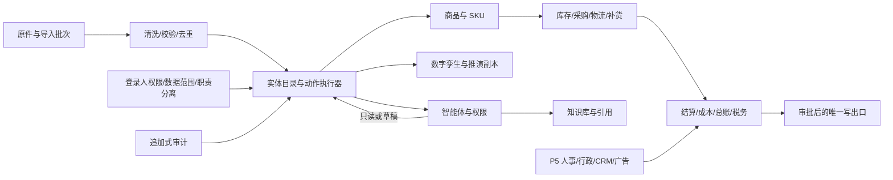

# 业务域指南

本文档组面向实现 CrossERP 的开发 agent。每个域文档都按相同顺序说明分期、状态、实体、动作权限、状态机、审批、金额口径、验收和未核实项。

## 事实来源与状态标记

- 后端目标设计：[`08-后端模块与 API 设计`](../design/08-后端模块与API设计.md)、[`ontology-entities.yaml`](../design/08/ontology-entities.yaml)、[`openapi-draft.yaml`](../design/08/openapi-draft.yaml)。这些文件由后端文档组放入仓库；当前工作树若尚未合并，先以任务提供的只读方案为准。
- 成本、记账和补货细节：[`07-成本记账与补货计划补齐`](../design/07-成本记账与补货计划补齐.md)。
- 前端页面 ID：[`page-api-coverage.csv`](../design/08/page-api-coverage.csv) 与 [`frontend/src/config/pages.ts`](../../frontend/src/config/pages.ts)。页面有 `implemented` 只表示静态页面实现，不表示真实接口已接通。
- 「已实现」只在当前 `src/crosserp` 代码核实后使用；「仅静态原型」指前端 mock 或占位页；「仅设计」指方案中有目标但当前代码没有实现。

## 域索引

| 域 | 主要分期 | 文档 | 依赖 |
|---|---|---|---|
| 供应链 | P1–P2，成本与孪生在 P3 | [供应链](供应链.md) | 主数据、数据进入、财务成本 |
| 财务 | P1 已有结算/对账/利润；P3 账务 | [财务](财务.md) | 导入、库存台账、审批、唯一写出口 |
| 智能体与权限 | P0 权限底座；P4 智能体 | [智能体与权限](智能体与权限.md) | 全部业务动作、审批、审计 |
| 数据清洗、知识库、数字孪生 | P1 数据进入；P3 孪生；P4 知识库 | [数据清洗-知识库-数字孪生](数据清洗-知识库-数字孪生.md) | 原件、实体目录、权限、agent |
| 平台与外部对接 | P1 文件导入；P4 平台和账套适配器 | [平台与外部对接](平台与外部对接.md) | IngestBatch、适配器、审批、ledger |
| 人事、行政、客户、广告 | P5 | [人事行政客户广告](人事行政客户广告.md) | 权限、审批、知识库、总账 |

## 跨域依赖图

## 跨域硬规则

1. 外部数据先原样落地，原件不可改；实体字段必须可追溯到批次、原始行和规则版本。
2. HTTP、网页、agent、定时任务、导入投射和推演都调用同一个实体动作执行器，不能绕过权限、状态机、职责分离和审计。
3. 只读查询（包括对账、利润、凭证、余额、薪资查询）是「无（只读）」；改数据但不改账是低/中；改账最多起草/待审；高危权限、审批决定、密钥、薪资发布和结账由 AI 禁用。完整动作清单以 08 第 4.4、5 节和 OpenAPI 为准。
4. 配置了审批人就必须审批，提交人和被代表人不能自批；没有可用审批人时，人发起直接生效并留痕，AI 发起的高风险或钱账动作退回本人确认。
5. 金额统一 `Money = {amountMinor: int64, currency}`，`amountMinor` 为万分位整数；金额计算不用浮点。会计和税务数字只用演示默认值，并写「真实使用前需核实」。
